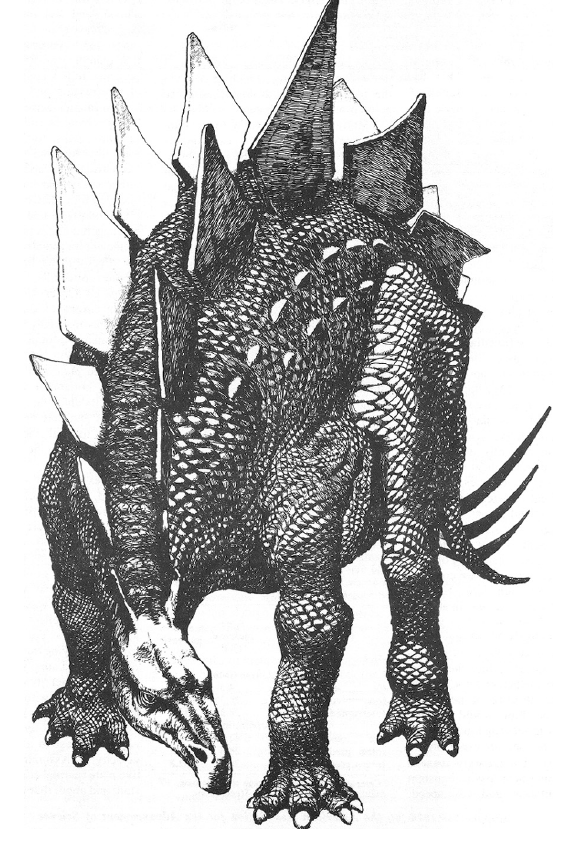
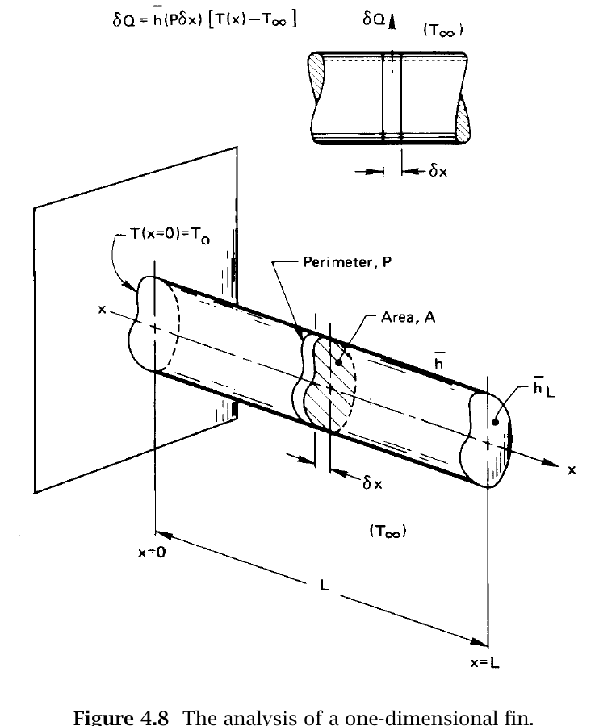

# Module 7, Part II: Finite And Infinite Rod Theory

This is the second part of Module 7. Read [Part I: Thermal Transport
Foundations](../theory-bridge-chapter-1/index.md) first, then use this derivation
in [Part III: Rod Instrument And Stationary Fin](../lab-08/index.md).

This reference develops Lienhard and Lienhard Section 4.5, textbook
pp. 163-173. It collects Eqs. (4.27)-(4.51) in one place so you can follow the
logic from a physical fin to the finite-length and infinite-length rod models
used in Module 7, Part III.

## Module 7 Priorities

Module 7 has two priorities, in this order:

1. **Build the six-thermistor instrument.** This is the primary objective of
   the module. Establish one TEC-base thermistor and five rod thermistors as a
   checked measurement system, then develop the Arduino acquisition and Python
   software needed to display and record all six temperatures together. The
   default is to use the raw readings when the six sensors agree within
   \(1^{\circ}\mathrm{C}\) in a common bath; apply calibration corrections only
   if that check fails.
2. **Understand heat transport in a long, thin cylinder.** Use Fourier's law,
   conservation of energy, side cooling, and boundary conditions to develop
   and test the one-dimensional heat-transport model for the rod.

Part II concentrates on the second priority. Its finite-rod and semi-infinite
solutions are the predictions that the six-thermistor instrument will test in
Part III.

**How to use your time.** Parts I and II are primarily work to complete at
home. You may use up to one hour of class time to begin this theory work; then
finish it at home and bring specific questions to class. Preserve the
remaining laboratory time for Part III, where you will build, check, and test
the six-thermistor instrument and its software.

## Learning Objectives

These are the Part II objectives supporting Module 7's second priority. By the
end of Module 7, Part II, you should be able to:

1. Use Fourier conduction, Newton cooling, and conservation of energy to derive
   the stationary one-dimensional heat equation and check every term's units.
2. Apply the base-temperature and insulated-tip boundary conditions to obtain
   the finite-rod temperature profile.
3. Interpret $\mathrm{Bi}_{\perp}$ and
   $\mathrm{Bi}_{\parallel}=hPL^2/(kA)$ as resistance ratios that compare
   radial conduction with surface convection and axial conduction with
   distributed side convection, respectively.
4. Obtain the semi-infinite exponential profile as a limit of the finite-rod
   solution and quantify the resulting approximation error at the sensor
   positions.
5. Recognize the range of applications of fins for heat transfer.

## Part II Vocabulary And Notation

This table extends the [foundational Module 7 vocabulary from Part
I](../theory-bridge-chapter-1/index.md#module-7-vocabulary-and-notation).

| Term | Meaning |
| --- | --- |
| Fin | A solid that conducts heat along its length while exchanging heat with the surrounding fluid through its surface. |
| Analysis base and tip | The analysis base at \(x=0\) is the plane where the rod temperature is measured or prescribed; the tip at \(x=L\) is the far end of the analyzed section. For the course rod, the first thermistor hole is the analysis base. |
| \(A\), \(P\), and \(PL\) | \(A\) is the cross-sectional area normal to axial heat flow, \(P\) is the cross-sectional perimeter, and \(PL\) is the lateral surface area of a uniform rod, excluding its ends. |
| Stationary or steady state | A condition in which temperature no longer changes with time, although heat can continue to flow. |
| Boundary condition | A physical constraint imposed at a boundary, such as prescribed base temperature, zero tip heat flux, or convection from the tip. |
| Adiabatic or insulated tip | A tip through which no heat flows: \(dT/dx=0\) at \(x=L\). |
| Convecting tip | A tip that transfers heat to the surroundings with coefficient \(h_L\). |
| Normalized excess temperature, \(\Theta\) | \(\Theta=(T-T_\infty)/(T_0-T_\infty)\); it is 1 at the prescribed-temperature base and dimensionless. |
| Dimensionless position, \(\xi=x/L\) | Position scaled by the analyzed length from the first thermistor hole to the tip, placing the analysis base at \(\xi=0\) and the tip at \(\xi=1\). |
| Fin parameter, \(m=\sqrt{hP/(kA)}\) | The inverse axial decay length, with units m\(^{-1}\). The characteristic decay length is \(1/m\). |
| \(mL\) | Rod length divided by decay length. It measures how strongly the finite tip can influence the temperature profile. |
| Transverse Biot number, \(\mathrm{Bi}_{\perp}=h(A/P)/k\) | The resistance ratio testing whether radial temperature variation across a section may be neglected. |
| Parallel Biot number, \(\mathrm{Bi}_{\parallel}=hPL^2/(kA)=(mL)^2\) | The course's descriptive name for the resistance ratio comparing axial conduction over the rod length with distributed side convection. Lienhard calls it a hybrid Biot number. |
| Tip Biot number, \(\mathrm{Bi}_{\mathrm{tip}}=h_LL/k\) | The dimensionless strength of convection from the tip relative to axial conduction. It drops out for an insulated tip. |
| Finite and semi-infinite models | The finite model retains the boundary at \(x=L\); the semi-infinite model neglects the far-end influence over the measured region. |

## How To Use This Reference

Read this page alongside Lienhard Section 4.5 for A4. Use the single
[Module 7 workload budget](../lab-08/index.md#outside-class-workload-budget)
for all three parts; do not count this reading a second time. This page is not
a separate submission and should not be copied into another report.

Annotate the derivation with three questions in mind:

1. Which term comes from Fourier conduction along the rod?
2. Which term comes from Newton cooling through the rod's side?
3. Which boundary condition distinguishes the finite insulated-tip solution
   from the semi-infinite solution?

## What A Fin Does

A fin conducts heat along a solid while exchanging heat with the surrounding
fluid through its surface. Increasing surface area can greatly increase heat
transfer.

*Extended metal surfaces increase the area available for heat transfer. Here fins are used to cool a CPU in a computer.*

*Lienhard and Lienhard, Fig. 4.7, textbook p. 165: a speculative biological
example of cooling fins.*

Thermal fins appear in technologies ranging from air-cooled engines to
semiconductor heat sinks. The same conduction problem appears in each case,
and the fin loses heat to the surrounding air by natural or forced convection.

<strong>Sidebar: Where Are Thermal Fins Used?</strong>

The common design idea is to conduct heat from a source into an extended solid
surface. What happens at that surface depends on the application.

| Application | Heat reaches the extended surface by | Heat leaves the surface by |
| --- | --- | --- |
| [Electronic heat sink](https://en.wikipedia.org/wiki/Heat_sink) | Conduction from a semiconductor package | Natural or fan-driven convection |
| [Air-cooled engine](https://en.wikipedia.org/wiki/Air-cooled_engine) | Conduction through the cylinder and cylinder head | Convection to air moving naturally, with the vehicle, or from a fan |

Both applications use Newton's law of cooling,

\[
\dot Q_{\mathrm{conv}}=hA_s\left(T_s-T_\infty\right),
\]

where natural or forced airflow continually replaces warmed air near the fins
and carries the transferred heat away.

## Geometry And The One-Dimensional Assumption

*Lienhard and Lienhard, Fig. 4.8, textbook p. 166: a fin of length \(L\),
cross-sectional area \(A\), perimeter \(P\), conductivity \(k\), side
coefficient \(h\), and tip coefficient \(h_L\).*

**Course coordinate convention.** In the textbook figure, the base is the
physical end where the fin joins the warmer body. For the course rod, we choose
the first thermistor hole as the **analysis base** and define it to be \(x=0\).
It is neither the physical end of the rod nor the thermistor embedded in the
TEC. Its measured temperature supplies the boundary value \(T(0,t)\), and
\(L\) is the distance from this first hole to the rod tip. Choosing this
interior reference plane is valid because the equations apply to the portion
of rod from that plane to the tip.

As derived in
[Part I](../theory-bridge-chapter-1/index.md#5-lumped-cooling-and-the-biot-number),
the transverse Biot number must be small to treat a cylinder as a one-dimensional object:

\[
\mathrm{Bi}_{\perp}
=\frac{h(A/P)}{k}\ll1.
\tag{4.27}
\]

### Transverse And Parallel Resistance Ratios

Part I defines the Biot number as a ratio of thermal resistances. Applied
across a rod section,

\[
\boxed{
\mathrm{Bi}_{\perp}
\sim
\frac{R_{\mathrm{radial\ conduction}}}
{R_{\mathrm{surface\ convection}}}
=\frac{h(A/P)}{k}
}.
\]

For a circular rod, $A/P=R/2$. Thus $\mathrm{Bi}_{\perp}\ll1$ means that
only a small center-to-surface temperature difference is needed to supply the
heat lost to the air, so each cross section is nearly isothermal. This is the
same argument developed in Part I and is not a comparison with axial
conduction.

For the axial comparison, assume a uniform cylindrical rod of length $L$,
constant cross-sectional area $A$, perimeter $P$, conductivity $k$, and side
heat-transfer coefficient $h$. Axial conduction crosses the end-on area $A$,
whereas side convection acts over the cylinder's entire lateral area $PL$
(excluding the two ends). The characteristic heat-transfer rates are therefore

\[
\dot Q_{\mathrm{axial\ conduction}}
\sim \frac{kA}{L}\Delta T_{\parallel},
\qquad
\dot Q_{\mathrm{side\ convection}}
\sim hPL\Delta T_{\mathrm{side}}.
\]

Here $\Delta T_{\parallel}$ is a representative temperature change along the
rod, while $\Delta T_{\mathrm{side}}$ is a representative rod-to-room
temperature difference. They are not generally the same actual temperature
difference. To compare the capacities of the two transport mechanisms, use a
common characteristic temperature scale $\Delta T$. Equivalently,

\[
R_{\mathrm{axial\ conduction}}\sim\frac{L}{kA},
\qquad
R_{\mathrm{side\ convection}}\sim\frac{1}{hPL}.
\]

Their ratio defines the parallel Biot number:

\[
\boxed{
\mathrm{Bi}_{\parallel}
\equiv
\frac{R_{\mathrm{axial\ conduction}}}
{R_{\mathrm{side\ convection}}}
=\frac{hPL^2}{kA}
=(mL)^2
}.
\]

We use the descriptive name \(\mathrm{Bi}_{\parallel}\) in this course because
the ratio compares axial conduction with distributed side convection. Lienhard
describes the same quantity \((mL)^2\) as a **hybrid Biot number**.

When $\mathrm{Bi}_{\parallel}\ll1$, axial conduction carries heat along the
rod readily compared with side convection. When
$\mathrm{Bi}_{\parallel}\gg1$, much of the heat is lost from the side before
it reaches the far end, and the temperature decays strongly along the rod.
The side loss is distributed continuously rather than occurring in one lump,
so this resistance ratio is a scaling interpretation of the fin equation.

The condition that justifies a one-dimensional fin model is
$\mathrm{Bi}_{\perp}\ll1$: it allows each cross section to be represented by
one temperature $T(x)$. The value of $\mathrm{Bi}_{\parallel}=(mL)^2$ does
not determine whether the model is one-dimensional. Instead, it determines how
strongly the temperature decays along the rod. When $mL$ is sufficiently
large, the measured region may also be approximated as semi-infinite.

## Energy Balance And Differential Equation

**Steady-state assumption.** Part I derived the time-dependent heat equation
for conduction without side loss. Here we add distributed convective cooling
from the side of the rod, but first consider only the stationary temperature
profile. At steady state, the temperature at every position is constant in
time:

\[
\frac{\partial T}{\partial t}=0.
\]

Each differential slice therefore stores no net energy. Axial heat conducted
into the slice minus axial heat conducted out must equal the heat lost by
convection from its side.

An energy balance on a slice of width \(\delta x\) with cross-sectional area $A$ and side area $P\delta x$, as shown in Lienhard Figure 4.8 is

\[
-kA\left.\frac{dT}{dx}\right|_{x+\delta x}
+kA\left.\frac{dT}{dx}\right|_x
+hP\delta x\,[T(x)-T_\infty]=0.
\tag{4.28}
\]

As \(\delta x\rightarrow0\),

\[
\frac{
\left.dT/dx\right|_{x+\delta x}
-\left.dT/dx\right|_x
}{\delta x}
\rightarrow
\frac{d^2T}{dx^2}
=\frac{d^2(T-T_\infty)}{dx^2}.
\tag{4.29}
\]

Therefore,

\[
\frac{d^2(T-T_\infty)}{dx^2}
=\frac{hP}{kA}(T-T_\infty).
\tag{4.30}
\]

Solving this second-order differential equation requires two boundary
conditions. Three common types appear in heat-transfer problems:

**Dirichlet boundary condition.** This condition specifies the temperature
itself. At the base of the rod,

\[
T(0)=T_0.
\]

**Neumann boundary condition.** This condition specifies the temperature
derivative, or equivalently the conductive heat flux. An insulated tip has
zero heat flux:

\[
\left.\frac{dT}{dx}\right|_{x=L}=0.
\]

**Robin boundary condition.** This condition relates the temperature to its
derivative. At a convecting tip, conductive heat flow to the tip equals heat
loss from the tip by Newton's law of cooling:

\[
-kA\left.\frac{dT}{dx}\right|_{x=L}
=h_LA\left[T(L)-T_\infty\right].
\]

Thus, the base has a Dirichlet condition. For a convecting tip, the second
condition is Robin:

\[
(T-T_\infty)_{x=0}=T_0-T_\infty,
\qquad
-kA\left.\frac{d(T-T_\infty)}{dx}\right|_{x=L}
=h_LA(T-T_\infty)_{x=L}.
\tag{4.31a}
\]

For an insulated tip, the second condition is Neumann:

\[
(T-T_\infty)_{x=0}=T_0-T_\infty,
\qquad
\left.\frac{d(T-T_\infty)}{dx}\right|_{x=L}=0.
\tag{4.31b}
\]

## Dimensional Analysis And Dimensionless Form

The dimensional functional relation is

\[
T-T_\infty
=\operatorname{fn}(T_0-T_\infty,x,L,kA,hP,h_LA).
\tag{4.32}
\]

Define

\[
\Theta=\frac{T-T_\infty}{T_0-T_\infty},
\qquad
\xi=\frac{x}{L},
\qquad
m=\sqrt{\frac{hP}{kA}},
\qquad
\mathrm{Bi}_{\mathrm{tip}}=\frac{h_LL}{k}.
\]

Then a convecting-tip fin has

\[
\Theta=\operatorname{fn}
\left(\xi,mL,\mathrm{Bi}_{\mathrm{tip}}\right),
\tag{4.33a}
\]

whereas an adiabatic-tip fin has

\[
\Theta=\operatorname{fn}(\xi,mL).
\tag{4.33b}
\]

### Choosing A Dimensionless Position Coordinate

The quantity $m$ is not itself a dimensionless coordinate: it has units of
inverse length. Both

\[
\xi=\frac{x}{L}
\qquad\text{and}\qquad
X=mx=\frac{x}{1/m}
\]

are valid dimensionless coordinates, but they emphasize different length
scales. The rod length $L$ is the geometric scale, whereas $1/m$ is the
thermal decay length set by axial conduction and side cooling.

For a finite rod, $\xi=x/L$ is convenient because the base is always at
$\xi=0$ and the tip is always at $\xi=1$. The physics then appears in the
separate dimensionless group

\[
mL=\frac{L}{1/m},
\]

which compares the rod length with the thermal decay length. We could instead
use $X=mx$. Equation (4.34) would then become

\[
\frac{d^2\Theta}{dX^2}=\Theta,
\]

but the tip would be located at $X=mL$ rather than at a fixed coordinate.
Nothing physical changes because $X=(mL)\xi$; the two choices merely organize
the same information differently. When the rod is effectively infinite and
the tip no longer matters, $mx$ becomes the natural coordinate and the solution
is $\Theta=e^{-mx}$.

[Lienhard, p. 167, Eqs. (4.32)-(4.33b)](../../references/lienhard-heat-transfer-textbook-v6.pdf#page=181)
uses $\xi=x/L$ for the finite-fin dimensional analysis. On
[p. 173, Eq. (4.50)](../../references/lienhard-heat-transfer-textbook-v6.pdf#page=187),
the long-fin limit is written as $e^{-mL\xi}=e^{-mx}$, and the following
paragraph interprets $(mL)^2$ as a hybrid Biot number comparing axial
conduction resistance with the overall resistance to side convection.

### Why The Tip Biot Number Disappears For An Adiabatic Tip

For a convecting tip, $h_L$ enters through the tip boundary condition:

\[
-\left.\frac{d\Theta}{d\xi}\right|_{\xi=1}
=\underbrace{\frac{h_LL}{k}}_{\mathrm{Bi}_{\mathrm{tip}}}\Theta(1).
\]

Thus $\mathrm{Bi}_{\mathrm{tip}}$ measures the strength of convection from
the tip relative to axial conduction. For an adiabatic tip, the heat flux at
the tip is zero:

\[
\left.\frac{d\Theta}{d\xi}\right|_{\xi=1}=0.
\]

There is no tip heat-transfer coefficient $h_L$ in this boundary condition.
Consequently, $h_L$ is absent from the dimensional functional relation and no
independent tip Biot number can be formed. Equivalently, one may set $h_L=0$
and obtain $\mathrm{Bi}_{\mathrm{tip}}=0$, but saying that the parameter
**drops out of the problem** better expresses the dimensional-analysis logic.
The transverse Biot number does not disappear: it remains the separate test of
whether each cross section can be assigned one temperature.

[Lienhard, p. 167, immediately following Eq. (4.33a)](../../references/lienhard-heat-transfer-textbook-v6.pdf#page=181)
makes this variable-counting argument explicitly: removing $h_L$ leaves one
fewer variable but the same fundamental dimensions, so the corresponding
dimensionless group $\mathrm{Bi}_{\mathrm{tip}}$ is removed, giving
Eq. (4.33b).

The differential equation becomes

\[
\frac{d^2\Theta}{d\xi^2}=(mL)^2\Theta.
\tag{4.34}
\]

Its general solution is

\[
\Theta=C_1e^{mL\xi}+C_2e^{-mL\xi}.
\tag{4.35}
\]

<strong>Sidebar: Finite Rod With An Insulated Tip</strong>

The dimensionless boundary conditions are

\[
\Theta(0)=1,
\qquad
\left.\frac{d\Theta}{d\xi}\right|_{\xi=1}=0.
\tag{4.36}
\]

Substitution into the general solution gives

\[
C_1+C_2=1,
\qquad
C_1e^{mL}-C_2e^{-mL}=0.
\tag{4.37}
\]

The hyperbolic functions used to simplify the result are

\[
\begin{aligned}
\sinh z&=\frac{e^z-e^{-z}}{2},&
\cosh z&=\frac{e^z+e^{-z}}{2},\\
\tanh z&=\frac{\sinh z}{\cosh z},&
\coth z&=\frac{\cosh z}{\sinh z}.
\end{aligned}
\tag{4.38}
\]

Their needed derivatives are

\[
\frac{d}{dz}\sinh z=\cosh z,
\qquad
\frac{d}{dz}\cosh z=\sinh z.
\tag{4.39}
\]

The constants are

\[
C_1=\frac{e^{-mL}}{2\cosh(mL)},
\qquad
C_2=1-\frac{e^{-mL}}{2\cosh(mL)}.
\tag{4.40}
\]

The finite insulated-tip temperature distribution is

\[
\Theta(\xi)
=\frac{\cosh[mL(1-\xi)]}{\cosh(mL)}
=\frac{\cosh[m(L-x)]}{\cosh(mL)}.
\tag{4.41}
\]

The heat-transfer rate at the base is

\[
\dot Q_0
=-kA\left.\frac{d(T-T_\infty)}{dx}\right|_{x=0}.
\tag{4.42}
\]

Thus,

\[
\frac{\dot Q_0L}{kA(T_0-T_\infty)}
=mL\frac{\sinh(mL)}{\cosh(mL)}
=mL\tanh(mL),
\tag{4.43}
\]

or

\[
\frac{\dot Q_0}
{\sqrt{kAhP}\,(T_0-T_\infty)}
=\tanh(mL).
\tag{4.44}
\]

At the tip,

\[
\Theta_{\mathrm{tip}}=\frac{1}{\cosh(mL)}.
\tag{4.45}
\]

<strong>Sidebar: Exact Convecting-Tip Solution</strong>

The dimensionless boundary conditions become

\[
\Theta(0)=1,
\qquad
-\left.\frac{d\Theta}{d\xi}\right|_{\xi=1}
=\mathrm{Bi}_{\mathrm{tip}}\Theta(1).
\tag{4.46}
\]

Substitution into the general solution gives

\[
\begin{aligned}
C_1+C_2&=1,\\
-mL(C_1e^{mL}-C_2e^{-mL})
&=\mathrm{Bi}_{\mathrm{tip}}
(C_1e^{mL}+C_2e^{-mL}).
\end{aligned}
\tag{4.47}
\]

The exact temperature distribution is

\[
\Theta(\xi)
=
\frac{
\cosh[mL(1-\xi)]
+(\mathrm{Bi}_{\mathrm{tip}}/mL)\sinh[mL(1-\xi)]
}{
\cosh(mL)
+(\mathrm{Bi}_{\mathrm{tip}}/mL)\sinh(mL)
}.
\tag{4.48}
\]

The corresponding base heat rate is

\[
\frac{\dot Q_0}
{\sqrt{kAhP}\,(T_0-T_\infty)}
=
\frac{
(\mathrm{Bi}_{\mathrm{tip}}/mL)+\tanh(mL)
}{
1+(\mathrm{Bi}_{\mathrm{tip}}/mL)\tanh(mL)
}.
\tag{4.49}
\]

## Infinite-Rod Limit

When \(mL\gg1\), the finite solution approaches

\[
\lim_{mL\rightarrow\infty}\Theta
=e^{-mL\xi}
=e^{-mx}.
\tag{4.50}
\]

The base heat rate becomes

\[
\dot Q_0=\sqrt{kAhP}\,(T_0-T_\infty).
\tag{4.51}
\]

Equation (4.51) follows directly from the infinite-rod temperature profile.
Because

\[
\Theta
=\frac{T(x)-T_\infty}{T_0-T_\infty}
=e^{-mx},
\]

the dimensional temperature profile is

\[
T(x)-T_\infty=(T_0-T_\infty)e^{-mx}.
\]

Fourier's law gives the heat entering the rod at its base:

\[
\dot Q_0
=-kA\left.\frac{dT}{dx}\right|_{x=0}.
\]

Differentiating the temperature profile gives

\[
\frac{dT}{dx}
=-m(T_0-T_\infty)e^{-mx}.
\]

At the base, $x=0$ and $e^{-mx}=1$, so

\[
\dot Q_0=kAm(T_0-T_\infty).
\]

Finally, substituting $m=\sqrt{hP/(kA)}$ gives

\[
kAm
=kA\sqrt{\frac{hP}{kA}}
=\sqrt{kAhP},
\]

which produces Eq. (4.51). Physically, this is the rate at which heat must
enter the base to replace all the heat lost by convection from the surface of
the semi-infinite fin.

Lienhard recommends \(mL\gtrsim5\) when using the infinite-fin approximation
for temperature and \(mL\gtrsim3\) when using it for the base heat rate. In
Module 7, Part III, you will calculate the actual finite-versus-infinite error at every
sensor rather than relying only on these general thresholds.

## What To Be Able To Explain

1. Why does Eq. (4.27) concern the **radius**, whereas \(mL\) concerns the
   **length**?
2. Which term in Eq. (4.28) represents side heat loss?
3. What physical assumption changes Eq. (4.31a) into Eq. (4.31b)?
4. How does Eq. (4.41) retain information about the far end?
5. Why is Eq. (4.50) an approximation rather than a new physical law?
6. Starting from Eq. (4.28), derive Eq. (4.30) and check every term's units.
7. Starting from the general solution, use the base and insulated-tip boundary
   conditions to obtain Eq. (4.41).
8. Show mathematically how Eq. (4.41) approaches Eq. (4.50) when the far end
   becomes irrelevant.

These are assessed in the [A4 written derivation](../lab-08/index.md#a4-finite-rod-model-and-validity-checks)
and may be sampled in the C5 oral check. Understanding the derivation matters
more than reproducing a long sequence of algebra from memory.
