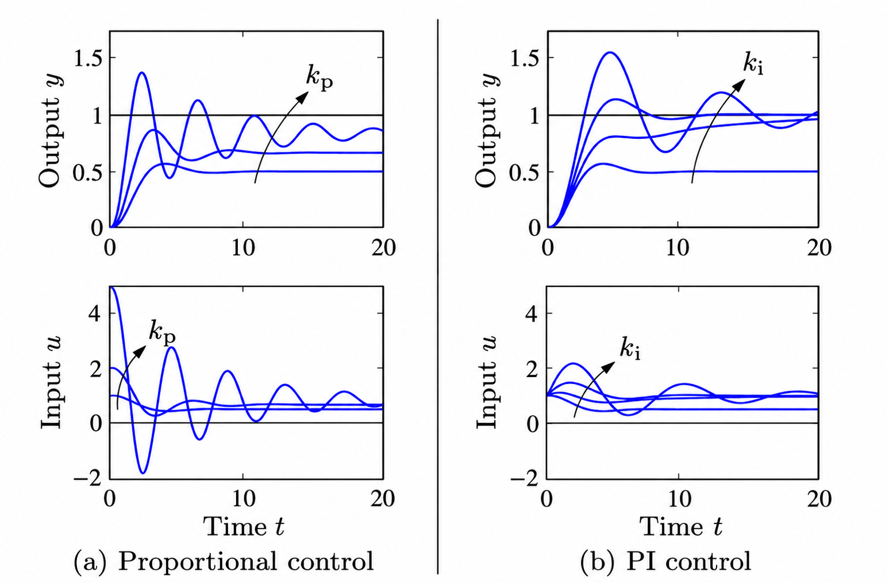
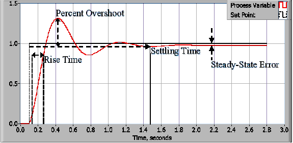

# Module 6, Part I: P/PI Control And Lumped Modeling

Module 6 has two linked parts:

1. **Part I (this page):** develop one-lump P and PI models and connect them to
   the Module 4 and Module 5 measurements.
2. [**Part II: TEC Process Model And Simulation**](../lab-07/index.md):
   extend the model, compare one- and two-lump descriptions, and test the model
   with the same prepared simulation.

## Purpose

Module 5 showed that proportional feedback reduces steady-state error but can
overshoot, ring, and oscillate. Module 6 develops the theory needed to
distinguish what a one-lump model explains from behavior that requires
additional thermal dynamics.

The goal is to connect thermal physics, feedback equations, and the data you measured from the TEC.

A central theme is **stability**: whether a disturbed response returns to its
steady state, continues oscillating, or grows away from it. You will first
identify these behaviors qualitatively in data and simulation, then connect
them to quantitative model predictions.

You will begin with algebra, then simulate the one-lump model in time, then
extend the model just enough to understand why integral control is useful and
why real feedback loops can oscillate.

## Learning Objectives

By the end of Module 6, Part I, you should be able to:

- derive and interpret the one-lump energy balance, open-loop susceptibility,
  thermal time constant, and P-control droop;
- calculate how $K_p$ changes one-lump P-control droop and response time, and
  explain why this first-order model is stable and cannot overshoot;
- use the one-lump PI damping ratio to predict qualitatively how $K_p$, $K_i$,
  and $C$ affect oscillation and settling;
- distinguish rise time, overshoot, settling time, steady-state error, and
  stable, marginal, or growing oscillations in simulation and measurement;
- connect model predictions to measured susceptibility, time constant, droop,
  and transient response, and identify where the one-lump model fails;
- explain qualitatively how internal thermal storage and transport create
  phase lag and motivate a two-lump model;
- implement PI control on the physical TEC, including integral reset and
  anti-windup;
- generate six experimental Goldilocks plots that show low-, medium-, and
  high-gain P and PI behavior, then use them to choose gains that balance speed,
  steady-state accuracy, overshoot, settling, and stability.

The Goldilocks plots are the principal way you achieve these objectives. They
are assessed through the physical six-run study, the six matched simulation
plots in Part II, and A3 Questions 1–5.

## Reading

Read selectively:

1. Lienhard and Lienhard, [*A Heat Transfer Textbook*](https://ahtt.mit.edu/).

    - Section 1.3: read for energy-balance language and units.
    - Chapter 4, especially Section 4.5: read for transient response and thermal
      time constants.

2. Review your Module 4 and Module 5 data.
3. Optional after class: [Bechhoefer, *Feedback for Physicists*,
   pp. 795-797](../../references/bechhoefer-feedback-for-physicists-2005.pdf),
   on feedback and stability.

Do not try to learn all of transient heat transfer at once. For this module, you
need the idea that a physical object has heat capacity, exchanges heat with its
environment, and responds over a time scale.

## Vocabulary

### Terms

- **Thermal capacitance (thermal mass):** energy required to raise the lump's
  temperature by one degree. In this module, *thermal mass* is an informal
  synonym for thermal capacitance.
- **Thermal resistance:** opposition to passive heat flow between the lump and
  its surroundings.
- **Heat-loss conductance:** the inverse of thermal resistance; passive heat
  transfer per degree of temperature difference.
- **Time constant:** characteristic decay time. A first-order system has one
  time constant; a higher-order system can have more than one decay time.
- **Command:** the controller output $u$, expressed here as a signed PWM value.
  For example, a command of $+25$ PWM means set $u=+25$ PWM.
- **Open-loop temperature susceptibility:** steady-state temperature change per
  applied PWM command, with direction held fixed.
- **P control:** command proportional to the current temperature error.
- **PI control:** command equal to the sum of a proportional term and a term
  proportional to accumulated temperature error.
- **Windup:** continued growth of the integral term while the actuator is
  saturated.
- **Anti-windup:** a software rule that prevents or reverses inappropriate
  growth of the integral term while the actuator is saturated.
- **Droop:** nonzero steady-state temperature error in P-only control.
- **Stable:** after a disturbance, the response returns to its steady state.
- **Underdamped:** a stable response that crosses its steady state and
  oscillates with decreasing amplitude.
- **Marginally stable:** an idealized response whose oscillations persist at
  constant amplitude rather than decaying.
- **Unstable:** a response that moves farther from steady state; in an
  oscillatory instability, successive oscillations grow.

### Symbol Glossary

<details class="note" markdown="1">
<summary><strong>Symbols Used In Module 6, Part I</strong></summary>

A temperature difference has the same numerical value in K and °C. Earlier
modules wrote the generic open-loop susceptibility as $\chi_{T,u}$. For
concision, this module writes it as $\chi$ and uses $\chi_h$ and $\chi_c$ when
the heating and cooling values must be distinguished. Similarly, $P_u$ means
the coefficient for the active direction; $P_{u,h}$ and $P_{u,c}$ distinguish
heating from cooling.

| Symbol | Meaning | Units |
| --- | --- | --- |
| $C$ | Thermal capacitance of one lump | J/K or J/°C |
| $T$ | Lump temperature | °C |
| $t$ | Time | s |
| $dT/dt$ | Rate of temperature change | K/s or °C/s |
| $P_u$ | Effective TEC thermal-power coefficient per signed PWM count | W/PWM count |
| $u$ | Signed PWM command: positive heats and negative cools | PWM counts |
| $H$ | Passive heat-loss conductance to the surroundings | W/K or W/°C |
| $T_{\mathrm{amb}}$ | Ambient (room) temperature | °C |
| $U$ | Thermal energy stored in the lump | J |
| $\dot Q_{\mathrm{in}}$ | Rate at which heat enters the lump | W |
| $\dot Q_{\mathrm{out}}$ | Rate at which heat leaves the lump | W |
| $m$ | Mass of the lump | kg |
| $c_p$ | Specific heat capacity of the lump material | J/(kg K) |
| $\chi$ | Open-loop temperature susceptibility for the active direction | °C/PWM count |
| $\chi_h$, $\chi_c$ | Heating and cooling susceptibilities | °C/PWM count |
| $r=\chi_h/\chi_c$ | Ratio of heating to cooling susceptibility | dimensionless |
| $\tau=C/H$ | Open-loop thermal time constant | s |
| $K_p$ | Proportional gain | PWM counts/°C |
| $K_i$ | Integral gain | PWM counts/(°C s) |
| $T_{\mathrm{set}}$ | Requested temperature setpoint | °C |
| $e=T_{\mathrm{set}}-T$ | Temperature error | °C |
| $q=\int e\,dt$ | Accumulated temperature error | °C s |
| $u_P=K_pe$, $u_I=K_iq$ | Proportional and integral contributions to the PWM command | PWM counts |
| $\mathrm{droop}=T_{\mathrm{set}}-T_{\mathrm{ss}}$ | Steady-state temperature error | °C |
| $\theta$, $z$ | Temperature and integral-state displacements from steady state | °C, °C s |
| $\lambda$ | Eigenvalue governing exponential growth or decay | 1/s |
| $\zeta$ | PI damping ratio | dimensionless |
| $\omega_n$ | Natural angular frequency of the one-lump PI response | rad/s |
| $\omega_d$ | Damped angular frequency of an underdamped response | rad/s |
| $T_{\mathrm{osc}}$ | Oscillation period | s |
| $\tau_{\mathrm{decay}}$ | Decay time of the oscillation envelope | s |
| $Q=1/(2\zeta)$ | Quality factor, a measure of how slowly oscillations decay | dimensionless |
| $T_{\mathrm{ss}}$ | Steady-state temperature | °C |
| $q_{\mathrm{ss}}$ | Steady accumulated error required to maintain $T_{\mathrm{set}}$ under PI control | °C s |
| $T_m$ | Temperature of the measured block in the two-lump model | °C |

</details>

In this module, a **command** means setting the controller output $u$, which is
the signed PWM value, to a particular value. For example, a command of
$+25$ PWM means set $u=+25$ PWM.

## Before Class

Review your Module 4 and Module 5 results. Before class, make sure you can
locate and open these existing files on your laptop:

- Module 4 steady-state temperature versus PWM data,
- Module 5 droop-versus-gain data,
- one Module 5 strip-chart trace at a stable gain,
- one Module 5 high-gain strip-chart trace showing overshoot or ringing; if no
  overshoot was safely observed, bring the highest-gain trace, and
- your current Python plotting or modeling environment.

Do not create new figures, tables, or written work for this section. The files
will be used during the in-class model comparison.

## Outside-Class Workload Budget

| Session | Work | Planned time |
| --- | --- | ---: |
| S12 | Read the selected material and complete the one-lump derivation | 150 minutes |
| S12 | **Total associated with S12** | **2 hours 30 minutes** |
| S13 | Explore open-loop, P, and PI behavior in the simulation and prepare the physical controller | 120 minutes |
| S13 | **Total associated with S13** | **2 hours** |
| S14 | Complete the six-run experimental Goldilocks study | 150 minutes |
| S14 | Organize plots and begin A3 | 90 minutes |
| S14 | **Total associated with S14** | **4 hours** |

Do not add optional reading until the required derivation and A3 evidence are
complete and understood.

## Pre-Class Questions

1. What physical part of the apparatus stores heat?
2. What physical paths let heat leave the measured block?
3. What evidence from your data suggests a thermal time constant?
4. Why does the algebraic droop model not predict oscillation?

## Part I Roadmap

1. Derive the one-lump steady-state droop and transient response using the
   susceptibility and time constant measured earlier.
2. Compare open-loop and P-control predictions with experiment.
3. Use the model's failure at high gain to motivate thermal phase lag and a
   qualitative two-lump description.
4. Explore PI control in simulation, then implement integral action and
   anti-windup on the physical TEC.
5. Generate the six experimental Goldilocks plots that anchor the comparison
   with simulation and the A3 analysis.

## Part 1: Algebraic Droop Model

The dimensional one-lump model is

\[
C\frac{dT}{dt}=P_u u-H(T-T_{\mathrm{amb}}).
\]

This is the one-lump heat balance written in terms of the lump's temperature.
It follows from the more general First Law in rate form. The change of energy in time is equal to the rate of heat into the lump minus the rate of heat out:

\[
\frac{dU}{dt}=\dot Q_{\mathrm{in}}-\dot Q_{\mathrm{out}}.
\]

If the lump has constant thermal capacitance \(C\), then \(dU=C\,dT\), so

\[
\frac{dU}{dt}=C\frac{dT}{dt}.
\]

Each of the three terms in the one-lump model therefore has units of power:

**1. Energy storage**

\[
C\frac{dT}{dt}.
\]

The thermal capacitance \(C=mc_p\) has units J/K, and \(dT/dt\) has units
K/s or °C/s. Their product has units J/s = W. A positive value means the
lump is warming; a negative value means it is cooling.

**2. TEC heating or cooling**

\[
P_u u.
\]

The signed PWM command \(u\) is positive for heating and negative for
cooling. The effective TEC coefficient \(P_u\) has units W/PWM, so
\(P_u u\) has units W. This term treats the rapidly switched PWM drive as
an average thermal power.

**3. Heat transfer to the surroundings**

\[
-H(T-T_{\mathrm{amb}}).
\]

The total heat-loss conductance \(H\) has units W/K, while
\(T-T_{\mathrm{amb}}\) is a temperature difference in K or °C. Their
product has units W. If \(T>T_{\mathrm{amb}}\), this term is negative and
the lump loses heat. If \(T<T_{\mathrm{amb}}\), the term is positive: the
room transfers heat into the colder lump.

The algebraic droop model below is the steady-state limit of this energy
balance, where \(dT/dt=0\).

### Guided Derivation And Numerical Check

The measured Module 4 open-loop relationship is

\[
T=T_{\mathrm{amb}}+\chi u,
\]

where $\chi=dT/du$ is the open-loop susceptibility with respect to signed
PWM. With the signed convention, $\chi$ is positive: positive $u$ heats
and raises $T$, while negative $u$ cools and lowers $T$. P-only feedback supplies

\[
u=K_p(T_{\mathrm{set}}-T).
\]

Substitute the controller law into the measured open-loop relationship:

\[
T=T_{\mathrm{amb}}+\chi K_p(T_{\mathrm{set}}-T).
\]

At steady state, collect the terms containing $T$:

\[
(1+\chi K_p)T
=T_{\mathrm{amb}}+\chi K_pT_{\mathrm{set}}.
\]

Subtract this result from $T_{\mathrm{set}}$ to obtain the droop:

\[
\boxed{
T_{\mathrm{set}}-T=
\frac{T_{\mathrm{set}}-T_{\mathrm{amb}}}{1+\chi K_p}.
}
\]

The product $L=\chi K_p$ is dimensionless. It is the loop gain for this
steady-state model. Part 2 derives $\chi=P_u/H$ from the dimensional
model.

Using one of your Module 5 runs, use $\chi$, $T_{\mathrm{amb}}$,
$T_{\mathrm{set}}$, and $K_p$ in the boxed equation to calculate the predicted
settled temperature and droop. Compare the prediction with the measured Module
5 droop, then state one physical reason they may differ.

## Part 2: Express The One-Lump Model Using Measured Parameters

Continue with the dimensional one-lump energy balance from Part 1:

\[
C\frac{dT}{dt}=P_u u-H(T-T_{\mathrm{amb}}).
\]

This remains the physical foundation for the rest of Module 6. Divide by $C$:

\[
\frac{dT}{dt}
=\frac{P_u}{C}u-\frac{H}{C}(T-T_{\mathrm{amb}}).
\]

At steady state, $dT/dt=0$, so

\[
T=T_{\mathrm{amb}}+\frac{P_u}{H}u.
\]

Comparison with the Module 4 measurement
$T=T_{\mathrm{amb}}+\chi u$ identifies

\[
\boxed{\chi=\frac{P_u}{H}}.
\]

For constant $u$, define the steady-state temperature

\[
T_{\mathrm{ss}}
=T_{\mathrm{amb}}+\frac{P_u}{H}u
=T_{\mathrm{amb}}+\chi u.
\]

Now define the displacement from that steady state:

\[
\theta(t)=T(t)-T_{\mathrm{ss}}.
\]

Because $u$ and $T_{\mathrm{ss}}$ are constant, substitution into the
one-lump energy balance gives

\[
C\frac{d\theta}{dt}=-H\theta,
\]

or

\[
\frac{d\theta}{dt}=-\frac{H}{C}\theta.
\]

Its solution is

\[
\theta(t)=\theta(0)e^{-(H/C)t}
=\theta(0)e^{-t/\tau}.
\]

Comparison of the exponents identifies the open-loop thermal time constant:

\[
\boxed{\tau=\frac{C}{H}}.
\]

The units confirm that this ratio is a time:

\[
[\tau]=\frac{\mathrm{J/K}}{\mathrm{W/K}}
=\frac{\mathrm{J}}{\mathrm{J/s}}=\mathrm{s}.
\]

<details class="note" markdown="1">
<summary>Sidebar: Dimensionless form</summary>

The ratios $\tau=C/H$ and $\chi=P_u/H$ are the measured combinations that
govern the one-lump model. Define

\[
\hat t=\frac{t}{\tau},
\qquad
\hat T=\frac{T-T_{\mathrm{amb}}}{\chi u_0},
\qquad
\hat u=\frac{u}{u_0}.
\]

The open-loop model becomes

\[
\frac{d\hat T}{d\hat t}=\hat u-\hat T.
\]

This shows that $\tau$ supplies the time scale and $\chi u_0$ supplies the
temperature scale. For P control, the dimensionless loop gain is
$L=\chi K_p$. See [Stone, Sections 1.5.1-1.5.2](../../references/stone-dimensional-analysis-size-and-scale.pdf#page=21)
and [Lienhard, Section 5.2](../../references/lienhard-heat-transfer-textbook-v6.pdf#page=208)
for fuller treatments.

</details>

The two measured quantities are the thermal time constant and the open-loop
susceptibility:

\[
\boxed{\tau=\frac{C}{H}},
\qquad
\boxed{\chi=\frac{P_u}{H}}.
\]

These two measured quantities determine the two parameter ratios that govern
the dynamics:

\[
\boxed{\frac{H}{C}=\frac{1}{\tau}},
\qquad
\boxed{\frac{P_u}{C}
=\frac{P_u/H}{C/H}
=\frac{\chi}{\tau}}.
\]

Module 4 provides the heating and cooling susceptibilities, and a temperature
step from Module 4 or Module 5 provides $\tau$. Use the susceptibility for the
corresponding direction. Therefore, once
$T_{\mathrm{amb}}$ and the command $u$ are specified, the model has **no free
parameters**. Its transient temperature prediction can be compared directly
with the measurement rather than fitted to it.

The same dimensional energy balance can therefore be written entirely in
terms of $\chi$ and $\tau$:

\[
\boxed{
\frac{dT}{dt}
=\frac{T_{\mathrm{amb}}+\chi u-T}{\tau}.
}
\]

This is not a different model. It is the one-lump energy balance expressed in
a form that can be simulated using your measured susceptibility and time
constant. The quantity $T_{\mathrm{amb}}+\chi u$ is the steady temperature toward
which the model moves for a constant command $u$; $\tau$ determines how
quickly it moves there.

## Part 3: Estimate $\tau$

Use a temperature step from Module 4 or Module 5.

Use a trace in which every temperature value was calculated by averaging
exactly 1,000 raw thermistor-voltage measurements, as required in Modules 2
through 5.

One practical method:

1. Identify the initial temperature, $T_{\mathrm{initial}}$.
2. Identify the approximate final temperature, $T_{\mathrm{final}}$.
3. Calculate 63 percent of the total change using
   $T_{63}=T_{\mathrm{initial}}
   +0.63\left(T_{\mathrm{final}}-T_{\mathrm{initial}}\right)$.

4. Estimate $\tau$ as the elapsed time when the temperature first reaches
   $T_{63}$.

Record how uncertain your estimate is. The trace may not be a perfect
exponential. In the dimensional model, this measurement determines the ratio
$C/H$; it does not separately determine $C$ and $H$.

### Using The Prepared Simulation

The simulation is the modeling tool for Parts 4 through 7. It runs
continuously in a rolling time window, and its sliders change physical and
controller parameters while the simulation runs. The display separates the
proportional and integral PWM contributions and shows the dimensional energy
balance, controller equations, heating and cooling susceptibilities, time
constants, P droop prediction, required steady-state command and power, and PI
damping ratio.

Your work is to predict behavior from the equations, choose controlled
parameter comparisons, record quantitative results, and explain the physics
and control. The prepared program supplies the numerical integration; it does
not replace comparison with your experimental data. Its **two-lump** option is
motivated qualitatively in Part 5 and developed quantitatively in [Module 6,
Part II](../lab-07/index.md).

## Part 4: Simulate Open-Loop And P Control

Download [the prepared Module 6/7 TEC
simulation](../../downloads/Lab_6_7_modeling_tec.py). Save it in your
project repository as `python/Lab_6_7_modeling_tec.py`, then run it from the
repository root:

```bash
python python/Lab_6_7_modeling_tec.py
```

For Module 6, select `one_lump` as the physical model. The program performs an
Euler integration of the dimensional energy balance:

\[
T_{n+1}=T_n+\frac{\Delta t}{C}
\left[P_u u_n-H(T_n-T_{\mathrm{amb}})\right].
\]

Because your experiment measures $\chi=P_u/H$ and $\tau=C/H$, the
equivalent measured-parameter update is

\[
\boxed{
T_{n+1}=T_n+\frac{\Delta t}{\tau}
\left(T_{\mathrm{amb}}+\chi u_n-T_n\right).
}
\]

Select `measured` under **Physical parameters**. Enter your measured
$\chi_c$, $\chi_h$, and $\tau$, the on-state voltage measured across the TEC,
and the TEC module resistance from the datasheet. The voltage control is
limited to the apparatus maximum of $12\ \mathrm{V}$. The program uses these
measurements to calculate $r$, $P_{u,c}$, $H$, and the total one-lump
capacitance $C$. Select `direct constants`  when you want to enter $H$,
$C$, $P_{u,c}$, and $r$ independently for a modeling study. Before running,
use the steady-state equation to predict the final temperature for one heating
command and one cooling command.


### Guided Simulation Exercise: Open Loop And Thermal Mass

Select `one_lump`, `measured`, and `open_loop`. Use the
current simulation defaults

\[
T_{\mathrm{amb}}=22\ ^\circ\mathrm{C},
\qquad
\chi_c=0.23\ ^\circ\mathrm{C/PWM},
\qquad
\chi_h=0.46\ ^\circ\mathrm{C/PWM},
\qquad
r=2.
\]

Before each run, predict the steady-state temperature from
$T_{\mathrm{ss}}=T_{\mathrm{amb}}+\chi u$:

| Command | Predicted $T_{\mathrm{ss}}$ |
| ---: | ---: |
| $u=+25$ PWM | $33.5\ ^\circ\mathrm{C}$ |
| $u=-25$ PWM | $16.25\ ^\circ\mathrm{C}$ |
| $u=-50$ PWM | $10.5\ ^\circ\mathrm{C}$ |

Run each case and answer:

1. Why do $+25$ PWM and $-25$ PWM produce unequal temperature changes?
2. Use the displayed PWM value $u$, ambient temperature $T_{\mathrm{amb}}$,
   and steady-state temperature $T_{\mathrm{ss}}$ to calculate $\chi_h$,
   $\chi_c$, and their ratio. Confirm that your calculated values agree with
   the susceptibilities displayed by the simulation.

Next, keep one open-loop command fixed and note the displayed value of $C$.
Select `direct constants`, double $C$, and leave $H$, $P_{u,c}$, and $r$
unchanged. Predict both the steady temperature and the response time before
resuming. Confirm that the steady temperature is unchanged while
$\tau=C/H$ doubles. Explain why thermal mass changes the transient but not the
steady-state energy balance. Return to `measured` before continuing.

After the guided exercise, choose one heating command and one cooling command
that match your experimental runs. Compare the simulated curves with measured
open-loop traces. Record the values and units of $\chi_c$, $\chi_h$, $\tau$,
$T_{\mathrm{amb}}$, $u$, and $\Delta t$. Choose $\Delta t$ much smaller than
$\tau$ and verify that making it smaller does not appreciably change the
result. Explain any important difference between the model and the apparatus.

### Continue With P Control

Keep the same measured one-lump parameters and select `p`. The command is

\[
u_n=K_p(T_{\mathrm{set}}-T_n).
\]

Use one gain from your Module 5 experiment and one larger gain. Before each
run, predict the steady-state droop from the [Part 1
result](#guided-derivation-and-numerical-check) and the closed-loop time
constant from the [Part 5 result](#part-5-explain-the-one-lump-p-transient-and-its-limit).

Confirm that increasing $K_p$ decreases both droop and response time. Record
only the settings and whether the predictions agree; do not make a second
P-control data table. The six experimental Goldilocks plots later in this
lesson provide the assessed gain comparison.

## Part 5: Explain The One-Lump P Transient And Its Limit

Now analyze the same dimensional one-lump model used throughout this module.
The solution explains why its P-controlled response cannot oscillate. If the
real apparatus oscillates, the difference identifies physics missing from the
model.

Substituting the P-control law into the energy balance gives

\[
C\frac{dT}{dt}
=P_uK_pT_{\mathrm{set}}+HT_{\mathrm{amb}}
-(H+P_uK_p)T.
\]

Now define the displacement from steady state,

\[
\theta(t)=T(t)-T_{\mathrm{ss}}.
\]

Substitution reduces the entire closed-loop P model to

\[
C\frac{d\theta}{dt}=-(H+P_uK_p)\theta.
\]

Separate variables and integrate:

\[
\frac{d\theta}{\theta}
=-\frac{H+P_uK_p}{C}\,dt,
\]

\[
\ln\!\left(\frac{\theta(t)}{\theta(0)}\right)
=-\frac{H+P_uK_p}{C}t.
\]

Therefore the temperature is explicitly

\[
\boxed{
T(t)=T_{\mathrm{ss}}
+\left[T(0)-T_{\mathrm{ss}}\right]
\exp\!\left(-\frac{H+P_uK_p}{C}t\right)
}.
\]

Equivalently,

\[
T(t)=T_{\mathrm{ss}}
+\left[T(0)-T_{\mathrm{ss}}\right]e^{-t/\tau_{\mathrm{cl}}},
\qquad
\tau_{\mathrm{cl}}=\frac{C}{H+P_uK_p}.
\]

Using $\tau=C/H$ and the dimensionless loop gain $L=\chi K_p$,

\[
\boxed{
\tau_{\mathrm{cl}}=\frac{\tau}{1+\chi K_p}=\frac{\tau}{1+L}.
}
\]

!!! important "Increasing gain has two effects"

    Increasing $K_p$ does two things at the same time:

    1. **It decreases droop.**

        \[
        T_{\mathrm{set}}-T_{\mathrm{ss}}
        =\frac{T_{\mathrm{set}}-T_{\mathrm{amb}}}{1+\chi K_p}.
        \]

    2. **It speeds up the response** by decreasing the closed-loop time
       constant.

        \[
        \tau_{\mathrm{cl}}=\frac{\tau}{1+\chi K_p}.
        \]

    Thus, in this unsaturated one-lump model, both droop and response time are
    reduced by the same factor, $1+\chi K_p$. Larger gain moves the
    temperature closer to the setpoint and makes it approach its steady value
    more quickly.

To find the eigenvalue directly, try an exponential mode,

\[
\theta(t)=\theta_0e^{\lambda t},
\qquad
\frac{d\theta}{dt}=\lambda\theta.
\]

Substitute this trial solution into the homogeneous P equation:

\[
C\lambda\theta=-(H+P_uK_p)\theta.
\]

Cancel the nonzero factor \(\theta\). There is only one eigenvalue,

\[
\lambda=-\frac{H+P_uK_p}{C},
\]

and it is real and negative for positive physical parameters and negative
feedback. The exponential is always positive, so
\(T(t)-T_{\mathrm{ss}}\) retains its
initial sign while shrinking toward zero. The response therefore cannot cross
the steady state, overshoot, or oscillate. Increasing \(K_p\) decreases both
droop and \(\tau_{\mathrm{cl}}\); it does not create the additional dynamical
state or time delay needed for oscillation.

Thus the ideal one-lump P model is **stable and non-oscillatory** for positive
physical parameters and negative feedback. A measured overshoot, sustained
oscillation, or growing oscillation is behavior this model cannot produce and
therefore falsifies it as a model of the transient response.

Return to the high-gain trace saved in Module 5. Mark the late-time value
$T_{\mathrm{ss}}$ and the first overshoot. If the measured temperature crosses
$T_{\mathrm{ss}}$, its behavior is incompatible with this one-lump solution.
State the contradiction directly: the model predicts a monotonic exponential,
whereas the apparatus shows an underdamped transient. This is evidence that the
model is inadequate, not that the exponential solution is wrong.

The one-lump model is missing thermal lag between where the TEC applies heat
and where the thermistor measures temperature. The simplest extension is to
represent these locations as two coupled thermal masses. This **two-lump
model** is introduced below and developed systematically in Part II.

<details class="note" markdown="1">
<summary>Why a Thermal Control System Can Oscillate Without Mechanical Inertia</summary>

**Begin with the familiar mass and spring.** A damped mechanical oscillator
obeys

\[
m\ddot x+b\dot x+kx=0.
\]

Its two state variables are position $x$ and velocity $\dot x$. Ignoring
damping for the moment, the spring force is zero when the mass passes through
$x=0$, but the velocity is largest there. Kinetic energy carries the mass past
equilibrium. This is mechanical inertia: zero restoring force does not imply
zero velocity.

**A one-lump thermal model cannot coast.** Its P-controlled displacement obeys

\[
C\frac{d\theta}{dt}=-(H+P_uK_p)\theta.
\]

Temperature is its only state variable. If the net heat flow becomes zero,
then $dT/dt=0$ immediately. The temperature cannot coast through equilibrium,
so the model produces one monotonic exponential and cannot overshoot.

**The apparatus contains a hidden thermal state.** The simplest improvement is
a **two-lump thermal model**. One lump represents the region near the TEC,
where heat is applied. The other represents the block and thermistor, where
temperature is measured. Each lump stores thermal energy, and heat takes time
to move between them.

With P control, $u=K_p(T_{\mathrm{set}}-T_m)$, where $T_m$ is the measured
temperature. Suppose $T_m$ reaches the setpoint and the controller reduces its
command. The TEC-side region can still be hotter than the measured block, so
stored energy continues flowing toward the thermistor and $T_m$ continues
rising. The temperature overshoots not because it has mechanical momentum,
but because the measured temperature does not reveal all the thermal energy
already stored elsewhere in the apparatus.

The qualitative correspondence is

| Mass-spring oscillator | Thermal control system |
| --- | --- |
| measured position $x$ | measured temperature $T_m$ |
| hidden velocity $\dot x$ | hidden TEC-side temperature $T$ |
| kinetic energy carries the mass past equilibrium | stored heat continues flowing after $T_m$ reaches the setpoint |
| mechanical inertia supplies the second state | thermal storage and transport supply the second state |

**The phase-lag interpretation.** The thermistor reports the effect of a TEC
command only after heat has propagated to the measured block. The controller
therefore acts partly on old information. As gain increases, this lag can make
the correction arrive too late, after which the controller overcorrects in the
opposite direction.

This qualitative model explains why the real apparatus can overshoot even
though the one-lump model cannot. [Module 6, Part II introduces the coupled
two-lump equations, shows why they form a second-order system, and explores
their behavior
quantitatively.](../lab-07/index.md#from-two-first-order-equations-to-one-second-order-equation)

</details>

Thus the nearly model-independent steady-state energy balance can succeed even
when the one-lump transient model fails. Part II develops and tests the
two-lump explanation quantitatively.

## Part 6: Add Integral Action In Simulation

Keep the same dimensional one-lump energy balance. PI control changes only the
command supplied to the TEC. Define the temperature error and its accumulated
value as

\[
e=T_{\mathrm{set}}-T,
\qquad
q(t)=q(0)+\int_0^t e(t')\,dt'.
\]

The PI command is

\[
u=K_p e+K_iq,
\]

so the physical model remains

\[
\boxed{
C\frac{dT}{dt}
=P_u\left[K_p(T_{\mathrm{set}}-T)+K_iq\right]
-H(T-T_{\mathrm{amb}}),
\qquad
\frac{dq}{dt}=T_{\mathrm{set}}-T.
}
\]

The simulation first updates the integral state,

\[
q_{n+1}=q_n+(T_{\mathrm{set}}-T_n)\Delta t,
\]

then calculates and clamps the command using the accepted value of
$q_{n+1}$,

\[
u_n=K_p(T_{\mathrm{set}}-T_n)+K_iq_{n+1},
\]

and finally advances the temperature:

\[
T_{n+1}=T_n+\frac{\Delta t}{\tau}
\left(T_{\mathrm{amb}}+\chi u_n-T_n\right).
\]

Select `pi` in the simulation and begin with a stable $K_p$. Use **Zero integral** to
clear the controller memory before a comparison. Watch the displayed values of
$e$, $u_P$, $u_I$, and the applied command while the temperature approaches
the setpoint.

### Guided Simulation Exercise: Watch The Integral Contribution

Begin from the P-control case after it has developed visible droop. Select
`pi`, press **Zero integral**, and resume. Watch $e$, $u_P$, $u_I$, and the
applied command $u$ while the temperature approaches the setpoint. Answer:

1. While $e>0$, why does $u_I$ continue to grow?
2. As $T$ reaches the setpoint, why does $u_P$ approach zero?
3. Why can $u_I$ remain nonzero when $e=0$?
4. After steady state, press **Zero integral** again. Why does the temperature
   initially move away from the setpoint?

The steady integral contribution replaces the nonzero proportional error that
was required to provide the steady command under P-only control.

<a id="why-integral-windup-occurs"></a>

<details class="note" markdown="1">
<summary>Why Integral Windup Occurs</summary>

The PI controller first calculates a **requested command**,

\[
u_{\mathrm{req}}=K_pe+K_iq,
\qquad
q_{n+1}=q_n+e_n\Delta t.
\]

The actuator can apply only a limited command, so the program clamps that
request:

\[
u_{\mathrm{applied}}
=\operatorname{clamp}(u_{\mathrm{req}},-u_{\max},u_{\max}).
\]

Suppose a large positive error requests more than $u_{\max}$. The applied PWM
cannot increase further, but ordinary integration keeps adding the positive
error to $q$. The extra integral contribution has no immediate effect on the
TEC because the actuator is already saturated. It is stored in the controller
instead.

When the temperature later approaches the setpoint, the error and proportional
contribution become small, but the accumulated integral contribution can
remain large. The controller therefore continues driving the TEC through the
setpoint. It may take a long time for error of the opposite sign to unwind the
stored integral, producing excessive overshoot and slow recovery.

The anti-windup rule used here is **conditional integration**:

- if the command is saturated and the current error would push it farther into
  saturation, hold $q$ fixed;
- otherwise, update $q$, including when the error helps bring the command out
  of saturation.

The PWM clamp, anti-windup rule, and **Zero integral** control have different
jobs. The clamp protects the actuator, anti-windup controls the growth of the
controller's memory during normal operation, and **Zero integral** deliberately
clears that memory before a new comparison.

</details>

### Why PI Can Be Underdamped

PI control adds the accumulated error as a second state variable. The
one-lump P model has only one state and therefore produces one monotonic
exponential; the one-lump PI model has two coupled states and can overshoot or
oscillate.

For an unsaturated PI controller at steady state, the integral state must stop
changing. Because $dq/dt=e$,

\[
\frac{dq}{dt}=0
\quad\Longrightarrow\quad
e_{\mathrm{ss}}=0
\quad\Longrightarrow\quad
T_{\mathrm{ss}}=T_{\mathrm{set}}.
\]

The steady-state heat balance is therefore

\[
0=P_u u_{\mathrm{ss}}
-H(T_{\mathrm{set}}-T_{\mathrm{amb}}),
\]

which requires

\[
u_{\mathrm{ss}}
=\frac{H(T_{\mathrm{set}}-T_{\mathrm{amb}})}{P_u}.
\]

At zero error the proportional contribution is zero, so the integral
contribution supplies the entire steady command:

\[
u_{\mathrm{ss}}=K_iq_{\mathrm{ss}}.
\]

Combining these results gives

\[
T_{\mathrm{ss}}=T_{\mathrm{set}},
\qquad
q_{\mathrm{ss}}
=\frac{H(T_{\mathrm{set}}-T_{\mathrm{amb}})}{P_uK_i}.
\]

This result assumes stable control, a reachable setpoint, no sustained
actuator saturation, and continued integral action.

Define the temperature and integral-state displacements from steady state,

\[
\theta=T-T_{\mathrm{set}},
\qquad
z=q-q_{\mathrm{ss}}.
\]

Because $e=-\theta$, the two coupled first-order equations are

\[
\frac{d\theta}{dt}
=-\frac{H+P_uK_p}{C}\theta
+\frac{P_uK_i}{C}z,
\qquad
\frac{dz}{dt}=-\theta.
\]

In matrix form,

\[
\frac{d}{dt}
\begin{pmatrix}\theta\\z\end{pmatrix}
=
\underbrace{
\begin{pmatrix}
-\dfrac{H+P_uK_p}{C} & \dfrac{P_uK_i}{C}\\
-1 & 0
\end{pmatrix}
}_{A}
\begin{pmatrix}\theta\\z\end{pmatrix}.
\]

Differentiate the first equation and substitute $dz/dt=-\theta$. The two
coupled first-order equations are therefore equivalent to one second-order
differential equation for the temperature displacement:

\[
\boxed{
C\frac{d^2\theta}{dt^2}
+(H+P_uK_p)\frac{d\theta}{dt}
+P_uK_i\theta=0
}.
\]

Trying $\theta\propto e^{\lambda t}$ gives the second-order characteristic
equation

\[
\lambda^2+\frac{H+P_uK_p}{C}\lambda+\frac{P_uK_i}{C}=0.
\]

<details class="note" markdown="1">
<summary>How diagonalization solves the matrix ODE</summary>

Write the state vector and its equation as

\[
\mathbf{x}(t)=
\begin{pmatrix}\theta(t)\\z(t)\end{pmatrix},
\qquad
\frac{d\mathbf{x}}{dt}=A\mathbf{x}.
\]

Look for one exponential mode,

\[
\mathbf{x}(t)=\mathbf{v}e^{\lambda t},
\]

where the constant vector $\mathbf{v}$ gives the relative amounts of
temperature displacement and integral-state displacement in that mode.
Substitution and cancellation of the nonzero exponential give

\[
(A-\lambda I)\mathbf{v}=0.
\]

We want a nonzero eigenvector $\mathbf{v}$. If $A-\lambda I$ were invertible,
multiplying by its inverse would force $\mathbf{v}=0$. A nonzero solution is
therefore possible only when the matrix is singular:

\[
\boxed{\det(A-\lambda I)=0}.
\]

This determinant equation finds the allowed eigenvalues. For each eigenvalue,
solving $(A-\lambda I)\mathbf{v}=0$ gives its eigenvector. If the two
eigenvectors are independent, put them in the columns of

\[
V=\begin{pmatrix}\mathbf{v}_+&\mathbf{v}_-\end{pmatrix},
\qquad
\Lambda=
\begin{pmatrix}\lambda_+&0\\0&\lambda_-\end{pmatrix}.
\]

The eigenvalue equations together say $AV=V\Lambda$. Change coordinates by
writing $\mathbf{x}=V\mathbf{y}$. Because $V$ is constant,

\[
V\frac{d\mathbf{y}}{dt}
=AV\mathbf{y}
=V\Lambda\mathbf{y},
\]

so multiplication by $V^{-1}$ gives

\[
\frac{d\mathbf{y}}{dt}=\Lambda\mathbf{y}.
\]

Because $\Lambda$ is diagonal, the coupled system has become two independent
scalar equations,

\[
\frac{dy_+}{dt}=\lambda_+y_+,
\qquad
\frac{dy_-}{dt}=\lambda_-y_-.
\]

Their solutions are $y_\pm(t)=y_\pm(0)e^{\lambda_\pm t}$. Transforming back
gives

\[
\boxed{
\mathbf{x}(t)
=V
\begin{pmatrix}
e^{\lambda_+t}&0\\0&e^{\lambda_-t}
\end{pmatrix}
V^{-1}\mathbf{x}(0)
=e^{At}\mathbf{x}(0)
}.
\]

For this PI-control matrix, evaluating the determinant and applying the
quadratic formula give

\[
\boxed{
\lambda_\pm
=-\frac{H+P_uK_p}{2C}
\pm
\sqrt{
\left(\frac{H+P_uK_p}{2C}\right)^2
-\frac{P_uK_i}{C}
}
}.
\]

The common negative term sets the exponential decay rate. The expression
under the square root determines the form of the transient:

- a positive value gives two real negative eigenvalues and an overdamped
  response;
- zero gives a repeated eigenvalue and critical damping; and
- a negative value gives a complex-conjugate pair and an underdamped response.

In the underdamped case, write

\[
\lambda_\pm=-\zeta\omega_n\pm i\omega_d.
\]

The real part $-\zeta\omega_n$ controls the decay envelope, while the imaginary
part $\omega_d$ controls the oscillation period,

\[
T_{\mathrm{osc}}=\frac{2\pi}{\omega_d}.
\]

Thus diagonalization expresses the matrix exponential as two ordinary
exponential modes. Complex-conjugate eigenvalues combine to produce a real
decaying oscillation. At critical damping, a repeated eigenvalue may provide
only one eigenvector; the matrix exponential still exists, and the solution
can contain a term proportional to $t e^{\lambda t}$.

</details>

Compare this equation with the standard second-order form

\[
\lambda^2+2\zeta\omega_n\lambda+\omega_n^2=0.
\]

The natural angular frequency and damping ratio are therefore

\[
\omega_n=\sqrt{\frac{P_uK_i}{C}},
\qquad
\boxed{
\zeta=\frac{H+P_uK_p}{2\sqrt{CP_uK_i}}
}.
\]

The dimensionless damping ratio $\zeta$ identifies the transition:

- $\zeta>1$: overdamped, with two real negative roots;
- $\zeta=1$: critically damped; and
- $\zeta<1$: underdamped, with a complex-conjugate pair and a decaying
  oscillation.

For positive $C$, $H$, $P_u$, $K_p$, and $K_i$, the real parts of both
eigenvalues are negative. The ideal one-lump PI model is therefore **stable**
in all three cases above. In particular, *underdamped* means that its
oscillations decay; it does not mean unstable. Constant-amplitude oscillations
that last forever would be marginally stable, and growing oscillations would
be unstable. Neither is predicted by this unsaturated one-lump PI model with
positive parameters.

For the underdamped one-lump PI model, the temperature approaches steady state
as a decaying sinusoid,

\[
\boxed{
T(t)-T_{\mathrm{ss}}
=A e^{-\zeta\omega_n t}\cos(\omega_d t-\phi)
},
\qquad
\omega_d=\omega_n\sqrt{1-\zeta^2}.
\]

The exponential envelope has decay time

\[
\tau_{\mathrm{decay}}=\frac{1}{\zeta\omega_n},
\]

and the oscillation period is

\[
T_{\mathrm{osc}}=\frac{2\pi}{\omega_d}.
\]

The dimensionless quality factor is

\[
\boxed{
Q=\frac{1}{2\zeta}
=\frac{\sqrt{CP_uK_i}}{H+P_uK_p}
}.
\]

Thus $Q<1/2$ is overdamped, $Q=1/2$ is critically damped, and $Q>1/2$
is underdamped. Larger $Q$ means more slowly decaying oscillations.

Within this ideal unsaturated one-lump PI model, increasing $K_i$ decreases
$\zeta$ and makes oscillation more likely, while increasing $K_p$ increases
$\zeta$. The simulation displays this **one-lump PI damping ratio**. It is not
the damping ratio of the full two-lump model developed in Part II.

This result is included for interpretation, not as a required A3 derivation.
Use the simulation to observe how $K_p$ and $K_i$ change the response.

## Part 7: Implement PI Control And Collect The Experimental Goldilocks Plots

Use your working Module 5 P controller as the starting point. Do not replace
the Arduino's independent temperature shutdown or the existing signed-PWM
clamp. Implement the integral state and the [conditional-integration rule
introduced above](#why-integral-windup-occurs):

\[
q_{n+1}=q_n+e_n\Delta t,
\qquad
u_n=K_pe_n+K_iq_{n+1}.
\]

Calculate $\Delta t$ from the actual elapsed time between accepted temperature
measurements. Display and save $e$, $u_P=K_pe$, $u_I=K_iq$, the requested
command, and the applied command. Provide a control that sets $q=0$ before a
new comparison.

Use **conditional integration** for anti-windup: if the requested command is
already beyond the PWM limit and the current error would drive it farther into
saturation, do not update $q$ on that step. The output clamp and independent
Arduino safety shutdown remain active even when anti-windup is working.

Before applying actuator power, show the instructor the lines that calculate
$e$, $q$, $u_P$, $u_I$, and the clamped command. Then begin the Goldilocks
study. The first successful P and PI validation traces may count among the six
retained runs when they use the matched conditions specified below:

1. Use the same safe setpoints and a stable $K_p$ from Module 5.
2. Set $K_i=0$, zero the integral state, and record a P-only response. Retain
   it as a Goldilocks run if it meets the protocol below.
3. Set PWM to zero before changing controller mode or resetting the integral.
4. Choose a small positive $K_i$ after exploring it in the simulation. Zero the integral
   state, enable PI, and record the response from comparable initial
   conditions. Retain it as a Goldilocks run if it meets the protocol below.
5. Confirm that $u_I$ grows while a persistent error remains and that the
   steady error becomes smaller than in the P-only run.
6. Stop and set PWM to zero if the temperature moves in the wrong direction,
   the display freezes, saturation persists unexpectedly, or oscillations grow.

Do not collect extra traces solely to validate the controller. If a validation
run does not meet the matched Goldilocks conditions, use it only for debugging
and do not include it in A3. Complete the six-run study below before beginning
Part II.

### Experimental Goldilocks Study

Use one apparatus, one PWM limit, and the same two temperature setpoints for
all six retained runs. Each run must contain an upward setpoint step and a
downward setpoint step so that heating and cooling are compared under matched
conditions. Begin each step from a settled or clearly documented initial
temperature.

| Run | Controller | Gain choice | Purpose |
| ---: | --- | --- | --- |
| 1 | P | Low $K_p$ | No overshoot; relatively slow response or large droop |
| 2 | P | Intermediate $K_p$ | Best P-only compromise |
| 3 | P | High $K_p$ | Clear overshoot or ringing |
| 4 | PI | Slightly below Run 2 $K_p$; low $K_i$ | Slow integral correction |
| 5 | PI | Run 4 $K_p$; intermediate $K_i$ | Best PI compromise |
| 6 | PI | Run 4 $K_p$; high $K_i$ | Excess overshoot, ringing, or saturation |

For P runs, set $K_i=0$. **Hint for PI control:** the integral term contributes
part of the output $u$, so begin by exploring $K_p$ values near but slightly
below the Run 2 value. Choose one PI value of $K_p$, hold it fixed for Runs
4-6, and change only $K_i$. Reset the integral state before every run.
Preserve time series for measured temperature, setpoint, signed applied PWM,
$u_P$, $u_I$, and error. Record the actual gains, initial temperatures, PWM
limit, sample interval, and anti-windup setting. The Arduino temperature
shutdown and PWM clamp remain active for every run.

Make and label the **six experimental Goldilocks plots** during this lesson.
Part II asks you to make the six corresponding simulation plots and compare
them under matched conditions.

### Preserve Your Evidence

Before closing the simulation or dismantling the apparatus, save the settings,
data, plots, and calculations needed for A3. Commit the simulation and your
Markdown record so the analysis is reproducible.

```bash
git status
git add README.md docs data python/Lab_6_7_modeling_tec.py
git commit -m "Analyze open-loop P and PI temperature control"
git push
```

## A3: Feedback Data And Lumped-Model Memo

- **Due:** Wednesday, October 21, at **6:00 PM**
- **Type:** team, 10 points
- **Moodle file:** `A3_Lastname_Lastname.pdf`
- **Moodle submission:** Each student uploads the team PDF separately;
  teammates may upload the same PDF
- **Repository file:** `docs/assessments/a3_feedback_model.md`
- **Analysis and submission target:** about **2 hours** after the in-class analysis is
  complete

### How A3 Is Divided Between Parts I And II

| Complete after | A3 questions | Work completed in that part |
| --- | --- | --- |
| **Part I** | **Questions 1, 2, and 4** | Derive the one-lump predictions; present the six experimental Goldilocks plots and step-response metrics; analyze PI steady state, windup, and anti-windup. |
| **Part II** | **Questions 3 and 5** | Produce the six two-lump simulation Goldilocks plots; compare simulation with experiment; explain the model limits and justify the selected gains. |

Question 2 contains the experimental reference measurements. Question 3 uses
Part II to make and interpret the corresponding simulations. Do not try to
complete Questions 3 or 5 before completing Part II.

The final A3 assembly consists of selecting the already completed comparison
plots and table, writing the short interpretation, checking paths, committing,
pushing, and submitting the PDF. The one-lump derivation is part of this paper,
not a separate graded document.

Use the six experimental Goldilocks plots produced in Part 7 and the six
corresponding simulation plots produced in Part II. No additional runs are
required for A3.

### A3 Questions

Answer the following questions concisely. Support each answer with equations,
measured values, or plots where requested.

#### 1. One-Lump Model And P-Control Predictions

Starting from the dimensional one-lump energy balance, show that $\tau=C/H$
and $\chi=P_u/H$, then write the model using your measured $\tau$ and $\chi$.
Derive the P-control droop,

\[
T_{\mathrm{set}}-T_{\mathrm{ss}}
=\frac{T_{\mathrm{set}}-T_{\mathrm{amb}}}{1+\chi K_p},
\]

and the closed-loop time constant,

\[
\tau_{\mathrm{cl}}=\frac{\tau}{1+\chi K_p}.
\]

Explain why increasing $K_p$ both decreases droop and speeds up the response.
Identify the dimensionless loop gain. Compare one representative open-loop or
P-control prediction with measurement and state what agrees.

<span id="a3-question-2"></span>

#### 2. Experimental Goldilocks Plots And Step-Response Metrics

**Part 1: Experimental Goldilocks plots.**

Present six experimental plots: low-, medium-, and high-gain P responses
followed by low-, medium-, and high-gain PI responses. For each plot, show the
process output (measured temperature) and process input (signed applied PWM).
The four curves in the reference figure below correspond to this part: the
input $u$ and output $y$ for P control, and the input $u$ and output $y$ for PI
control.



*Reference responses for (a) proportional control and (b) PI control. In this
course, the input $u$ is the signed PWM command applied to the TEC, and the
output $y$ is the measured temperature.*

**Part 2: Step-response metrics.**

Analyze the largest-gain P and PI cases quantitatively. For both upward and
downward steps, report rise time, percent overshoot, settling time,
steady-state error, and oscillation period when applicable. Define the
thresholds used for rise and settling times.

These measured quantities provide the experimental reference for the
[guided simulation exercise on increasing and suppressing
oscillation](../lab-07/index.md#guided-simulation-exercise-what-increases-or-suppresses-oscillation).
In that exercise, you will vary model parameters and determine which changes
increase or suppress the same response features measured here.



*Step-response attributes: rise time, percent overshoot, settling time, and
steady-state error.*

<span id="a3-question-3"></span>

#### 3. Simulation Goldilocks Plots And Experiment-Theory Comparison

**To be answered after completing Part II.**

Present six simulation plots corresponding to the six experimental plots in
Question 2. Every simulation must use the **same physical parameters**
$\chi_c$, $\chi_h$, $\tau$, $G$, $C_T/C$, TEC voltage, TEC resistance,
setpoints, starting conditions, and PWM limit because all six experiments use
the same apparatus. Change only controller mode, $K_p$, and $K_i$ as required
by the [guided six-run protocol in Part
II](../lab-07/index.md#make-the-six-two-lump-goldilocks-plots). Label each P
plot with the displayed $\zeta_{\mathrm{2L,P}}$ and each PI plot with the
displayed $K_{i,\mathrm{crit}}$ and $\rho_I=K_i/K_{i,\mathrm{crit}}$. Use these
stability measures to explain rise time, overshoot, settling, and oscillation
decay. For the shared physical parameter set, also calculate
$K_{p,\mathrm{crit}}$ and identify which of the three P gains lie below, near,
or above it. Classify each response as stable non-oscillatory, stable
underdamped, marginally stable, or unstable, and state whether the selected
model permits that behavior. Identify one important agreement and one
important disagreement between simulation and experiment.

#### 4. PI Steady State, Assumptions, And Windup

**Part 1: Ideal PI steady state.** Assume ideal PI behavior and
$T_{\mathrm{set}}=55\ ^\circ\mathrm{C}$. What is the steady-state temperature
$T_{\mathrm{ss}}$? Use $u=u_P+u_I=K_pe+K_iq$ and $dq/dt=e$ to justify your
answer and explain how integral action removes droop.

**Part 2: Conditions for the ideal result.** What assumptions must hold for
the result in Part 1 to be reached? Address closed-loop stability, the
available PWM range, actuator saturation, continued integral action, and
temperature measurement. Explain integral windup, describe your anti-windup
rule, and state what happens when the integral state is reset after PI control
has reached steady state.

#### 5. Model Limits And Gain Selection

**To be answered after completing Part II.**

Explain mathematically why the one-lump P-control model cannot overshoot. Use
the two-lump equations and your twelve Goldilocks plots to explain how internal
thermal lag produces behavior absent from the one-lump model. Use
$\zeta_{\mathrm{2L,P}}$, $K_{p,\mathrm{crit}}$, and $\rho_I$ to justify your
final $K_p$ and $K_i$, then name one physical effect that a better model should
include.

### What To Submit

Submit one PDF containing concise responses to all five questions, the six
experimental and six simulated Goldilocks plots, the guided comparison
answers, and links to the underlying data, analysis
code, and GitHub modeling checkpoint. Integrate the [Module 5 interpretation
questions](../lab-05/index.md#student-derivation-recover-the-droop-equation)
into A3 Questions 1 and 5, and integrate the windup thought experiment into
Question 4 rather than repeating either set separately.

### A3 Rubric

| Criterion | Points |
| --- | ---: |
| One-lump energy balance, measured parameters, P-control droop, response speed, and dimensionless gain are correct | 2 |
| Six experimental Goldilocks plots use matched conditions, and the largest-gain P and PI runs are quantified in both directions | 2 |
| Six simulation Goldilocks plots use one common set of physical parameters and are compared with experiment | 2 |
| Integral action, reset, windup, and anti-windup are explained using the controller equations | 2 |
| The two-lump explanation, quantitative stability criteria, model comparison, and final gain choice are justified | 2 |

### Oral Review Questions: PI Control

Use this PI-control question to check your understanding and prepare A3:

1. Why can integral action remove droop, and what is integral windup?
2. How did changing $K_p$ and $K_i$ affect rise time, overshoot, settling time,
   steady-state error, and saturation in the physical apparatus?

Also prepare the [Module 5 P-control questions](../lab-05/index.md#oral-review-questions-p-control)
and [Module 7 modeling questions](../lab-07/index.md#oral-review-questions-process-modeling).
The [A3 deadline and rubric](#a3-feedback-data-and-lumped-model-memo) are above.
