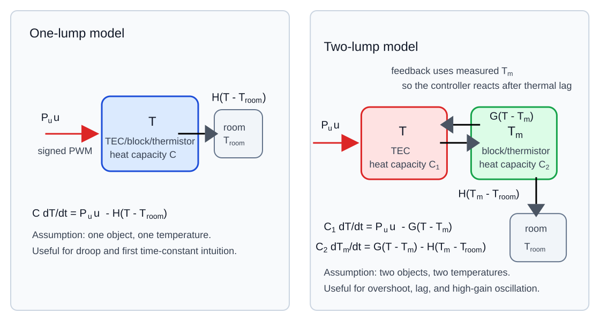

# Module 6, Part II: TEC Process Model And The Simulation

This is the second part of Module 6. Complete
[Part I: P/PI Control And Lumped Modeling](../lab-06/index.md) first.
Both parts use the same prepared
[simulation](#how-to-run-the-python-gui): Part I emphasizes
the one-lump model, while Part II compares the one- and two-lump models.

## Introductory Material

### Purpose

This part follows the first Module 6 modeling work and the initial physical PI
implementation. Before beginning Part II, complete the physical $K_p$ and
$K_i$ study and generate the six experimental plots required by [Module 6,
Part I, A3 Question 2](../lab-06/index.md#a3-question-2). Part II connects three
things:

1. the physical TEC/block/thermistor system,
2. the feedback-control equations,
3. a [Python simulation GUI](#how-to-run-the-python-gui) that lets you change
   model parameters and watch the predicted temperature response.

This module is not about perfect quantitative prediction. It is about learning
how a simple model can qualitatively or semi-quantitatively explain droop,
overshoot, lag, and the onset of instability.

### How A3 Is Divided Between Parts I And II

| Complete after | A3 questions | Work completed in that part |
| --- | --- | --- |
| [**Part I**](../lab-06/index.md#a3-feedback-data-and-lumped-model-memo) | **Questions 1, 2, and 4** | Derive the one-lump predictions; present the six experimental Goldilocks plots and step-response metrics; analyze PI steady state, windup, and anti-windup. |
| **Part II (this page)** | **Questions 3 and 5** | Produce the six two-lump simulation Goldilocks plots; compare simulation with experiment; explain the model limits and justify the selected gains. |

Part II does not replace or repeat the experimental analysis in Question 2.
It supplies the simulation and model interpretation required for [Question
3](../lab-06/index.md#a3-question-3) and [Question
5](../lab-06/index.md#5-model-limits-and-gain-selection).

### Learning Objectives

By the end of Module 6, Part II, you should be able to:

- write and interpret the coupled energy balances for the TEC-side and
  measured-block thermal masses;
- show how two coupled first-order temperature equations produce one
  second-order equation for the measured temperature;
- use the two-lump model to explain phase lag, overshoot, and underdamped
  behavior that the one-lump model cannot reproduce;
- predict and verify which controller and physical parameters increase or
  suppress oscillation in the one- and two-lump models;
- characterize matched physical P and PI responses using rise time,
  overshoot, settling time, steady-state error, and oscillation period;
- generate six simulation Goldilocks plots using one shared set of physical
  parameters and compare them with the six experimental Goldilocks plots; and
- select and justify $K_p$ and $K_i$ by balancing rise time, settling time,
  overshoot, and stability while connecting theory, simulation, and
  measurement.

The six measured and six simulated Goldilocks plots are the principal way you
achieve these objectives. They are assessed together with the two-lump
derivation in A3 Questions 3 and 5.

### Class Theme

**Use Models To Explain Measurements**

In control theory, the **process** is the physical cause-and-effect system that
turns the controller output into a measured response. Here, the PWM command
changes the heat transported by the TEC; thermal capacitances store energy;
thermal conductances move heat through the aluminum block and to the room; and
the thermistor measures the resulting temperature. This chain from PWM command
to measured temperature is the process we are modeling.

### At A Glance

Before class, spend your time in this order:

- **25-30 min**: Read the selected sections of
  [Lienhard](../../references/lienhard-heat-transfer-textbook-v6.pdf) and
  prepare Problem 1.8 as a one-lump review.
- **15-20 min**: Open the [Python GUI](#how-to-run-the-python-gui) and confirm
  that it runs.
- **20 min**: Annotate the two-lump equations and organize your completed
  physical P/PI plots from Part I.

During class on October 19, the approximate schedule for one 170-minute meeting is:

1. **0-15 min**: Inspect the completed P/PI plots and state what the one-lump
   model explains and fails to explain.
2. **15-35 min**: Review the one-lump energy balance with
   [Lienhard](../../references/lienhard-heat-transfer-textbook-v6.pdf)
   Problem 1.8.
3. **35-75 min**: Develop the coupled two-lump balances and reduce them to a
   second-order equation for the measured temperature.
4. **75-120 min**: Compare one- and two-lump responses and connect thermal lag
   to the experimental plots.
5. **120-155 min**: Vary one parameter at a time and interpret the results
   using the equations.
6. **155-170 min**: Wrap up: what the model explains, what it leaves out, and
   why the long-rod experiment will require a spatial model.

### Outside-Class Workload Budget

| Session | Work | Planned time |
| --- | --- | ---: |
| S14 | Read the selected Lienhard material and prepare Problem 1.8 | 30 minutes |
| S14 | Open the simulation, annotate the two-lump equations, and organize the completed P/PI plots | 40 minutes |
| S14 | **Total associated with S14** | **1 hour 10 minutes** |
| S15 | Complete the matched model comparison and A3 evidence | 120 minutes |
| S15 | Commit, push, and prepare the A3 submission | 45 minutes |
| S15 | **Total associated with S15** | **2 hours 45 minutes** |

The Chapter 1 time is for reading with equations and physical interpretation,
not for a quick skim. The optional extension is not part of the four-hour
budget and should be attempted only after required work is complete.

### Vocabulary

- **Process**: the physical system being controlled. Here, the process is the
  TEC/block/thermistor thermal system.
- **State variable**: a number that describes the current state of the model,
  such as temperature.
- **Heat**: energy transferred because of a temperature difference. Heat is not
  the same thing as temperature; temperature tells how hot something is, while
  heat is energy moving into or out of the system.
- **Lumped model**: a model that treats an extended object as if the entire
  object were at the same temperature. The lump can be viewed as a point
  object of finite thermal mass. See the [one-lump/two-lump
  figure](#lumped-model-figure).
- **Thermal lag**: delay between changing the actuator and observing the
  measured temperature response.
- **Saturation**: the actuator command reaches its limit, such as PWM 255. This could be a physical or software imposed limit.

### Model Equations And Numerical Algorithm

The [Python GUI](#how-to-run-the-python-gui) separates the physical model
from the controller. Select either a one-lump or two-lump process, then select
open-loop, P, or PI control.

#### One-Lump Physical Model

<details class="note" markdown="1">
<summary><strong>Symbols Used In Module 6, Part II</strong></summary>

| Symbol | Meaning | Units |
| --- | --- | --- |
| $T$ | One-lump temperature, or TEC-side temperature in the two-lump model | $^\circ$C |
| $T_m$ | Measured-block temperature in the two-lump model | $^\circ$C |
| $T_{\mathrm{amb}}$ | Ambient room temperature | $^\circ$C |
| $T_{\mathrm{set}}$ | Controller setpoint | $^\circ$C |
| $C$ | One-lump thermal capacitance, $C=C_T+C_m$ | J/K |
| $C_T$ | TEC-side thermal capacitance | J/K |
| $C_m$ | Measured-block thermal capacitance | J/K |
| $G$ | Passive thermal conductance between the two lumps | W/K |
| $H$ | Passive thermal conductance from the measured lump to the room | W/K |
| $u$ | Signed PWM command | PWM counts |
| $P_u$ | TEC thermal-power coefficient for the active direction | W/PWM count |
| $P_{u,h}$, $P_{u,c}$ | Heating and cooling thermal-power coefficients | W/PWM count |
| $\chi_h$, $\chi_c$ | Heating and cooling susceptibilities | $^\circ$C/PWM count |
| $r=\chi_h/\chi_c$ | Heating-to-cooling susceptibility ratio | dimensionless |
| $e=T_{\mathrm{set}}-T_{\mathrm{meas}}$ | Temperature error | $^\circ$C |
| $K_p$ | Proportional gain | PWM counts/$^\circ$C |
| $K_i$ | Integral gain | PWM counts/($^\circ$C s) |
| $\Delta t$ | Numerical time step | s |
| $\theta_T$, $\theta_m$ | Deviations from the steady-state temperatures | $^\circ$C |

</details>

Part I developed the [one-lump energy balance and its measured-parameter
form](../lab-06/index.md#part-2-express-the-one-lump-model-using-measured-parameters).
Carry those results forward rather than deriving them again. For comparison
with the two-lump model, the one-lump capacitance is the sum

\[
C=C_T+C_m,
\]

and the simulation continues to use $P_{u,h}$ for heating and $P_{u,c}$ for
cooling, with

\[
r=\frac{P_{u,h}}{P_{u,c}}=\frac{\chi_h}{\chi_c}.
\]

#### Two-Lump Physical Model

The two-lump model separates the TEC-side temperature $T$ from the measured
temperature $T_m$:

\[
C_T\frac{dT}{dt}=P_u(u)u-G(T-T_m),
\]

\[
C_m\frac{dT_m}{dt}=G(T-T_m)-H(T_m-T_{\mathrm{amb}}).
\]

Here $C_T$ and $C_m$ are thermal capacitances. The conductance $G$ couples the
two lumps through the passive heat flow $G(T-T_m)$. The same heat that leaves
the TEC-side lump enters the measured lump, so this term appears with opposite
signs in the two equations. We simplify the apparatus by giving the TEC-side
lump no separate path to the room; all heat loss to the room is represented by
$H(T_m-T_{\mathrm{amb}})$ in the measured-lump equation.

The controller responds to $T_m$, but $T$ and $T_m$ do not change at the same
time. Which temperature changes first if someone opens a window and
$T_{\mathrm{amb}}$ suddenly decreases? Which changes first if
$T_{\mathrm{set}}$ changes? This lag can produce overshoot or oscillation.

#### From Two First-Order Equations To One Second-Order Equation

Consider one heating or cooling direction so that $P_u$ is constant, assume
the PWM is not saturated, and use P control:

\[
u=K_p(T_{\mathrm{set}}-T_m).
\]

Let $\theta_T$ and $\theta_m$ be deviations of $T$ and $T_m$ from their
steady-state values. The constant steady-state terms cancel, leaving

\[
C_T\dot\theta_T=-G\theta_T+(G-P_uK_p)\theta_m,
\]

\[
C_m\dot\theta_m=G\theta_T-(G+H)\theta_m.
\]

The second equation gives the hidden TEC-side temperature in terms of the
measured temperature and its rate of change:

\[
G\theta_T=C_m\dot\theta_m+(G+H)\theta_m.
\]

Differentiate the second equation, use the first equation to replace
$\dot\theta_T$, and then use the expression above to replace $\theta_T$. The
result is one second-order differential equation for the measured temperature:

\[
\boxed{
C_TC_m\ddot\theta_m+
\left[C_T(G+H)+C_mG\right]\dot\theta_m+
G(H+P_uK_p)\theta_m=0.
}
\]

Thus two coupled first-order equations for two stored-energy states are
equivalent to one second-order equation for $T_m$. Substituting
$\theta_m\propto e^{st}$ gives

\[
C_TC_m s^2+
\left[C_T(G+H)+C_mG\right]s+
G(H+P_uK_p)=0.
\]

Divide by $C_TC_m$ and compare with the standard second-order form

\[
s^2+2\zeta\omega_n s+\omega_n^2=0.
\]

The two-lump P-control natural frequency and damping ratio are

\[
\boxed{
\omega_n=\sqrt{\frac{G(H+P_uK_p)}{C_TC_m}}
},
\]

\[
\boxed{
\zeta_{\mathrm{2L,P}}
=\frac{C_T(G+H)+C_mG}
{2\sqrt{C_TC_mG(H+P_uK_p)}}
}.
\]

This expression predicts the transition:

- $\zeta_{\mathrm{2L,P}}>1$ gives an overdamped response;
- $\zeta_{\mathrm{2L,P}}=1$ gives critical damping; and
- $\zeta_{\mathrm{2L,P}}<1$ gives an underdamped response with overshoot or
  ringing.

For fixed physical parameters, increasing $K_p$ increases the denominator and
therefore decreases $\zeta_{\mathrm{2L,P}}$. Sufficiently large P gain can move
the two-lump model from overdamped to underdamped behavior. The critical gain
is found by setting $\zeta_{\mathrm{2L,P}}=1$:

\[
\boxed{
K_{p,\mathrm{crit}}
=\frac{1}{P_u}
\left[
\frac{\left(C_T(G+H)+C_mG\right)^2}
{4C_TC_mG}-H
\right]
}.
\]

The dependence on $G$ is not monotonic. Very large $G$ forces $T\approx T_m$
and recovers one-lump behavior. Very small $G$ nearly disconnects the measured
mass from the TEC, producing a very slow response. For fixed $C_T$, $C_m$, and
$H$, the damping ratio is smallest at

\[
G=\frac{C_TH}{C_T+C_m}.
\]

Likewise, at fixed total capacitance $C=C_T+C_m$, putting almost all the
capacitance in either lump suppresses the second-order behavior. The damping
ratio is smallest when

\[
\frac{C_T}{C}=\frac{G}{H+2G},
\]

which is close to one-half when $G\gg H$. Thus a noticeable internal lag and
two appreciable thermal stores promote ringing; neither phrase alone means
that making $G$ arbitrarily small always creates more oscillation.

Complex eigenvalues produce an underdamped transient even though the apparatus
contains no mechanical momentum. Thermal storage in two locations and delayed
transport between them supply the two dynamical states.

#### Stability Of Two-Lump PI Control

PI control adds the integral state

\[
q=\int e\,dt,\qquad \dot q=-\theta_m,
\]

and the command perturbation is

\[
u=-K_p\theta_m+K_iq.
\]

Substitution into the two-lump equations gives the characteristic equation

\[
\boxed{
C_TC_m s^3+
\left[C_T(G+H)+C_mG\right]s^2+
G(H+P_uK_p)s+
GP_uK_i=0.
}
\]

This equation is third order, so the complete response does not have one
second-order damping ratio $\zeta$. It commonly has one real eigenvalue and a
complex-conjugate pair; that pair produces the observed ringing.

Write the cubic as $a_3s^3+a_2s^2+a_1s+a_0=0$. All four coefficients above
are positive. The Routh-Hurwitz stability condition therefore reduces to

\[
a_2a_1>a_3a_0.
\]

Solving the equality for the integral gain gives the stability boundary

\[
\boxed{
K_{i,\mathrm{crit}}
=\frac{\left[C_T(G+H)+C_mG\right](H+P_uK_p)}
{C_TC_mP_u}.
}
\]

A useful dimensionless measure of integral aggressiveness is

\[
\boxed{\rho_I=\frac{K_i}{K_{i,\mathrm{crit}}}.}
\]

As $\rho_I$ approaches 1 from below, the oscillatory pair becomes less damped.
At $\rho_I=1$, the normalized polynomial factors as
$(s+a)(s^2+b)$: one eigenvalue remains negative while the other two are purely
imaginary. The linear model then predicts sustained oscillation. For
$\rho_I>1$, it predicts growing oscillation and instability.

These results give practical rules of thumb:

| Change | Expected effect | Interpretation |
| --- | --- | --- |
| Increase $K_i$ | Increases $\rho_I$ and promotes oscillation | Integral action removes droop, but too much increases settling time or causes instability. |
| Increase $K_p$ at fixed $K_i$ | Raises $K_{i,\mathrm{crit}}$ | P action can improve the PI stability margin, although excessive $K_p$ can already excite two-lump P overshoot. |
| Decrease $G$ over the apparatus-relevant range | Increases internal lag and usually reduces PI stability margin | The integral continues accumulating while $T_m$ responds slowly. Extremely small or large $G$ requires direct evaluation rather than this slogan. |
| Make both $C_T$ and $C_m$ appreciable | Strengthens two-state behavior | Concentrating nearly all capacitance in one lump moves the system toward one-lump behavior. |
| Increase total $C$ without retuning gains | Slows the plant and generally makes the same $K_i$ more aggressive | More error can accumulate before the measured temperature responds. |
| Increase $P_u$ | Makes each PWM unit more effective | The same numerical $K_p$ and $K_i$ produce stronger physical feedback. |
| Saturate PWM with anti-windup off | Produces integral windup | The resulting overshoot is nonlinear controller memory, not solely the linear two-lump instability. |

The objective is not the shortest rise time at any cost. A large gain may
reach the setpoint quickly on the first crossing but then overshoot and take
longer to settle. A useful tuning procedure is:

1. choose $K_p$ for a fast P response without unacceptable overshoot;
2. choose a slightly smaller $K_p$ when adding integral action;
3. increase $K_i$ from zero until droop is removed on the desired timescale;
4. stop increasing $K_i$ when extra oscillation makes the settling time worse;
5. verify both heating and cooling steps without sustained saturation.

At steady state, both temperature derivatives are zero, so

\[
P_u u=G(T-T_m)=H(T_m-T_{\mathrm{amb}}).
\]

The internal conductance $G$ sets the temperature difference between the two
lumps, but it cancels from the overall balance
$P_u u=H(T_m-T_{\mathrm{amb}})$. This is the quantitative reason the one-lump
model can predict the final measured temperature and P-control droop even when
it fails to predict the high-gain transient.

#### Controller Choices

The measured temperature is $T$ for the one-lump model and $T_m$ for the
two-lump model. Define

\[
e=T_{\mathrm{set}}-T_{\mathrm{meas}}.
\]

The three controller choices are

\[
u=u_{\mathrm{user}}\quad\text{(open loop)},
\]

\[
u=K_pe\quad\text{(P control)},
\]

\[
u=K_pe+K_i\int e\,dt=u_P+u_I\quad\text{(PI control)}.
\]

The signed command is clamped to the PWM limit. If the anti-windup option is
enabled, the program prevents the integral state from continuing to grow when
the actuator is saturated in the same direction as the error.

#### What The Algorithm Does At Each Time Step

The simulation described in [How To Run The Python
GUI](#how-to-run-the-python-gui) performs the numerical work, but you should
understand its sequence:

1. Read the model's measured temperature, $T_n$ or $T_{m,n}$.
2. Calculate the error $e_n$.
3. For PI control, propose the integral update
   $q_{n+1}=q_n+e_n\Delta t$. Accept it unless anti-windup prevents the
   update; otherwise use $q_{n+1}=q_n$.
4. Calculate the requested command for the selected controller:
   $u_n=u_{\mathrm{user}}$ for open-loop control, $u_n=K_pe_n$ for P control,
   or $u_n=K_pe_n+K_iq_{n+1}$ for PI control.
5. Clamp $u_n$ to the signed PWM limit.
6. Select $P_{u,h}$ or $P_{u,c}$ from the sign of the applied command.
7. Evaluate the heat-balance derivatives and advance $T$ and, for the
   two-lump model, $T_m$ by one Euler step.

For example, the first two-lump Euler updates are

\[
T_{n+1}=T_n+\frac{\Delta t}{C_T}
\left[P_u(u_n)u_n-G(T_n-T_{m,n})\right],
\]

\[
T_{m,n+1}=T_{m,n}+\frac{\Delta t}{C_m}
\left[G(T_n-T_{m,n})-H(T_{m,n}-T_{\mathrm{amb}})\right].
\]

You are not required to write this code. Use it to develop physical intuition:
vary one model, parameter, or initial condition at a time; predict the result;
observe the response; and interpret it using the heat balances and controller
equations.

<a id="lumped-model-figure"></a>



*Course-specific lumped-model diagram.*

### Thermal Transport Theory Assignments

This part of the course uses **lumped thermal models**. A lumped model assumes
that one object, such as the TEC/block assembly, can be described by one
temperature. This is an approximation. It is useful before we move to the long
rod, where temperature depends on position.

#### One-Lump Results Carried Forward From Part I

In [Module 6, Part I](../lab-06/index.md#part-2-express-the-one-lump-model-using-measured-parameters),
you derived the one-lump energy balance, expressed it using the measured
$\chi$ and $\tau$, and found its steady-state temperature. Use those results
here; do not repeat that assignment.

#### Two-Lump Theory Assignment

Use the [two-lump equations and their definitions](#two-lump-physical-model)
above to answer these required pre-class questions:

1. Identify which term transfers heat from the TEC side to the measured
   thermistor/block side.
2. Identify which term describes heat loss from the measured block to room air.
3. Explain why `Tm` can lag behind `T`.
4. Explain why a controller that uses `Tm` may react too late.
5. Divide the measured-lump equation by $C_m$ and compare it term by term with
   the rate-constant form
   $dT_m/dt=k_{21}(T-T_m)-k_m(T_m-T_{\mathrm{amb}})$. Identify
   $k_{21}=G/C_m$ and $k_m=H/C_m$, give their units, and explain how increasing
   each one changes the equilibration between the lumps or the relaxation
   toward room temperature.

<details class="note" markdown="1">
<summary>Looking Ahead: From Lumps To A Temperature Field</summary>

The two-lump model is a crude spatial approximation. It replaces an extended
apparatus with two internally uniform regions connected by a thermal
conductance. It distinguishes a region near the TEC from a region near the
thermistor, but it contains no continuous distance, temperature gradient, or
spatial coordinate.

The long-rod experiment cannot be described by a single temperature. It needs
a temperature field that depends on longitudinal position and time:

\[
T = T(x,t)
\]

For the rod we will move toward equations of the form

\[
\frac{\partial T}{\partial t}
=
\alpha \frac{\partial^2 T}{\partial x^2}
\]

with an additional term that represents heat loss from the sides to the room:

\[
\frac{\partial T}{\partial t}
=
\alpha \frac{\partial^2 T}{\partial x^2}
-
\beta\left(T - T_{\mathrm{room}}\right)
\]

In these equations, `alpha` is the thermal diffusivity in m²/s and `beta` is a
side-loss rate constant in 1/s.

You do not need to solve these equations or submit written answers about them
in Module 6. They are included to show where the lumped-model sequence leads.

</details>

## Pre-Class Assignment

### How To Run The Python GUI

Clicking the Python source-code link opens or downloads the `.py` file. It does
not run the simulation. To run the model, download the file and run it from a
folder on your own computer.

First make a working folder and put the Python file there:

```bash
mkdir -p ~/phys39-lab7
cd ~/phys39-lab7
```

Download this file into that folder:
[Lab_6_7_modeling_tec.py](../../downloads/Lab_6_7_modeling_tec.py).

Set up Python the first time you use this folder:

```bash
python3 -m venv .venv
source .venv/bin/activate
python -m pip install matplotlib
```

Then run the desktop GUI:

```bash
python Lab_6_7_modeling_tec.py
```

After the first setup, start from this folder and run:

```bash
cd ~/phys39-lab7
source .venv/bin/activate
python Lab_6_7_modeling_tec.py
```

### Before Class

1. Read [Lienhard](../../references/lienhard-heat-transfer-textbook-v6.pdf),
   **Chapter 1: Introduction**, selectively. Focus on conservation of energy,
   thermal resistance, heat capacity, and lumped models. Prepare **Problem
   1.8** for possible board work: identify the physical system, write the heat
   balance, check units, and state the lumped-model approximation.

2. Complete [How To Run The Python GUI](#how-to-run-the-python-gui) and
   confirm that the simulation opens.
3. In your notebook, copy the two-lump model equations and label the meaning of
   each variable.
4. Answer the five prompts in the [Two-Lump Theory
   Assignment](#two-lump-theory-assignment).

## In-Class Assignment

### What You Will Do

You will:

- run the [Python simulation GUI](#how-to-run-the-python-gui),
- interpret the matched physical P and PI responses completed in Part I,
- compare the one-lump and two-lump models,
- reproduce the measured progression from low to high P and PI gains,
- connect each important response feature to a model parameter and its Euler
  update,
- explain what this model teaches you about the real TEC experiment.

Before beginning the comparison, load the measured parameters and saved
one-lump results from Part I. Confirm that the displayed susceptibility, time
constant, and P-control droop prediction match those saved values. Rerun a
one-lump case only if this settings check fails.

<span id="guided-simulation-exercise-what-increases-or-suppresses-oscillation"></span>

### Part 1: Guided Goldilocks Simulation And Oscillation Study

**The purpose of this exercise is to build an explicit match between experiment
and theory.** It is the simulation counterpart to [A3 Question 2, Part
2](../lab-06/index.md#a3-question-2), where you measured rise time, percent
overshoot, settling time, steady-state error, and oscillation period. Here you
will determine which model parameters increase or suppress those same response
features, then produce the six simulation plots required by A3 Question 3.

Use the same setpoint, initial temperature, PWM limit, and physical parameters
for every controlled comparison. Reset the simulation before each run and vary
only the named parameter.

#### Carry Forward The One-Lump Results

Do not repeat the Part I one-lump P gain study. Use its result as the baseline:
increasing $K_p$ reduces droop and response time, but this one-state P model
remains monotonic.

For one-lump PI control, use

\[
\zeta=\frac{H+P_uK_p}{2\sqrt{CP_uK_i}}.
\]

Make three brief controlled comparisons:

1. Hold $K_p$ fixed and increase $K_i$.
2. Hold $K_i$ fixed and increase $K_p$.
3. Using `direct constants`, increase $C$ while holding $H$, $P_u$, $K_p$, and
   $K_i$ fixed.

For each comparison, predict the change in $\zeta$, then verify whether the
change increases or suppresses overshoot and ringing. Return to the measured
physical parameters before continuing. These are exploratory comparisons, not
additional Goldilocks plots.

#### Predict And Observe The Two-Lump P Transition

Before matching your apparatus, use the following common parameter set to make
the overdamped-to-underdamped transition predictable. Select `two_lump`,
`direct constants`, and `p`, then enter:

| Parameter | Value |
| --- | ---: |
| $T_{\mathrm{amb}}$ | $22\ ^\circ\mathrm{C}$ |
| $T_0$ | $22\ ^\circ\mathrm{C}$ |
| $T_{\mathrm{set}}$ | $23\ ^\circ\mathrm{C}$ |
| $C$ | $91\ \mathrm{J/K}$ |
| $C_T/C$ | $0.35$ |
| $G$ | $50\ \mathrm{W/K}$ |
| $H$ | $1.14\ \mathrm{W/K}$ |
| $P_{u,c}$ | $0.26\ \mathrm{W/PWM}$ |
| $r=P_{u,h}/P_{u,c}$ | $2.0$ |
| $K_i$ | $0$ |
| PWM limit | $255$ |
| $\Delta t$ | $0.05\ \mathrm{s}$ |

The $1\ ^\circ\mathrm{C}$ setpoint step keeps the requested command below the
PWM limit for all three gains, so saturation does not obscure the linear
P-control prediction. Anti-windup has no effect because $K_i=0$.

Use the boxed expression for $\zeta_{\mathrm{2L,P}}$ to verify these predictions
before running the simulation:

| $K_p$ (PWM/$^\circ$C) | Predicted $\zeta_{\mathrm{2L,P}}$ | Predicted behavior |
| ---: | ---: | --- |
| $60$ | $1.31$ | Overdamped |
| $105$ | $1.00$ | Approximately critically damped |
| $160$ | $0.81$ | Underdamped |

Reset the simulation before each run and plot only the mass temperature. Check
whether the response changes from monotonic, to nearly critically damped, to
overshooting. Small numerical and graphical differences are expected because
the displayed values are rounded.

Now hold $K_p=105$ and vary one physical parameter at a time:

1. Set $G$ to $35$, $50$, and $70\ \mathrm{W/K}$. The predicted damping ratios
   are approximately $0.84$, $1.00$, and $1.18$, respectively. Verify the
   transition from underdamped to overdamped over this range. This local trend
   does not imply that $G\rightarrow0$ produces unlimited ringing.
2. Restore $G=50\ \mathrm{W/K}$ and set $C_T/C$ to $0.20$, $0.35$, $0.50$,
   and $0.80$. The corresponding damping ratios are approximately $1.19$,
   $1.00$, $0.96$, and $1.21$. Verify that the response is least damped when
   both thermal masses are appreciable and becomes more damped when the
   capacitance is concentrated in either lump.

These runs isolate intrinsic two-lump P dynamics. They are practice runs, not
additional A3 plots. Return to your measured parameters before making the six
Goldilocks plots.

#### Predict And Observe Two-Lump PI Stability

Continue with the common parameter set above, but set $G=2\ \mathrm{W/K}$,
$K_p=18\ \mathrm{PWM}/^\circ\mathrm{C}$, and select PI control. Keep the
$1\ ^\circ\mathrm{C}$ setpoint step and anti-windup on so actuator saturation
does not obscure the linear prediction.

For these values,

\[
K_{i,\mathrm{crit}}\approx
2.34\ \mathrm{PWM}/(^\circ\mathrm{C\,s}).
\]

Calculate $\rho_I=K_i/K_{i,\mathrm{crit}}$ and then reset and run each case:

| $K_i$ (PWM/($^\circ$C s)) | $\rho_I$ | Prediction |
| ---: | ---: | --- |
| $0.25$ | $0.11$ | Stable, relatively well damped |
| $1.00$ | $0.43$ | Stable, more oscillatory |
| $2.10$ | $0.90$ | Stable but weakly damped; long settling time |
| $2.50$ | $1.07$ | Unstable in the linear model |

For every run, record rise time, overshoot, settling time, and whether the
oscillation decays or grows. Verify that increasing $K_i$ can shorten the
initial correction while simultaneously making the final settling slower.

Next hold $K_i=1.00$ and compare $G=0.5$, $1$, $2$, and
$5\ \mathrm{W/K}$. Recalculate $K_{i,\mathrm{crit}}$ and $\rho_I$ each time.
Predict the stable or unstable result before pressing **Resume**, then check
the prediction. Finally, restore the common values and move $C_T/C$ toward
either extreme. Observe that concentrating the capacitance in one lump
suppresses the two-state oscillatory behavior.

These are short parameter studies, not additional A3 plots. Their purpose is
to teach how the physical parameters set the stability margin and how the
controller gains trade rapid approach against overshoot and settling time.

#### Make The Six Two-Lump Goldilocks Plots

Select `two_lump`. Enter your measured $T_{\mathrm{amb}}$, $\chi_c$, $\chi_h$,
and $\tau$, and use the setpoints, PWM limit, starting conditions, TEC voltage,
and TEC resistance from the six physical runs. Your numerical gains may differ
from those used by other teams.

The measurements determine the one-lump behavior but do not uniquely determine
the internal parameters $G$ and $C_T/C$. Find **one shared set** of these
parameters that qualitatively reproduces the experimental progression. The
apparatus did not change between runs, so do not choose different physical
parameters for different gains.

1. With $K_i=0$, simulate the experimental low, medium, and high $K_p$ values.
   Look for the progression from slow response and larger droop, through a
   useful compromise, to overshoot or ringing. Plot only the mass temperature
   when the TEC-side temperature obscures the measured response.
2. Near the transition to overshoot, test both a smaller and a larger $G$,
   returning to the shared value between tests. Repeat for $C_T/C$. Predict
   each result and determine which direction increases thermal lag and which
   suppresses overshoot or ringing. Do not assume either dependence remains
   monotonic over every possible value.
3. Restore the shared physical parameters. Select `pi`, hold $K_p$ at the
   value used for all three experimental PI runs, and simulate the low,
   medium, and high $K_i$ values. Keep anti-windup on and reset the integral
   before every run. This makes the retained comparison primarily about the
   physical model and controller gains.
4. Make and label the **six simulation Goldilocks plots** using the same
   organization, axes, and labels as the six experimental plots.

After preserving the six plots, you may demonstrate windup separately: turn
anti-windup off, reduce $G$, choose PI control, and apply a setpoint step large
enough to saturate the PWM command. The measured temperature responds slowly,
so the persistent error continues increasing the integral contribution even
while the applied command is clamped. This extra overshoot is caused by stored
controller error, not solely by the two-lump damping ratio. Turn anti-windup
back on and press **Zero integral** before continuing.

Record the one physical parameter set used for all six simulations:

| $\chi_c$ | $\chi_h$ | $\tau$ | $G$ | $C_T/C$ | TEC voltage | TEC resistance | Setpoints | PWM limit |
| ---: | ---: | ---: | ---: | ---: | ---: | ---: | --- | ---: |
|  |  |  |  |  |  |  |  |  |

Compare the six matched conditions:

| Condition | Controller | $K_p$ | $K_i$ | Experimental behavior | Simulated behavior | Agreement or mismatch |
| --- | --- | ---: | ---: | --- | --- | --- |
| P low | P |  | 0 |  |  |  |
| P medium | P |  | 0 |  |  |  |
| P high | P |  | 0 |  |  |  |
| PI low | PI |  |  |  |  |  |
| PI medium | PI |  |  |  |  |  |
| PI high | PI |  |  |  |  |  |

Use one table to summarize the parameter trends observed in both the brief
one-lump comparisons and the two-lump study:

| Model and controller | Parameter changed | Held fixed | Change that increased oscillation | Change that suppressed oscillation | Evidence |
| --- | --- | --- | --- | --- | --- |
| One-lump P | $K_p$ | Physical parameters | None observed | Not applicable: response remained monotonic | Part I result |
| One-lump PI | $K_i$, then $K_p$, then $C$ | All other parameters |  |  |  |
| Two-lump P | $K_p$, then $G$, then $C_T/C$ | All other parameters |  |  |  |
| Two-lump PI | $K_i$ | $K_p$ and physical parameters |  |  |  |

Use these two tables and the twelve Goldilocks plots directly in A3 Questions
3 and 5. Explain why one-lump P control cannot oscillate, identify the heat
flow that makes $T_m$ lag behind $T$, connect the parameter changes to rise
time, droop, overshoot, and oscillation decay, and state one important
agreement and disagreement between simulation and experiment. Do not write a
separate Part II report.

## Post-Class Assignment

### Preserve The A3 Evidence

Before leaving S15, save the shared model settings, six simulation comparisons,
parameter-to-behavior table, exact run command, and links to the experimental
data. Preserve the prepared simulation in your repository. These are A3
working materials, not a separate submission.

### Oral Review Questions: Process Modeling

Use this modeling question bank to check your understanding and prepare A3:

1. Which physical lag in the apparatus can produce overshoot or oscillation as
   gain increases?
2. Identify one model parameter, give its units, and explain its physical
   effect on the simulated response.

Also prepare the [Module 5 P-control questions](../lab-05/index.md#oral-review-questions-p-control)
and [Module 6 PI-control question](../lab-06/index.md#oral-review-questions-pi-control).

## Instructor Notes

- This module is a consolidation point after manual control and P/PI control.
- Keep the emphasis on physical interpretation, not formal control theory.
- Students should leave understanding why delay plus gain causes trouble.
- The long-rod model should be introduced as a preview, not fully derived here
  unless the class is ready.
