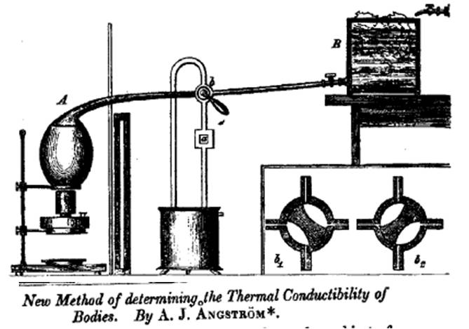
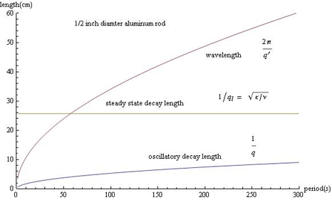
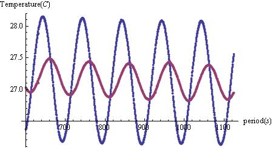

# Module 8, Part I: The Angstrom Method

Module 8 has two linked parts. This page develops and applies the Angstrom
method. Continue with [Part II: Conductivity, Heat Loss, And Final
Synthesis](../lab-10/index.md).

## Purpose

In this module the TEC controller creates a sinusoidal temperature boundary at the
base of the aluminum rod. Thermal diffusion causes the oscillation amplitude to
decrease and its phase to lag with distance. Measuring both effects allows you
to separate thermal diffusion from heat loss to the air.

## Schedule And Due Work

| Session | In class | Due |
| --- | --- | --- |
| S18, Mon. Nov. 2 | Tune sinusoidal base-temperature tracking; collect a pilot run | Module 8 home preparation; `P3` prediction and pilot-plan check |
| S19, Wed. Nov. 4 | Fit pilot amplitudes and phases; choose the production period | Pilot-analysis and production-plan check |
| S20, Mon. Nov. 9 | Acquire at least five settled production periods | Data-readiness check |
| S21, Wed. Nov. 11 | Fit spatial decay and phase slopes; infer `kappa` and `nu` | **A5: Angstrom derivation and model-validity plan** |
| S22, Mon. Nov. 16 | Repeat or extend the measurement; test frequency consistency, residuals, and model validity | `P4`; formative modeling-app check |

## Outside-Class Workload Budget

| Session | Work | Planned time |
| --- | --- | ---: |
| S18 | Read this assignment and review the periodic solution | 60 minutes |
| S18 | Prepare the pilot-run settings and metadata plan | 30 minutes |
| S18 | **Total associated with S18** | **1 hour 30 minutes** |
| S19 | Continue and check the individual A5 derivation and validity plan | 120 minutes |
| S19 | Inspect pilot fits and prepare the production-run plan | 45 minutes |
| S19 | **Total associated with S19** | **2 hours 45 minutes** |
| S20 | Complete the individual A5 derivation and validity plan | 120 minutes |
| S20 | Prepare production filenames, metadata, and data-readiness checklist | 45 minutes |
| S20 | **Total associated with S20** | **2 hours 45 minutes** |
| S21 | Complete the spatial fits, uncertainty, and residual displays | 150 minutes |
| S21 | Document, commit, and push the formative modeling-app checkpoint | 30 minutes |
| S21 | **Total associated with S21** | **3 hours** |
| S22 | Prepare a repeat run or frequency-consistency and model-validity check | 60 minutes |
| S22 | **Total associated with S22** | **1 hour** |

Production data are acquired in class. If five settled periods do not fit in a
meeting, use an instructor-approved supervised run rather than silently adding
unscheduled outside laboratory time.

## Learning Objectives

By the end of this module, you should be able to:

1. **Create the boundary:** use PI control to drive the TEC and verify a
   sinusoidal temperature at the rod analysis base, the first hole at \(x=0\),
   while choosing a useful forcing period.
2. **Extract the spatial response:** fit noisy temperature data to determine
   the amplitude-decay coefficient \(q\) and phase coefficient \(q'\), using
   phase unwrapping and a consistent sign convention.
3. **Infer physical parameters:** determine thermal diffusivity \(\kappa\) and
   side-loss rate \(\nu\), with units and uncertainty.
4. **Assess the model:** use residuals, frequency consistency, and the
   finite-length and transverse-Biot checks from Module 7 to decide whether the
   one-dimensional model adequately describes the retained data.

## Roadmap And Student Work

The module follows one experimental argument. First predict what periodic heat
diffusion should look like along the rod. Then derive the amplitude decay and
phase lag, establish a sinusoidal boundary, test the analysis on a pilot run,
and acquire the production data. Finally, infer \(\kappa\) and \(\nu\) and test
whether the same model explains all retained sensors and forcing periods.

**Before S18:** read through the periodic solution, write down your qualitative
predictions, and prepare proposed pilot settings and metadata. This is the
`P3` check: bring your proposed drive period and your prediction for how
amplitude and phase will change with distance.

**In class during S18-S20:** tune the TEC drive and document the measured
rod-base waveform, collect a pilot run, fit it, choose the production period, and acquire
at least five periods after the response you judge to be settled.

**After the production run during S21-S22:** complete the spatial fits,
uncertainty and residual analysis, and model-validity checks. The `P4` check is
a periodic dataset with at least five periods you identify as settled, sensor
positions and units, acquisition metadata, and a rod-base waveform check.
State the criterion you used to decide that the response was settled.

## Reuse The Calibrated Sensor Map

Module 7 established the geometry and cross-calibrated six thermistor
measurement chains: one thermistor in the TEC base and five thermistors at
measured positions along the 6061-T6 aluminum rod. Keep the same coordinate
origin at the first rod hole, channel assignments, correction coefficients,
measured diameter, analysis length \(L\) from the first hole to the tip, and
sensor positions for the Angstrom experiment. Do not move a rod
sensor without updating the sensor map and its position uncertainty.

The thermistor embedded in the TEC measures the driven actuator, but it is not
the rod boundary at \(x=0\) and is not one of the five rod coordinates. Rod
thermistor 1 in the first hole measures \(T(0,t)\), the boundary condition used
in the Angstrom model. You will use the Angstrom measurement to determine thermal
conductivity rather than substitute a supplied final value. Literature values
of \(k\) may guide planning and model-validity checks.

This choice of origin does not change the Angstrom result. Shifting \(x=0\)
changes the reference amplitude and phase, but the fitted spatial decay and
phase coefficients depend on amplitude ratios, phase differences, and sensor
separations. Use the first hole as \(x=0\) consistently in every plot and fit.

In principle, the Angstrom method needs temperatures at only two distinct rod
positions. The experiment could therefore be repeated for several pairs of
positions. Five simultaneous rod measurements are preferable because they
provide multiple amplitude and phase differences in one run, support spatial
fits and residual checks, and avoid comparing pairs acquired under different
room or boundary conditions.

Before the pilot run, verify that the saved diagram or photograph identifies
the TEC-base channel, the five rod channels, the positive \(x\) direction, all
five measured rod positions, the analysis length from the first hole to the
tip, the overall physical length, and the measured diameter.

## Periodic Solution

*Historical drawing of Angstrom's method for determining thermal
conductivity. The course replaces the alternating hot and cold reservoirs with
a TEC-controlled sinusoidal boundary temperature.*

Take a few minutes to look at the
[1863 English translation of Angstrom's original work](../../references/angstrom-thermal-conductivity-1863.pdf).
You are not expected to follow every line. Focus on the apparatus, the recorded
observations, and the way the measurements are connected to the theory. Recognize the kinship between Angstrom and ourselves; the scientific process isn't different 165 years later, although the tools have progressed.

### Start With The Rod Equation

Use excess temperature $\theta=T-T_\infty$ and the rod equation

\[
\frac{\partial\theta}{\partial t}
=\kappa\frac{\partial^2\theta}{\partial x^2}-\nu\theta.
\]

Here $\kappa$ is thermal diffusivity in $\mathrm{m^2/s}$ and $\nu$ is
the lateral heat-loss rate coefficient in $\mathrm{s^{-1}}$. Every term has
units of K/s. We assume constant material properties, linear heat loss,
constant environmental temperature, and a temperature uniform across each
cross section. Module 7 denoted thermal diffusivity by $\alpha$; here
$\kappa\equiv\alpha=k/(\rho c)$. The symbol $T_\infty$ does not mean the
temperature at the other end of the universe. It is the temperature of the
surrounding room, which we treat as a large thermodynamic reservoir whose
temperature is not changed appreciably by the rod. We initially treat the rod
as semi-infinite, with $x\geq0$.

Use the measured temperature of rod thermistor 1 at the analysis base as

\[
\theta(0,t)=\theta_b\cos(\omega t),
\qquad
\omega=\frac{2\pi}{\tau},
\]

where $\tau$ is the period in seconds and $\omega$ is angular frequency in
rad/s. The TEC and its embedded thermistor create and monitor the forcing, but
the measured rod temperature at the first hole supplies this boundary
condition. We seek the settled periodic response after initial transients decay.
If the base oscillates about a mean above room temperature, the full solution
also contains a stationary mean profile. By linearity, we can solve for that
profile and the oscillating component separately; the derivation below gives
the oscillating component.

Before continuing, make a qualitative prediction. Sketch temperature versus
time at the base and at two increasing distances along the rod. Predict which
features remain the same, which change with distance, and what a shorter drive
period should do to the attenuation and phase lag. Return to this sketch after
the derivation and pilot run.

### Guess A Complex Exponential

A complex exponential is useful because differentiation returns a constant
times the same function. Guess

\[
\widetilde{\theta}(x,t)=\theta_b e^{-sx}e^{i\omega t}.
\]

The physical temperature is the **real part** of this expression. Because the
equation is linear with real coefficients, the real part of a complex solution
also satisfies the equation. Allowing $s$ to be complex lets us describe both
amplitude decay and phase delay along the rod. At $x=0$, taking the real part
gives the specified cosine boundary condition.

The derivatives are

\[
\frac{\partial\widetilde{\theta}}{\partial t}
=i\omega\widetilde{\theta},
\qquad
\frac{\partial^2\widetilde{\theta}}{\partial x^2}
=s^2\widetilde{\theta}.
\]

Substitution into the rod equation and cancellation of the common exponential
turn the differential equation into algebra:

\[
i\omega=\kappa s^2-\nu,
\qquad
\boxed{s^2=\frac{\nu+i\omega}{\kappa}}.
\]

The two spatial solutions are $e^{-sx}$ and $e^{+sx}$. Choose the square root
with positive real part and discard the growing solution $e^{+sx}$, because
the temperature oscillation must vanish far from the driven end.

### Separate Amplitude Decay From Phase Delay

Write $s=q+iq'$, with $q>0$ and $q'>0$ for positive driving frequency. The
prime in $q'$ is part of its name, not a derivative. Squaring gives

\[
s^2=q^2-q'^2+2iqq'.
\]

Equating real and imaginary parts with $(\nu+i\omega)/\kappa$ gives

\[
\boxed{q^2-q'^2=\frac{\nu}{\kappa}},
\qquad
\boxed{2qq'=\frac{\omega}{\kappa}}.
\]

To find the two coefficients explicitly, use

\[
(q^2+q'^2)^2=(q^2-q'^2)^2+(2qq')^2
=\frac{\nu^2+\omega^2}{\kappa^2}.
\]

Thus $q^2+q'^2=\sqrt{\nu^2+\omega^2}/\kappa$. Adding and subtracting
the expressions for this sum and for $q^2-q'^2$ gives the amplitude-decay
and phase coefficients, both in inverse meters:

\[
q=\sqrt{\frac{\nu+\sqrt{\nu^2+\omega^2}}{2\kappa}},
\qquad
q'=\sqrt{\frac{-\nu+\sqrt{\nu^2+\omega^2}}{2\kappa}}.
\]

The frequency of the drive therefore sets two useful spatial scales. The
**oscillatory decay length** $1/q$ is the distance over which the oscillation
amplitude falls by a factor of $e$. The **spatial wavelength** $2\pi/q'$ is the
distance over which the oscillation accumulates a full $2\pi$ phase lag. For
comparison, the stationary temperature profile has decay length
$1/q_1=\sqrt{\kappa/\nu}$.

*Characteristic lengths calculated for a half-inch-diameter aluminum rod.
Longer periods penetrate farther into the rod but produce less phase change per
unit length. Shorter periods produce more phase change per unit length but also
attenuate more rapidly. The experimental period should give both a measurable
amplitude and a resolvable phase difference across several sensors.*

### Take The Real Part

The complex solution can now be written

\[
\widetilde{\theta}(x,t)=\theta_b e^{-qx}e^{i(\omega t-q'x)}.
\]

Taking its real part gives

\[
\boxed{\theta(x,t)=\theta_b e^{-qx}\cos(\omega t-q'x)}.
\]

At every position, temperature oscillates at the imposed frequency. Its
amplitude decreases as $e^{-qx}$ and it lags the base by $q'x$ radians,
corresponding to a time delay $q'x/\omega$. This wave-like pattern is a
diffusive response, not ordinary wave propagation.

Allowing an arbitrary base amplitude $B_0$ and phase $\phi_0$ gives the form
used to fit the experiment:

\[
\theta(x,t)=B_0e^{-qx}\cos(\omega t-q'x+\phi_0).
\]

For the boundary condition chosen above, $B_0=\theta_b$ and $\phi_0=0$.

### Recover Diffusivity And Heat Loss From Measurements

For two sensors separated by $\Delta x=x_2-x_1>0$, let their oscillation
amplitudes be $B_1>B_2$, and let the downstream sensor lag by
$\Delta\phi=\phi_1-\phi_2>0$ radians after phase unwrapping. Then

\[
q=\frac{\ln(B_1/B_2)}{\Delta x},
\qquad
q'=\frac{\Delta\phi}{\Delta x}.
\]

With several sensors, fit the slopes of log amplitude and unwrapped phase
versus position. Rearranging the real- and imaginary-part equations gives
the useful inverse relations:

\[
\kappa=\frac{\omega}{2qq'},
\qquad
\nu=\kappa(q^2-q'^2).
\]

Amplitude attenuation and phase delay provide two independent measurements,
allowing us to separate thermal diffusivity from lateral heat loss. Thermal
conductivity follows from $k=\rho c\kappa$, where $\rho$ is density in
$\mathrm{kg/m^3}$ and $c$ is specific heat capacity in $\mathrm{J/(kg\,K)}$;
thus $k$ has units $\mathrm{W/(m\,K)}$.

As a check, with no lateral loss, $\nu=0$, so

\[
q=q'=\sqrt{\frac{\omega}{2\kappa}}.
\]

Positive lateral heat loss makes $q>q'$. A shorter driving period produces
stronger attenuation and phase change per unit distance. These expressions
describe the settled periodic response; they do not include startup transients.
A finite rod generally requires both spatial exponentials to satisfy its
far-end boundary condition.

These equations use a one-dimensional, semi-infinite rod. Before selecting
sensors for the fit, carry forward the finite-length error and transverse-Biot
checks from Module 7. State which sensors and conditions satisfy your chosen
approximation tolerances, and then use the measured residuals and
frequency-consistency test to determine whether those approximations were
adequate in practice.

## Part 1: Establish The Boundary Condition

1. Choose a safe mean TEC setpoint and an amplitude of approximately
   5-10 degrees Celsius unless the instructor specifies otherwise.
2. Begin with a period in the range 100-300 seconds.
3. Tune PI settings so the TEC drive produces a rod-base temperature at the
   first hole that is close to sinusoidal without strong clipping, drift, or
   phase jumps.
4. Record the TEC setpoint, measured TEC temperature, PWM, and all rod
   temperatures, including rod thermistor 1 at the analysis base.
5. Quantify the TEC tracking and the sinusoidal quality of rod thermistor 1
   with amplitude, phase, and residual measures.
6. Use the measured temperature of rod thermistor 1, rather than the requested
   TEC setpoint or TEC-thermistor temperature, as the model boundary condition.

## Part 2: Pilot Analysis And Experiment Plan

For each sensor, fit

\[
T_i(t)=a_i+B_i\cos(\omega t+\phi_i).
\]

With this convention, a downstream phase lag appears as a smaller unwrapped
value of $\phi_i$. Therefore a plot of unwrapped phase versus position has
slope $-q'$. Reversing the sinusoid convention reverses the phase signs but
must not change the inferred physics.

The experimental example below shows temperatures measured at two rod
positions. The traces have the same temporal frequency, while the downstream
response has a smaller amplitude and reaches each peak later.

*Course data showing the two observables used by the Angstrom method:
amplitude decay and phase lag. Fit each trace independently to obtain $B_i$ and
$\phi_i$; spatial fits of $\ln B_i$ and unwrapped $\phi_i$ then determine $q$
and $q'$.*

1. Remove the initial transient or justify the selected fitting interval. State
   what evidence you used to decide that the response was settled.
2. Fit at least five complete settled periods.
3. Plot the data and fitted sinusoid for every sensor.
4. Plot amplitude `B_i` versus position on a logarithmic vertical scale.
5. Unwrap phase and plot phase versus position.
6. Select a production period for which several sensors have measurable
   amplitude and phase differences while the run still fits available time.

Your experiment plan must state the period, mean, amplitude, run duration,
sampling interval, safety limits, settling criterion, channels, files, and the
tests you will use to decide whether the run is usable.

## Part 3: Production Data

1. Record at least five complete settled periods.
2. Repeat the run at a second period if time and signal quality permit.
3. Keep the rod geometry and sensor map unchanged.
4. Record room temperature and check for drift.
5. Preserve raw data. Apply calibration and exclusions in analysis code, not by
   overwriting the original file.

## Part 4: Spatial Fits And Modeling-App Draft

Fit

\[
B(x)=B_0e^{-qx},
\qquad
\phi(x)=\phi_0-q'x.
\]

Your Python app, notebook, or script must visibly show:

- imported raw data and selected fitting interval,
- TEC tracking and the measured rod-base waveform,
- sinusoid fit for every retained sensor,
- amplitude and unwrapped phase versus position,
- fitted `q` and `q_prime` with units and uncertainty,
- calculated `kappa` and `nu`,
- residuals and any excluded data with justification,
- the finite-length and transverse-Biot-number checks that justify the
  one-dimensional semi-infinite analysis for the retained sensors.

## Modeling-App Draft And Evidence

### Evidence To Save During S18-S22

Preserve the requested and measured boundary waveforms, controller settings,
sensor map, raw pilot and production data, fitting intervals, exclusions,
intermediate fit parameters, residuals, and exact code version. In your own
course repository, use `docs/module_notes/module_08_angstrom.md`,
`data/module_08/`, and `docs/figures/module_08/`. Never replace raw
measurements with processed data.

### A5: Angstrom Derivation And Model-Validity Plan

- **Type:** individual, 10 points
- **Due:** Wednesday, November 11, at **9:05 AM**
- **Moodle file:** `A5_Lastname.pdf`
- **Repository file:** `docs/assessments/a5_angstrom_derivation_plan.md`

Submit the amplitude/phase derivation, inverse relations for `kappa` and `nu`,
dimensional checks, justified acquisition plan, and the finite-length and
transverse-Biot checks carried forward from Module 7. State explicitly whether
the retained sensors support the proposed one-dimensional analysis.

### Formative Modeling-App Check

There is no separate modeling-app paper. Keep the team note at
`docs/module_notes/module_08_modeling_app.md` and authoritative runnable app,
script, or notebook under `python/analysis/`. Show it during the scheduled
progress check; its code, plots, and residuals become part of C6 and F1.

Submit runnable code, a short README with the exact command or procedure, the
data file or stable link, intermediate plots, preliminary `kappa` and `nu`, the
finite-length and transverse-Biot checks, and a note describing any AI
assistance. Every team member must be able to explain the input format, the
sequence of fits, and why the selected one-dimensional approximation is
acceptable or not.

### A5 Rubric

| Criterion | Points |
| --- | ---: |
| Periodic amplitude and phase relations and inverse equations are correct | 2 |
| Units and sign conventions are explicit and consistent | 2 |
| Drive period, sampling, settling, sensors, and safety limits are justified | 2 |
| Finite-length, transverse-Biot, and data-based validity checks support a clear conclusion | 2 |
| Individual PDF and cited Git checkpoint are clear and on time | 2 |

The formative app is ready when it loads documented raw data; displays
per-sensor fits, amplitude, unwrapped phase, and residuals; reports `q`,
`q_prime`, `kappa`, and `nu` with units and uncertainty; and documents
exclusions, approximation checks, run instructions, and AI assistance.

### How The Learning Objectives Are Assessed

| Learning objective | Evidence |
| --- | --- |
| 1. Create the boundary | `P3`, base-tracking plot, and the acquisition plan in A5 |
| 2. Extract the spatial response | A5 derivation; pilot and production sinusoid, amplitude, and phase fits |
| 3. Infer physical parameters | A5 inverse relations; formative app values and uncertainty for $\kappa$ and $\nu$ |
| 4. Assess the model | `P4`, residuals, frequency consistency, Module 7 approximation checks, and the C6 explanation |
