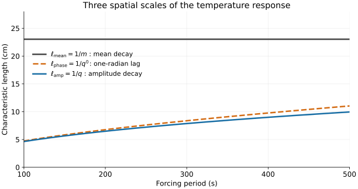
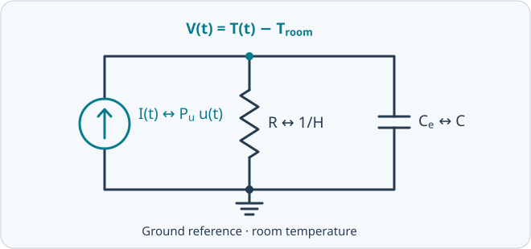

# Module 8, Part I: The Angstrom Method

Module 8 has two linked parts. This page develops and applies the Angstrom
method. Continue with [Part II: Conductivity, Heat Loss, And Final
Synthesis](../lab-10/index.md).

## Purpose

The TEC controller creates a sinusoidal temperature boundary condition at the base of
the aluminum rod. Thermal diffusion causes the oscillation amplitude to
decrease and its phase to lag with distance. Measuring both effects allows you
to separate axial thermal diffusion from heat loss to the air.

The module follows three priorities: obtain a trustworthy six-temperature
record, understand the Angstrom method, and compare experiment with theory.
The [learning objectives](#learning-objectives) state what you must be able to
do. The [S18 experimental overview](#s18-experimental-overview) previews the
measurements and control comparisons so that you can see what the theory must
explain. The detailed experimental instructions follow the theory in
[Stages 1-6](#stage-1-prepare-the-six-channel-measurement-and-live-record).

## Execution Checklist

Work through the steps below. Follow each link for the procedure and theory
checks. Keep the working calculations, plots, and raw records in your module
notes and repository, then use the [A5 reuse map](#a5-reuse-map) to select the
results for your individual account.

| Step | Do | Done when | Save |
| --- | --- | --- | --- |
| [Preparation](#roadmap-and-student-work) | Read the periodic solution and finite-rod derivation, sketch predictions, and prepare the 100 s and 200 s pilot plan. | You can explain the expected spatial decay and lag and present your P3 plan. | Predictions, settings, and working theory checks. |
| [Stage 1](#stage-1-prepare-the-six-channel-measurement-and-live-record) | Verify safety limits, sensor positions, live display, and recording. | Six plausible temperature channels are saved with the required metadata. | Sensor map, calibration record, code checkpoint, and sample file. |
| [Stage 2](#stage-2-explore-uncompensated-sinusoidal-pwm) | Run zero-centered PWM at 300, 200, and 100 s and positive-only PWM at 100 s. Complete the [S18.3 period sweep](#s18-3) and the paired [S18.4 experiment and simulation](#s18-4). | You can explain the effects of period and heating–cooling asymmetry. | Raw records, S18.3 tables and analytical checks, and both S18.4 tables with aligned plots. |
| [Stage 3](#stage-3-establish-and-compare-feedforward-p-and-pi-control) | Compare feedforward, P, and PI, tune PI at 100, 200, and 300 s, and complete the focused 100 s P/PI simulation during S19. | Common-setting measurements show what worked and why. | [Feedforward table](#s18-6), [gain log](#s18-7), [control summary](#s18-8), and [S19 simulation comparison](#focused-control-simulation-for-the-s19-analysis). |
| [Stage 4](#stage-4-pilot-analysis-and-experiment-plan) | Qualify the 100 s and 200 s rod records and finalize sensor positions. | Settling, waveform quality, and measurable amplitude and phase at three or more rod sensors are verified. | Pilot fits, settling criterion, sensor map, and production plan. |
| [Stage 5](#stage-5-production-data) | Acquire or reuse qualifying records at 100, 200, 300, 400, and 500 s. | Each period has at least five complete settled cycles and passes the pilot quality criteria. | Five qualified intervals with raw files and metadata. |
| [Stage 6](#stage-6-spatial-fits) | Fit all five periods and interpret the characteristic lengths. Use one matched run, normally 300 s, for the temperature-history comparisons. | The five-period estimates, uncertainties, residuals, and model checks support your conclusions. | Runnable analysis and rod figures for the [four A5 figure groups](#required-analysis-displays). |
| [A5](#a5-s18-evidence-boundary-control-analysis-and-angstrom-theory) | Explain the selected results in an individual scientific account. | The four questions are answered with traceable evidence in about 4–6 pages. | A5 PDF and repository links. |

<a id="a5-reuse-map"></a>

### How The Stage Work Builds A5

| Existing work | Use in A5 |
| --- | --- |
| S18 evidence table and saved acquisition records | Part 1: link to the existing table and identify the selected runs |
| S18.3 “Check The Derivation”: DEQ verification and analytical/numerical check | Supporting notes for Question 1; cite the result without repeating the calculation |
| S18.3 measured-data comparison, S18.4, and S18.5–S18.8 | Question 1: measured control comparison and what worked and why |
| Focused 100 s P/PI simulation during S19 | A5 Question 1: explanation of integral action and tuning |
| Theory predictions and four finite-rod checks | Questions 2–3: explain the model and reference the working derivation |
| Stage 6 characteristic-length task | Question 2: reuse the measured-parameter plot and its physical interpretation |
| Stages 4–6: selected intervals, spatial fits, uncertainties, and validity checks | Question 3: inference and limits of $\kappa$ and $\nu$ |
| Stage 6 items 3–5: matched run, normally 300 s | A5 Question 4: one theory–experiment–simulation comparison and scientific conclusion |

## Schedule And Due Work

| Session | In class | Due |
| --- | --- | --- |
| S18, Mon. Nov. 2 | Verify six-channel recording and run the raw-PWM and common-setting 100 s control comparisons. Begin the 100 s and 200 s pilots as time permits. | Module 8 home preparation; `P3` prediction and pilot-plan check |
| S19, Wed. Nov. 4 | Finish any remaining control runs and both pilots, complete the focused 100 s control simulation, and begin qualified production acquisition | Pilot-analysis and production-run plan check |
| S20, Mon. Nov. 9 | Complete the five-period production record with the Arduino, Python GUI, and laptop connected | Data-readiness and production-run check |
| S21, Wed. Nov. 11 | Fit spatial decay and phase slopes; infer `kappa` and `nu`; generate the characteristic-length plot | A5 analysis checkpoint |
| S22, Mon. Nov. 16 | Compare experiment, theory, and simulation; test frequency consistency and model validity; repeat measurements if needed | `P4`; formative modeling-app check |

## Outside-Class Workload Budget

The stages generate the analysis and figures; A5 selects and explains that
same work. Do not budget a second derivation, a second set of plots, or new
runs solely for A5. These planning times assume functioning acquisition and
analysis code and use of the scheduled classes for measurements, fitting,
and the focused simulations below. Raise missing data or code problems at
the progress checks rather than treating them as an extra assessment task.

| Session | Work | Planned time |
| --- | --- | ---: |
| S18 | Read the theory, make predictions, and prepare pilot settings and metadata | 90 minutes |
| S19 | Finish the S18.3 checks, pilot analysis, and focused Stage 3 simulation begun in class | 90 minutes |
| S20 | Prepare production filenames, metadata, and data-readiness checks | 30 minutes |
| S21 | Finish spatial fits, uncertainties, and the characteristic-length plot begun in class | 150 minutes |
| S21 | Document and commit the same analysis for the formative checkpoint | 30 minutes |
| S22 | Finish the matched model comparison and validity discussion begun in class | 30 minutes |
| After the stage analysis, before A5 is due | Select existing evidence, write the individual synthesis, and check the submission | 3–4 hours |
| **Total outside class** | **Stage work plus A5, counting reused work once** | **10–11 hours** |

Retain at least three complete settled cycles for the control comparison and
at least five for pilot or production use. A single interval can serve both
when it meets the pilot or production criteria.

Plan production acquisition across the supervised S19–S20 sessions after
the pilots qualify the setup. Five retained cycles at each of 100, 200,
300, 400, and 500 s total **125 minutes**, plus settling, transitions, and
any repeats. Use pilot settling times to budget each segment. Reuse qualifying
pilot or control records under the Stage 5 rule below. If a period fails,
record the reason, revise the settings, and arrange its supervised repeat
with the instructor during the scheduled S22 session for repeat measurements. Bring an
incomplete dataset to the progress check with the missing periods identified.

All required measurements are made while the Arduino is connected to the
laptop and the Python GUI is displaying and saving the data. Do not leave the
apparatus running outside the scheduled protocol or without completing the
safety and data-readiness checks below.

## Learning Objectives

By the end of this module, you should be able to:

1. **Generate and measure the sinusoidally driven TEC temperature:** Sinusoidally heat the TEC using raw open-loop PWM, susceptibility-based feedforward, closed-loop P control, and closed-loop PI control; display and record the TEC and all five rod temperatures with the live GUI; verify the stored file; and preserve sensor positions, units, timestamps, controller settings, and run metadata. **Explain** how the measured base temperature differs among raw PWM, feedforward, P, and PI control in mean error, amplitude, phase lag, waveform distortion, heating-cooling symmetry, and how those differences change with forcing frequency.

2. **Derive and understand the settled-periodic temperature profile:** derive
   the complete Angstrom solution for a finite rod with an insulated tip by
   separating the stationary mean and oscillatory parts, applying the boundary
   conditions, and taking the real part of the complex solution. Explain how
   the finite-rod solution approaches the semi-infinite result. Interpret the
   solution physically in terms of three spatial length scales: the
   mean-temperature decay length $\ell_{\mathrm{mean}}=1/m$, the
   oscillation-amplitude decay length $\ell_{\mathrm{amp}}=1/q$, and the
   one-radian phase-shift length $\ell_{\mathrm{phase}}=1/q'$. Relate these
   scales to one another and to the dimensional parameters $\kappa$, $\nu$,
   and $\omega$ through $m^2=\nu/\kappa$, $m^2=q^2-q'^2$, and
   $2qq'=\omega/\kappa$; express their ratios using the dimensionless frequency
   $\Omega=\omega/\nu$; and fit the measurements to obtain $q$, $q'$,
   $\kappa$, and $\nu$ with units and uncertainty. **Generate and interpret a
   theoretical characteristic-length plot using parameters inferred from your
   own measurements.** Explain which part of $T(x,t)$ each length controls,
   interpret the phase length as the distance for one radian of lag, and use
   the plot to explain the temperature histories and sensor placement.
3. **Compare experiment and theory:** use per-sensor fits, spatial trends,
   residuals, frequency consistency, and the finite-length and
   transverse-Biot checks from Module 7 to judge the one-dimensional model.

## Roadmap And Student Work

The module follows one experimental argument. First establish and verify the
six-channel measurement so that the primary result is a trustworthy set of
temperature histories. Then use the Angstrom method to predict and extract
amplitude decay and phase lag. Finally, compare those measurements with the
model, infer \(\kappa\) and \(\nu\), and test whether the same theory explains
all retained sensors and forcing periods.

**Before S18:** read through the periodic solution, write down your qualitative
predictions, and prepare proposed pilot settings and metadata. This is the
`P3` check. Bring the assigned 100 s and 200 s pilot periods, starting values of \(T_a\) and
\(T_b\), safety limits, and a prediction for how amplitude and phase will
change with distance. This is a planning check, not a separate written
submission.

**One analysis, reused throughout:** Keep the answers to the theory checks,
S18 questions, and Stage 6 tasks in your module notes alongside the code and
figures. These are working steps toward A5, not separate reports. A5 is the
individual synthesis of that work: reuse a calculation, figure, table, or
explanation wherever it answers more than one prompt, and cross-reference it
instead of repeating it. The [A5 reuse map](#a5-reuse-map) identifies where the
stage work contributes. Preserve full calculations and unsuccessful trials in
the repository; select the evidence needed for a concise scientific account.

**In class during S18–S20:** follow the schedule above for the control trials,
pilots, and production runs. Decide from the live data when each response has
settled before changing frequency.

**After the production run during S21-S22:** complete the spatial fits,
uncertainty and residual analysis, and model-validity checks. The `P4` check is
a minimum successful periodic dataset, as defined below, together with sensor
positions and units, acquisition metadata, and a rod-base waveform check. This
is an in-class data-readiness check, not a separate written submission. State
the criterion you used to decide that the response was settled.

### S18 Experimental Overview

A sinusoidal PWM command does not guarantee a sinusoidal temperature. The
raw-PWM, feedforward, P, and PI comparisons reveal what the actuator and
controller contribute to the measured boundary waveform. Along the rod, the
six-temperature record reveals a second question: why does the oscillation
shrink and lag with distance? The Angstrom theory connects these observations
to thermal diffusion and heat loss, and gives predictions to test at more than
one forcing period.

**Keep three temperatures distinct:** $T_{\mathrm{set}}$ is requested;
$T_{\mathrm{TEC}}$ measures the actuator; and `T1` at the first rod hole is the
boundary $T(0,t)$ used in the rod model. The detailed actions begin in
[Stage 1](#stage-1-prepare-the-six-channel-measurement-and-live-record).

## Choose Sensor Positions For The Quantity Being Measured

Module 7 established the geometry and validated six thermistor measurement
chains: one thermistor in the TEC base and five thermistors at measured
positions along the 6061-T6 aluminum rod. Keep the same coordinate origin at
the first rod hole, channel assignments, common-bath result, any optional
correction coefficients, measured diameter, and analysis length \(L\) from the
first hole to the tip. A sensor may be moved to a different hole, but each
measurement configuration must have its own recorded sensor map and position
uncertainties.

The thermistor embedded in the TEC measures the driven actuator, but it is not
the rod boundary at \(x=0\) and is not one of the five rod coordinates. Rod
thermistor 1 in the first hole measures \(T(0,t)\), the boundary condition used
in the Angstrom model. You will use the Angstrom measurement to determine thermal
conductivity rather than substitute a supplied final value. Literature values
of \(k\) may guide planning and model-validity checks.

This choice of origin does not change the Angstrom result. Shifting \(x=0\)
changes the reference amplitude and phase, but the fitted spatial decay and
phase coefficients depend on amplitude ratios, phase differences, and sensor
separations. Use the first hole as \(x=0\) consistently in every plot and fit.

The mean and oscillatory parts require different sensor-placement strategies.
For the course rod, the estimated mean-profile length is relatively long:
$mL\approx1.3$. The stationary mean excess temperature therefore remains
measurable over the full rod. Module 7 already measured this profile using a
full-length sensor configuration and compared it with the finite- and
infinite-rod models. **Do not repeat that measurement in Module 8.** Retain the
Module 7 sensor map, data, and fitted mean-decay coefficient $m$ for comparison
with the oscillatory results.

The oscillatory part decays much faster. Over periods from $100$ to $500$ s,
the estimate is $qL\approx6.5$ to $3.0$. In the semi-infinite approximation,
the oscillation amplitude at the far end would therefore be only
$e^{-qL}\approx0.0015$ to $0.05$ of its value at the base. A full-length sensor
layout would place too many thermistors where the oscillatory signal is very
small.

For the Module 8 Angstrom measurement, begin with `T1` in the first hole and
define that position as $x=0$. Place `T2`-`T5` at approximately 1-inch intervals
in order of increasing $x$. This spacing has produced measurable oscillatory
signals in prior trials while still providing enough separation to resolve
amplitude decay and phase lag. Measure and record every position, and save this
oscillatory-measurement map separately from the full-length mean-profile map
retained from Module 7.

Treat the 1-inch spacing as a starting point, not a permanent requirement.
Collect pilot data at 100 s and 200 s before finalizing the
layout. If the downstream oscillations are too small to fit, move the sensors
closer to the base or closer together. If the amplitudes and phases change too
little between neighboring sensors, spread the sensors farther apart. After
any repositioning, remeasure every $x$ coordinate and update the oscillatory
sensor map before collecting the production data.

In principle, the Angstrom method needs temperatures at only two distinct rod
positions. Five simultaneous rod measurements are preferable because they
provide multiple amplitude and phase differences in one run, support spatial
fits and residual checks, and avoid comparing pairs acquired under different
room or boundary conditions. Use the pilot run to confirm that at least three
rod sensors retain measurable amplitude and phase at every selected frequency.

Before the pilot run, verify that the saved diagram or photograph identifies
the TEC-base channel, the five rod channels, the positive \(x\) direction, all
five measured rod positions, the analysis length from the first hole to the
tip, the overall physical length, and the measured diameter.

## Periodic Solution

**Learning Objective 2 in practice — Derive and understand the
settled-periodic temperature profile.** As you work through this section,
follow the complete finite-rod derivation and connect each equation to the
three observable spatial scales: mean-temperature decay, oscillation-amplitude
decay, and phase shift.


*Historical drawing of Angstrom's method for determining thermal
conductivity. The course replaces the alternating hot and cold reservoirs with
a TEC-controlled sinusoidal boundary temperature.*

Take a few minutes to look at the
[1863 English translation of Angstrom's original work](../../references/angstrom-thermal-conductivity-1863.pdf).
You are not expected to follow every line. Focus on the apparatus, the recorded
observations, and the way the measurements are connected to the theory. Recognize the kinship between Angstrom and ourselves; the scientific process isn't different 165 years later, although the tools have progressed.

### Start With The Rod Equation

Module 7, Part III [introduced this rod model and explained each physical term](../lab-08/index.md#model),
including its units and the definitions of the transport coefficients.

Use excess temperature $\theta=T-T_\infty$ and the rod equation

\[
\frac{\partial\theta}{\partial t}
=\kappa\frac{\partial^2\theta}{\partial x^2}-\nu\theta.
\]

Here $\kappa$ is thermal diffusivity in $\mathrm{m^2/s}$ and $\nu$ is
the lateral heat-loss rate coefficient in $\mathrm{s^{-1}}$. Every term has
units of K/s. We assume constant material properties, linear heat loss,
constant environmental temperature, and a temperature uniform across each
cross section. Module 7 denoted thermal diffusivity by $\alpha$; here
$\kappa\equiv\alpha=k/(\rho c)$. The symbol $T_\infty$ does not mean the
temperature at the other end of the universe. It is the temperature of the
surrounding room, which we treat as a large thermodynamic reservoir whose
temperature is not changed appreciably by the rod. We initially treat the rod
as semi-infinite, with $x\geq0$.

Use the measured temperature `T1` at the analysis base as

\[
\theta(0,t)=\theta_b\cos(\omega t),
\qquad
\omega=\frac{2\pi}{\tau},
\]

where $\tau$ is the period in seconds and $\omega$ is angular frequency in
rad/s. The TEC and its embedded thermistor create and monitor the forcing, but
the measured rod temperature at the first hole supplies this boundary
condition. We seek the settled periodic response after initial transients decay.
If the base oscillates about a mean above room temperature, the full solution
also contains a stationary mean profile. By linearity, we can solve for that
profile and the oscillating component separately; the derivation below gives
the oscillating component.

Before continuing, make a qualitative prediction. Sketch temperature versus
time at the base and at two increasing distances along the rod. Predict which
features remain the same, which change with distance, and what a shorter drive
period should do to the attenuation and phase lag. Return to this sketch after
the derivation and pilot run.

### Preview The Six-Sensor Angstrom Experiment

**Optional preparation.** Open the [interactive six-sensor Angstrom simulator](../../simulators/angstrom-six-sensor/).
This version extends the finite-rod simulator used in Module 7. Select the
Angstrom sinusoidal drive and begin with

\[
T_{\mathrm{set}}(t)=T_a+T_b\sin(\omega t),
\qquad
T_a=40^\circ\mathrm{C},\quad
T_b=16^\circ\mathrm{C},\quad
\tau=200\ \mathrm{s}.
\]

The simulator displays the driven temperature and the live responses at six
positions along the finite rod. Compare their amplitudes and phase delays, and
then change the forcing period to predict which sensor positions will provide
measurable signals in the physical experiment. The simulator labels its six
modeled rod positions `T0`-`T5`; in the apparatus, the embedded `TEC` sensor is
separate and the five rod sensors are named `T1`-`T5`.

Let the response settle into a repeatable periodic state.

This simulated setpoint ranges from $24^\circ\mathrm{C}$ to $56^\circ\mathrm{C}$; it is
an exploration setting, **not** permission to exceed the
$56^\circ\mathrm{C}$ hardware limit.

For each modeled position, estimate the time-averaged temperature
$\overline{T}(x)$, oscillation amplitude $B(x)$, and phase lag relative to
`T0`. Look for four features:

1. The mean excess temperature, $\overline{T}(x)-T_\infty$, falls
   approximately exponentially with position.
2. The oscillation amplitude $B(x)$ also falls approximately exponentially,
   but generally with a different decay coefficient.
3. The phase lag increases monotonically downstream: each successive
   temperature trace reaches corresponding points in its cycle later.
4. Compare the PWM phase with both the requested setpoint and the temperature
   traces. The PWM should generally lead the measured thermal response because
   actuator effort precedes the temperature change it produces. Its phase
   relative to the requested setpoint is not universal: it depends on the
   controller type and gains, the TEC and rod dynamics, and any saturation. A
   P-only command is in phase with the instantaneous error; adding the integral
   term changes the command phase. Measure these phase relationships rather
   than assuming that PWM always leads the setpoint.

Test the two exponential statements by plotting
$\ln[\overline{T}(x)-T_\infty]$ and $\ln B(x)$ against $x$. Compare their
slopes, and inspect whether points near the finite tip depart systematically
from straight lines.

<details markdown="1">
<summary>What model is being simulated?</summary>

This simulator uses the same finite-difference rod and dynamic TEC model as
the Module 7 simulator. Its rod elements obey

\[
\frac{\partial\theta}{\partial t}
=\kappa\frac{\partial^2\theta}{\partial x^2}-\nu\theta,
\qquad \theta=T-T_\infty,
\]

with a finite, zero-flux far tip. The TEC has separate hot- and cold-side
thermal states and includes Peltier transport, Joule heating, internal
conduction, rod contact, and heat-sink loss. A PID controller drives bounded
heating and cooling PWM so that the `T0` sensor follows the requested
sinusoidal setpoint. Each of the six displayed thermistors has the same
first-order sensor lag.

Unlike the semi-infinite analytic solution derived below, the numerical model
retains the finite tip and actuator dynamics. It therefore lets you explore
where the exponential amplitude and phase relations work well and where the
ideal Angstrom assumptions begin to fail.

</details>

### Full Complex-Exponential Derivation

#### Start From The Space-Time Equation

For excess temperature \(\theta(x,t)=T(x,t)-T_\infty\), the semi-infinite rod
obeys

\[
\boxed{
\frac{\partial \theta(x,t)}{\partial t}
=\kappa\frac{\partial^2\theta(x,t)}{\partial x^2}
-\nu\theta(x,t)
},
\qquad x\geq 0.
\]

The periodic boundary conditions are

\[
\theta(0,t)=\theta_b\cos(\omega t),
\qquad
\lim_{x\rightarrow\infty}\theta(x,t)=0.
\]

#### Guess A Complex Exponential

A complex exponential is useful because differentiation returns a constant
times the same function. Guess

\[
\widetilde{\theta}(x,t)=\theta_b e^{-sx}e^{i\omega t}.
\]

The physical temperature is the **real part** of this expression. Because the
equation is linear with real coefficients, the real part of a complex solution
also satisfies the equation. Allowing $s$ to be complex lets us describe both
amplitude decay and phase delay along the rod. At $x=0$, taking the real part
gives the specified cosine boundary condition.

The derivatives are

\[
\frac{\partial\widetilde{\theta}}{\partial t}
=i\omega\widetilde{\theta},
\qquad
\frac{\partial^2\widetilde{\theta}}{\partial x^2}
=s^2\widetilde{\theta}.
\]

Substitution into the rod equation and cancellation of the common exponential
turn the differential equation into algebra:

\[
i\omega=\kappa s^2-\nu,
\qquad
\boxed{s^2=\frac{\nu+i\omega}{\kappa}}.
\]

The two spatial solutions are $e^{-sx}$ and $e^{+sx}$. Choose the square root
with positive real part and discard the growing solution $e^{+sx}$, because
the temperature oscillation must vanish far from the driven end.

#### Separate Amplitude Decay From Phase Delay

Write $s=q+iq'$, with $q>0$ and $q'>0$ for positive driving frequency. The
prime in $q'$ is part of its name, not a derivative. Squaring gives

\[
s^2=q^2-q'^2+2iqq'.
\]

Equating real and imaginary parts with $(\nu+i\omega)/\kappa$ gives

\[
\boxed{q^2-q'^2=\frac{\nu}{\kappa}},
\qquad
\boxed{2qq'=\frac{\omega}{\kappa}}.
\]

To find the two coefficients explicitly, use

\[
(q^2+q'^2)^2=(q^2-q'^2)^2+(2qq')^2
=\frac{\nu^2+\omega^2}{\kappa^2}.
\]

Thus $q^2+q'^2=\sqrt{\nu^2+\omega^2}/\kappa$. Adding and subtracting
the expressions for this sum and for $q^2-q'^2$ gives the amplitude-decay
and phase coefficients, both in inverse meters:

\[
q=\sqrt{\frac{\nu+\sqrt{\nu^2+\omega^2}}{2\kappa}},
\qquad
q'=\sqrt{\frac{-\nu+\sqrt{\nu^2+\omega^2}}{2\kappa}}.
\]

The frequency of the drive therefore sets two useful spatial scales. The
**oscillation-amplitude decay length** $\ell_{\mathrm{amp}}=1/q$ is the distance
over which the oscillation amplitude falls by a factor of $e$. The
**phase-shift length** $\ell_{\mathrm{phase}}=1/q'$ is the distance over which
the oscillation accumulates one radian of phase lag. For comparison, the
stationary temperature profile has mean-decay length
$\ell_{\mathrm{mean}}=1/m=\sqrt{\kappa/\nu}$.



*The three characteristic lengths calculated using the course-rod planning
values $\kappa=6.90\times10^{-5}\ \mathrm{m^2/s}$ and
$\nu=1.30\times10^{-3}\ \mathrm{s^{-1}}$. These are illustrative parameters;
use your measured parameters for your own plot. Longer periods penetrate farther into the rod but produce less phase change per
unit length. Shorter periods produce more phase change per unit length but also
attenuate more rapidly. The experimental period should give both a measurable
amplitude and a resolvable phase difference across several sensors.*

**You must generate your own version of this theoretical plot from your
measurements**, following the [Stage 6 characteristic-length task](#generate-and-interpret-your-characteristic-length-plot).
The supplied figure illustrates the three lengths:
$\ell_{\mathrm{mean}}$, $\ell_{\mathrm{amp}}$, and $\ell_{\mathrm{phase}}$.

#### Take The Real Part

The complex solution can now be written

\[
\widetilde{\theta}(x,t)=\theta_b e^{-qx}e^{i(\omega t-q'x)}.
\]

Taking its real part gives

\[
\boxed{\theta(x,t)=\theta_b e^{-qx}\cos(\omega t-q'x)}.
\]

At every position, temperature oscillates at the imposed frequency. Its
amplitude decreases as $e^{-qx}$ and it lags the base by $q'x$ radians,
corresponding to a time delay $q'x/\omega$. This wave-like pattern is a
diffusive response, not ordinary wave propagation.

Allowing an arbitrary base amplitude $B_0$ and phase $\phi_0$ gives the form
used to fit the experiment:

\[
\theta(x,t)=B_0e^{-qx}\cos(\omega t-q'x+\phi_0).
\]

For the boundary condition chosen above, $B_0=\theta_b$ and $\phi_0=0$.

### Combine The Mean And Oscillatory Solutions

The derivation above gives only the oscillatory part. The imposed boundary
temperature also has a time-independent mean:

\[
T(0,t)=T_a+T_b\cos(\omega t).
\]

Because the rod equation is linear, add the stationary mean profile to the
settled oscillatory response. For a semi-infinite rod, the complete
settled-periodic solution is

\[
\boxed{
T(x,t)=T_\infty
+(T_a-T_\infty)e^{-mx}
+T_b e^{-qx}\cos(\omega t-q'x)
},
\]

where

\[
m=\sqrt{\frac{\nu}{\kappa}},
\qquad
s=q+iq'=\sqrt{\frac{\nu+i\omega}{\kappa}},
\qquad
m^2=q^2-q'^2.
\]

The first exponential describes the time-averaged temperature above room
temperature. The second describes the oscillation about that mean. Thus the
mean and the oscillation amplitude both decrease with position, but generally
with different decay coefficients, $m$ and $q$. This is a **settled periodic
state**, not a time-independent steady state. Using sine instead of cosine only
changes the choice of time origin.

The solution contains three physical length scales:

\[
\ell_{\mathrm{mean}}=\frac{1}{m}=\sqrt{\frac{\kappa}{\nu}},
\qquad
\ell_{\mathrm{amp}}=\frac{1}{q},
\qquad
\ell_{\mathrm{phase}}=\frac{1}{q'}.
\]

Over $\ell_{\mathrm{mean}}$, the mean excess temperature falls by a factor of
$e$. Over $\ell_{\mathrm{amp}}$, the oscillation amplitude falls by a factor of
$e$. Over $\ell_{\mathrm{phase}}$, the oscillation accumulates one radian of
phase lag.

Define the dimensionless driving frequency

\[
\Omega=\frac{\omega}{\nu}.
\]

The three scales are not independent. Dividing the relations for $q$ and $q'$
by $m=\sqrt{\nu/\kappa}$ gives

\[
\frac{q}{m}
=\sqrt{\frac{1+\sqrt{1+\Omega^2}}{2}},
\qquad
\frac{q'}{m}
=\sqrt{\frac{-1+\sqrt{1+\Omega^2}}{2}}.
\]

Equivalently, $\ell_{\mathrm{amp}}/\ell_{\mathrm{mean}}=m/q$ and
$\ell_{\mathrm{phase}}/\ell_{\mathrm{mean}}=m/q'$. For a finite rod, the
dimensionless lengths $mL$, $qL$, and $q'L$ state how many mean-decay,
amplitude-decay, and one-radian phase-shift lengths fit within the rod.

<details class="note" markdown="1">
<summary><strong>Popup: Estimate The Three Dimensionless Lengths For The Course Rod</strong></summary>

Use the planning values

\[
L=0.300\ \mathrm{m},\qquad
d=0.0127\ \mathrm{m},\qquad
h=10\ \mathrm{W\,m^{-2}K^{-1}},
\]

and the 6061-T6 aluminum properties

\[
k=167\ \mathrm{W\,m^{-1}K^{-1}},\qquad
\rho=2700\ \mathrm{kg\,m^{-3}},\qquad
c=896\ \mathrm{J\,kg^{-1}K^{-1}}.
\]

For a circular rod,

\[
\kappa=\frac{k}{\rho c}=6.90\times10^{-5}\ \mathrm{m^2\,s^{-1}},
\qquad
\nu=\frac{4h}{\rho cd}=1.30\times10^{-3}\ \mathrm{s^{-1}}.
\]

The mean-profile decay coefficient and dimensionless rod length are

\[
m=\sqrt{\frac{\nu}{\kappa}}=4.34\ \mathrm{m^{-1}},
\qquad
mL=1.30.
\]

Thus the rod contains about 1.3 mean-decay lengths, independent of forcing
frequency. For each forcing period $\tau$, calculate $\omega=2\pi/\tau$ and

\[
q=\sqrt{\frac{\nu+\sqrt{\nu^2+\omega^2}}{2\kappa}},
\qquad
q'=\sqrt{\frac{-\nu+\sqrt{\nu^2+\omega^2}}{2\kappa}}.
\]

| Period $\tau$ (s) | $mL$ | $qL$ | $q'L$ (rad) | Full $2\pi$ phase shifts, $q'L/(2\pi)$ |
| ---: | ---: | ---: | ---: | ---: |
| 100 | 1.30 | 6.47 | 6.33 | 1.01 |
| 200 | 1.30 | 4.62 | 4.43 | 0.71 |
| 300 | 1.30 | 3.81 | 3.58 | 0.57 |
| 400 | 1.30 | 3.34 | 3.07 | 0.49 |
| 500 | 1.30 | 3.01 | 2.72 | 0.43 |

At every period in this range, $qL>mL$. Therefore
$\ell_{\mathrm{amp}}=1/q$ is shorter than
$\ell_{\mathrm{mean}}=1/m$: the oscillation amplitude decays more rapidly with
position than the average excess temperature. At $100$ s, the rod spans about
one complete $2\pi$ spatial phase shift. At $500$ s, it spans about $0.43$ of a
complete phase shift. Longer-period oscillations penetrate farther and
accumulate less phase lag across the rod.

The semi-infinite model would predict a base-to-tip oscillation-amplitude ratio
$e^{-qL}$ ranging from about $0.0015$ at $100$ s to $0.049$ at $500$ s. These
small values explain why the oscillatory thermistors should be concentrated
near the base. Because the physical rod is finite, measurements near the tip
should ultimately be compared with the finite-rod solution rather than treated
as exact semi-infinite predictions.

</details>

### Guided Student Solution: The Finite Insulated-Tip Rod

For a finite rod, let the analysis base be at $x=0$ and the insulated tip be at
$x=L$. The boundary conditions are

\[
T(0,t)=T_a+T_b\cos(\omega t),
\qquad
\left.\frac{\partial T}{\partial x}\right|_{x=L}=0.
\]

**Step 1: Separate the mean and oscillatory parts.** Write

\[
T(x,t)=T_\infty+\overline{\theta}(x)
+\operatorname{Re}\!\left\{\widetilde{\theta}_{\mathrm{osc}}(x,t)\right\}.
\]

The stationary part obeys

\[
\frac{d^2\overline{\theta}}{dx^2}-m^2\overline{\theta}=0,
\qquad
\overline{\theta}(0)=T_a-T_\infty,
\qquad
\overline{\theta}'(L)=0.
\]

Use the [finite insulated-tip solution from Module 7](../fin-design-derivation/index.md#energy-balance-and-differential-equation)
to obtain

\[
\boxed{
\overline{\theta}(x)
=(T_a-T_\infty)
\frac{\cosh[m(L-x)]}{\cosh(mL)}
}.
\]

**Step 2: Solve the oscillatory spatial problem.** Use

\[
\widetilde{\theta}_{\mathrm{osc}}(x,t)=F(x)e^{i\omega t}.
\]

Substitution into the rod equation gives

\[
F''-s^2F=0,
\qquad
s^2=\frac{\nu+i\omega}{\kappa}.
\]

Apply

\[
F(0)=T_b,
\qquad
F'(L)=0.
\]

The finite-rod oscillatory solution is

\[
\boxed{
\widetilde{\theta}_{\mathrm{osc}}(x,t)
=T_b
\frac{\cosh[s(L-x)]}{\cosh(sL)}
e^{i\omega t}
}.
\]

**Step 3: Combine the two pieces and take the real part.** The complete
finite-rod settled-periodic solution is

\[
\boxed{
\begin{aligned}
T(x,t)=T_\infty
&+(T_a-T_\infty)
\frac{\cosh[m(L-x)]}{\cosh(mL)}
\\
&+\operatorname{Re}\!\left\{
T_b\frac{\cosh[s(L-x)]}{\cosh(sL)}e^{i\omega t}
\right\}.
\end{aligned}
}
\]

Define

\[
\frac{\cosh[s(L-x)]}{\cosh(sL)}
=A(x)e^{-i\phi(x)}.
\]

Here $A(x)$ is the dimensionless oscillation amplitude relative to the base,
so the temperature-oscillation amplitude is $T_bA(x)$, and $\phi(x)$ is the
phase lag. With $s=q+iq'$, its explicit magnitude is

\[
A(x)=\left|\frac{\cosh[s(L-x)]}{\cosh(sL)}\right|
=\sqrt{\frac{\cosh[2q(L-x)]+\cos[2q'(L-x)]}
{\cosh(2qL)+\cos(2q'L)}}.
\]

The phase lag can be written as the semi-infinite phase $q'x$ plus a
finite-tip correction:

\[
\boxed{\phi(x)=q'x+\Delta(L-x)-\Delta(L)},
\]

where

\[
\boxed{
\Delta(y)=\tan^{-1}\!\left[
\frac{\sin(2q'y)}{e^{2qy}+\cos(2q'y)}
\right]
}.
\]

To obtain this form, factor the complex amplitude ratio as

\[
A(x)e^{-i\phi(x)}
=e^{-(q+iq')x}
\frac{1+e^{-2(q+iq')(L-x)}}{1+e^{-2(q+iq')L}}.
\]

In particular, $A(0)=1$ and $\phi(0)=0$. The complete real temperature
solution is therefore

\[
\boxed{
T(x,t)=T_\infty
+(T_a-T_\infty)\frac{\cosh[m(L-x)]}{\cosh(mL)}
+T_bA(x)\cos[\omega t-\phi(x)]
}.
\]

This form directly parallels the semi-infinite solution: the mean profile,
oscillation amplitude $T_bA(x)$, and phase lag $\phi(x)$ remain separate.
For $mL\gg1$ and $qL\gg1$, at positions sufficiently far from the tip
($m(L-x)\gg1$ and $q(L-x)\gg1$),

\[
\frac{\cosh[m(L-x)]}{\cosh(mL)}\longrightarrow e^{-mx},
\qquad
A(x)\longrightarrow e^{-qx},
\qquad
\phi(x)\longrightarrow q'x=\frac{x}{\ell_{\mathrm{phase}}}.
\]

For the finite rod, $\phi(x)$ depends on both $q$ and $q'$ and is not exactly
proportional to distance. At the insulated tip, $A'(L)=0$ and
$\phi'(L)=0$, consistent with zero spatial temperature gradient.

The spatial parameters $m$, $q$, and $q'$ are defined above by
$m^2=\nu/\kappa$, $q^2-q'^2=\nu/\kappa$, and
$2qq'=\omega/\kappa$, with $q,q'>0$.

**Checks for you to complete:**

**Check 1.** Set $x=0$ and verify that the solution gives
$T(0,t)=T_a+T_b\cos(\omega t)$.

**Check 2.** Differentiate with respect to $x$ and verify that both
contributions have zero slope at $x=L$.

**Check 3.** Show that when $mL\gg1$ and $qL\gg1$,

\[
\frac{\cosh[m(L-x)]}{\cosh(mL)}\rightarrow e^{-mx},
\qquad
\frac{\cosh[s(L-x)]}{\cosh(sL)}\rightarrow e^{-sx}.
\]

Thus the finite solution reduces to the semi-infinite solution above.

**Check 4.** Explain why data near the tip are the most sensitive to the
difference between the finite and semi-infinite models.

### Recover Diffusivity And Heat Loss From Measurements

For two sensors separated by $\Delta x=x_2-x_1>0$, let their oscillation
amplitudes be $B_1>B_2$, and let the downstream sensor lag by
$\Delta\phi=\phi_1-\phi_2>0$ radians after phase unwrapping. Then

\[
q=\frac{\ln(B_1/B_2)}{\Delta x},
\qquad
q'=\frac{\Delta\phi}{\Delta x}.
\]

With several sensors, fit the slopes of log amplitude and unwrapped phase
versus position. Rearranging the real- and imaginary-part equations gives
the useful inverse relations:

\[
\kappa=\frac{\omega}{2qq'},
\qquad
\nu=\kappa(q^2-q'^2).
\]

This is an important experimental advantage of the Angstrom method. Thermal
conductivity follows directly from the product of the measured amplitude-decay
and phase slopes:

\[
\boxed{k=\rho c\kappa
=\rho c\frac{\omega}{2qq'}}.
\]

Determining \(k\) therefore does **not** require an independent measurement of
the convective coefficient \(h\) or the total heat lost from the rod. Such a
measurement would be difficult because convection depends on airflow,
orientation, surface condition, and temperature. Instead, the amplitude and
phase measurements contain enough independent information to separate axial
diffusion from convective side loss.

<details markdown="1">
<summary>Numerical sanity check</summary>

For example, suppose a 100-second run gives
\(\omega=0.0628\ \mathrm{rad/s}\), \(q=25\ \mathrm{m^{-1}}\), and
\(q'=18\ \mathrm{m^{-1}}\). Then

\[
\kappa=\frac{0.0628}{2(25)(18)}
=6.98\times10^{-5}\ \mathrm{m^2/s},
\]

and

\[
\nu=\kappa(25^2-18^2)
=2.10\times10^{-2}\ \mathrm{s^{-1}}.
\]

Use this only as a unit and order-of-magnitude check; it is not a supplied
result for the course rod.

</details>

The second inverse relation separately gives the side-loss rate \(\nu\), from
which the convective coefficient \(h\) can also be inferred. Here \(\rho\) is
density in \(\mathrm{kg/m^3}\) and \(c\) is specific heat capacity in
\(\mathrm{J/(kg\,K)}\), so \(k\) has units \(\mathrm{W/(m\,K)}\).

As a check, with no lateral loss, $\nu=0$, so

\[
q=q'=\sqrt{\frac{\omega}{2\kappa}}.
\]

Positive lateral heat loss makes $q>q'$. Therefore a fitted result with
\(q\leq q'\), a negative \(\nu\), or strongly frequency-dependent
\(\kappa\) is evidence to investigate the data, uncertainty, settling
criterion, or model assumptions rather than a number to repair silently. A shorter driving period produces
stronger attenuation and phase change per unit distance. These expressions
describe the settled periodic response; they do not include startup transients.
A finite rod generally requires both spatial exponentials to satisfy its
far-end boundary condition.

These equations use a one-dimensional, semi-infinite rod. Before selecting
sensors for the fit, carry forward the finite-length error and transverse-Biot
checks from Module 7. State which sensors and conditions satisfy your chosen
approximation tolerances, and then use the measured residuals and
frequency-consistency test to determine whether those approximations were
adequate in practice.

## Experimental Notation

| Symbol or channel | Meaning |
| --- | --- |
| \(T_\infty\) | Measured room temperature, treated as the surrounding thermal reservoir |
| \(T_{\mathrm{set}}(t)\) | Requested temperature waveform; distinct from both measured temperatures below |
| \(T_a\) | Requested mean TEC setpoint temperature |
| \(T_b\) | Requested TEC setpoint amplitude |
| \(T_{\mathrm{TEC}}\) or `TEC` | Temperature measured by the thermistor embedded in the TEC base |
| \(T(0,t)\) or `T1` | Temperature at the first rod hole, which defines the analysis boundary \(x=0\) |
| `T2`-`T5` | Temperatures at the four downstream rod sensors |
| \(a_i\) | Mean temperature obtained by fitting rod sensor \(i\) |
| \(B_i\) | Oscillation amplitude obtained by fitting rod sensor \(i\) |
| \(\phi_i\) | Unwrapped phase obtained by fitting rod sensor \(i\) |
| \(\tau\), \(\omega=2\pi/\tau\) | Forcing period and angular frequency |
| \(q\) | Spatial amplitude-decay coefficient obtained from \(\ln B_i\) versus \(x_i\) |
| \(q'\) | Spatial phase coefficient obtained from unwrapped \(\phi_i\) versus \(x_i\) |
| \(\kappa\) | Thermal diffusivity inferred from \(q\), \(q'\), and \(\omega\) |
| \(\nu\) | Convective side-loss rate inferred from \(q\), \(q'\), and \(\omega\) |
| \(r=\chi_{\mathrm{heat}}/\chi_{\mathrm{cool}}\) | Measured heating-to-cooling response ratio used in the feedforward compensation |

In this module, \(\tau\) denotes the **forcing period**. It is not the thermal
relaxation time denoted by \(\tau\) in Module 6.

<a id="common-time-fit"></a>

## Common Time Fit For The Stage Analysis

Use the same sinusoidal fit for the raw-PWM comparisons, controller trials,
pilots, and production analysis. Select a settled interval and use the
recorded forcing frequency.

For each sensor, fit

\[
T_i(t)=a_i+B_i\cos(\omega t+\phi_i).
\]

With this convention, a downstream phase lag appears as a smaller unwrapped
value of $\phi_i$. Therefore a plot of unwrapped phase versus position has
slope $-q'$. Reversing the sinusoid convention reverses the phase signs but
must not change the inferred physics.

Report the fitted mean, fundamental amplitude, and phase with uncertainty,
and inspect the residuals. For lag relative to PWM or setpoint, fit that
reference using the same time origin. Compute the lag as
$\phi_{\mathrm{reference}}-\phi_{\mathrm{response}}$, choosing the phase
branch consistently. For controller comparisons,
also report mean tracking error, amplitude ratio, RMS tracking error, and
saturation. For spatial fits, reference phases to measured rod-boundary T1
and unwrap them consistently with position.

<a id="s18-in-class-procedure"></a>

## Experimental Stages

**S18 control objective:** Find operating conditions and controller gains that
make the **measured TEC temperature** follow

\[
T_{\mathrm{TEC}}(t)\approx T_{\mathrm{set}}(t)
=40^\circ\mathrm{C}+16^\circ\mathrm{C}\sin\!\left(\frac{2\pi t}{\tau}\right)
\]

using forcing periods of $100$, $200$, or $300\ \mathrm{s}$.
Test $100$, $200$, and
$300\ \mathrm{s}$: seek a measured mean of $40^\circ\mathrm{C}$, a fixed
measured amplitude of $16^\circ\mathrm{C}$, and a phase shift relative to the
setpoint as close to zero as possible. A sinusoidal command alone does not
establish that the measured temperature meets this goal.

Use the open-loop and P-only trials to identify why they fall short of this
tracking objective under the tested conditions. Then tune PI control: enabling
integral action is not enough, and gains that work at one period may need
adjustment at another. Demonstrate what worked with measured amplitude, phase,
mean error, and waveform quality, and explain why. Distinguish the measured
TEC temperature from the rod-boundary temperature `T1`; continue to use `T1`
for the Angstrom analysis. The existing temperature limits remain in force;
if they prevent the full target from being achieved, document the limitation
and any reduced-amplitude trial rather than claiming that it meets the target.

Work through **S18.1-S18.10 in order in Stages 1-4**. Stages 5-6 use
the pilot results to acquire the production record and compare it with theory.

<a id="s18-evidence-table"></a>

Maintain an **S18 evidence table** with one row for each action: cite the saved
file, figure, code checkpoint, measurement, or written observation; record the
principal result; and describe any departure from the procedure. This table
is linked from Part 1 of A5 without being rewritten. A checked box by itself
is not evidence.

**Required experimental core:** the raw-PWM and feedforward/P/PI comparisons,
the 100 s and 200 s pilot checks, and production records at 100, 200, 300,
400, and 500 s. Each production period must contain at least five complete
settled cycles with measurable amplitude and phase at three or more rod
sensors. The automated frequency schedule and global fit are optional
extensions.

## Stage 1: Prepare The Six-Channel Measurement And Live Record

**Goal:** Verify the measurement and recording system before energizing the TEC.

**Do:** Complete S18.1-S18.2 with the TEC output off.

<a id="s18-1"></a>

### S18.1: Verify The Measurement And Safety Limits

Verify the `TEC` and `T1`-`T5` channel labels, units, common-bath result,
optional correction coefficients, measured sensor positions, and safety
limits. Begin with `T1` in the first rod hole at $x=0$ and `T2`-`T5` at
approximately 1-inch intervals in order of increasing distance. Use the
[sensor-placement reasoning](#choose-sensor-positions-for-the-quantity-being-measured)
above to document the initial map and later pilot-based changes.

For every trial, keep the measured rod-base temperature at or below
$56^\circ\mathrm{C}$, retain margin for overshoot, and use no forcing period
shorter than $100\ \mathrm{s}$. Preserve the existing safety limits and physical
thermal cutoff. Stop the run if a safety limit or the cutoff is reached.

<a id="s18-2"></a>

### S18.2: Verify The Live Display And Saved Record

Connect the Arduino to the laptop and start the Python GUI. Verify the live
display and timestamped local file against the requirements below before
proceeding.

Revise the Arduino sketch and Python GUI so that one serial record contains, at
minimum,

```text
time_ms,run_state,control_mode,step,Ta_C,Tb_C,period_s,setpoint_C,feedforward_pwm,TEC_C,T1_C,T2_C,T3_C,T4_C,T5_C,controller_pwm,heating_to_cooling_ratio,signed_pwm
```

The GUI must display the TEC thermistor and all five rod thermistors live,
display the requested setpoint, control mode, and PWM output, and save a local
copy of every complete record it receives. Fields that do not apply in the
selected control mode must have a documented placeholder rather than changing
the record structure. The Arduino must use one documented
`Serial.print()` record format throughout the experiment.

Preserve every startup transient, control-mode change, frequency transition,
and safety event in the same documented record. Do not replace raw data with a
cleaned file. The `step` field identifies the active run segment even when
frequency changes are selected manually.

<details markdown="1">
<summary>Suggested Copilot prompts for the Arduino sketch and Python GUI</summary>

For the existing tested Arduino sketch:

> Extend this sketch without removing its working PI control or safety limits.
> Add two diagnostic raw-PWM modes: `u = ub*sin(omega*t)`, which alternates
> between positive and negative PWM about room temperature, and
> `u = ua + ub*sin(omega*t)`, constrained by `ua > ub > 0`, which remains on
> the heating branch with a mean TEC temperature near 40 C. Do not apply the
> heating-cooling compensation in either diagnostic mode. Also add selectable
> susceptibility-based feedforward, proportional-only, and PI modes for the
> corrected comparison. Calculate the feedforward PWM offset and amplitude from the measured heating
> slope and room temperature as in S18.5. Verify that the command stays on the
> heating branch and within the allowed PWM range.
> Print one documented CSV record containing elapsed milliseconds, operating
> state, control mode, run segment, requested sinusoid parameters, setpoint,
> feedforward command, TEC temperature, five rod temperatures, raw controller
> command, cooling compensation ratio, and applied signed PWM. Compute the
> selected signed P or PI command, multiply negative commands by the measured
> ratio $r=\chi_h/\chi_c$, and then apply PWM saturation, direction
> selection, safety limits, and anti-windup. Never energize both H-bridge
> directions. Use one documented `Serial` record format for the live GUI.

For the existing tested Python GUI:

> Extend this GUI without removing its current controls. Parse and validate the
> new CSV record, display the TEC and five rod thermistors live on a common time
> axis, display control mode, setpoint, and PWM, report malformed or missing records, and save
> every unmodified valid record to a timestamped local CSV file.

</details>

**Stop when:** All six channels update plausibly, the saved file contains the
documented complete records, and the controls and safety limits are ready.

**Save:** The sensor map and calibration record, acquisition code checkpoint,
sample raw file, and evidence for S18.1-S18.2.

## Stage 2: Explore Uncompensated Sinusoidal PWM

**Goal:** Observe how the actuator responds before compensating its unequal
heating and cooling response.

**Do:** Complete four runs in the two raw-PWM modes below while displaying and saving all
six temperatures. Use the $300\ \mathrm{s}$ trial as the initial safety check,
then keep the selected PWM amplitude fixed while testing the shorter periods.
Retain the safety limits established in Stage 1.

<a id="s18-3"></a>

### S18.3: Apply Zero-Centered Sinusoidal PWM

#### Experiment
First, sinusoidally drive the
signed PWM command in the Arduino:

\[
\boxed{u(t)=u_a+u_b\sin(\omega t)},
\qquad -255\leq u(t)\leq255.
\]

Here $\omega=2\pi/\tau$, where $\tau$ is the forcing period.
The sign selects heating or cooling; $|u|$ gives the PWM magnitude from 0 to
255. Follow this protocol:

1. Measure and record room temperature and verify the signed-PWM convention.
2. Set $u_a=0$, begin near room temperature, and apply the $300\ \mathrm{s}$
   period with $u_b=50$ PWM counts as an initial value. Start with the longest
   period because it is expected to give the largest temperature excursion.
   Keep the Stage 1
   safety limits active. If the software cutoff is approached, reduce $u_b$
   until the measured temperature remains safely below it.
3. Keep that selected  value of $u_b$ fixed and collect settled records at
   periods of $300$, $200$, and $100\ \mathrm{s}$. Record the applied PWM and
   all six temperatures as a function of time at each period. This data will help guide you in designing the Angstrom experiment that follows.

#### Experimental analysis

1. Plot the
measured TEC temperature and signed PWM on aligned time axes. Look for unequal
heating and cooling excursions, phase lag, and departures from a sine wave.

2. Fit the TEC temperature data to a sine function. Find the mean temperature, the amplitude and the phase of the temperature relative to the PWM signal.


3. Make a table of the fitted values:

| Period (s) |  (1) Mean minus room (°C) | (2) Amplitude (°C) | (3) Phase lag (°) |
| ---: |  ---: | ---: | ---: |
| 100 |  | | |
| 200 |  | | |
| 300 |  | | |


#### Simulate the time-varying temperature

Open the [Module 6 one-lump model](../../simulators/angstrom-six-sensor/index.html?s18=3).
Set room and initial temperatures to $22^\circ\mathrm{C}$ and the thermal
relaxation time to $80\ \mathrm{s}$. Keep $\chi_h=0.46\ ^\circ\mathrm{C/PWM}$,
$u_a=0$, and your selected PWM amplitude $u_b$ fixed across all six runs.

For each row, set the period and $\chi_c$, click **Apply / Reset**, then **Run**.
From the **Settled response** readout, record **(1) mean minus room temperature**,
**(2) fundamental amplitude**, and **(3) phase lag** in the table. The amplitude and phase lag describe the fundamental, the sinusoidal
component at the PWM frequency.

| Period (s) | $\chi_c$ (°C/PWM) | (1) Mean minus room (°C) | (2) Amplitude (°C) | (3) Phase lag (°) | (4) Residual amplitude (°C) |
| ---: | ---: | ---: | ---: | ---: | ---: |
| 100 | 0.23 | | | | |
| 100 | 0.46 | | | | |
| 200 | 0.23 | | | | |
| 200 | 0.46 | | | | |
| 300 | 0.23 | | | | |
| 300 | 0.46 | | | | |

With zero-centered PWM, $u(t)=u_b\sin(\omega t)$, where $\omega=2\pi/\tau$.
The one-lump model weights the positive and negative halves by different
susceptibilities. The resulting thermal forcing is

\[
\chi(u)u
=\frac{u_b}{2}(\chi_h+\chi_c)\sin(\omega t)
+\frac{u_b}{2}(\chi_h-\chi_c)|\sin(\omega t)|.
\]

The absolute-value term repeats every half period. It contributes a mean
shift and even harmonics, starting at $2\omega$. The PWM command itself
oscillates at $\omega$. The thermal response damps the faster harmonics,
so the temperature can look nearly sinusoidal even when its mean shifts.

For each run, select **Show settled PWM, temperature, and residual**.
The residual is the simulated temperature minus its fitted mean and
fundamental sinusoid. Record its **(4) amplitude**, defined as half its
peak-to-peak range. Compare that value with the fundamental amplitude to
assess the degree of distortion. Save the aligned plots for both
susceptibility settings at one common period. Use the plots to check
whether the residual repeats twice per PWM cycle when $\chi_h\ne\chi_c$.
For $\chi_h=\chi_c$, the absolute-value term vanishes, so the settled
residual amplitude should be zero up to numerical error.

At fixed period, what changes when $\chi_c$ changes? At fixed $\chi_c$,
how do mean temperature, amplitude and phase lag change with period? After the derivation,
use the boxed solution to explain the equal-susceptibility rows.

#### Derive The Response For Equal Heating And Cooling Susceptibilities

First assume $\chi_h=\chi_c=\chi>0$. Since $u$ is signed, the same positive
$\chi$ multiplies $u$ on both branches: positive PWM heats and negative PWM
cools. Equivalently, susceptibilities written as $+\chi$ and $-\chi$ would
multiply the unsigned magnitude $|u|$.

The [Module 6 one-lump model](../lab-06/index.md) treats the TEC face as
a single body at temperature $T(t)$. Its energy balance is

\[
C\frac{dT}{dt}=P_u u(t)-H\bigl(T-T_{\mathrm{room}}\bigr).
\]

Here $C$ is the thermal capacitance in J/K, $H$ is the thermal conductance
to the room in W/K, and $P_u$ is the thermal power per signed PWM count
in W/count. Equal heating and cooling susceptibilities give the same
positive $P_u$ on both branches.

Divide by $H$ and define $\tau_{\mathrm{th}}=C/H$ and $\chi=P_u/H$.
With constant room temperature, set $\theta(t)=T(t)-T_{\mathrm{room}}$,
so $d\theta/dt=dT/dt$. For zero-centered PWM,
$u(t)=u_b\sin(\omega t)$, the balance becomes

<a id="eq-s18-3-1"></a>

\[
\tau_{\mathrm{th}}\dot\theta+\theta
=\chi u_b\sin(\omega t).
\tag{S18.3.1}
\]

Try the particular solution

\[
\theta_p(t)=a\sin(\omega t)+b\cos(\omega t).
\]

Substitution and matching the sine and cosine coefficients gives

\[
a-\omega\tau_{\mathrm{th}}b=\chi u_b,
\qquad
b+\omega\tau_{\mathrm{th}}a=0.
\]

Therefore,

\[
a=\frac{\chi u_b}{1+(\omega\tau_{\mathrm{th}})^2},
\qquad
b=-\frac{\chi u_b\omega\tau_{\mathrm{th}}}
{1+(\omega\tau_{\mathrm{th}})^2}.
\]

Here $T(t)$ is the one-lump prediction for the temperature of the TEC's
controlled face.

Adding the homogeneous solution gives the complete temperature history:

\[
\boxed{
T(t)=T_{\mathrm{room}}
+\frac{\chi u_b}{\sqrt{1+(\omega\tau_{\mathrm{th}})^2}}
\sin(\omega t-\delta)
+C e^{-t/\tau_{\mathrm{th}}}
},
\qquad
\delta=\tan^{-1}(\omega\tau_{\mathrm{th}}).
\]

The initial temperature determines $C$. If $T(0)=T_{\mathrm{room}}$, then

\[
C=\frac{\chi u_b\omega\tau_{\mathrm{th}}}
{1+(\omega\tau_{\mathrm{th}})^2}.
\]

After the exponential transient decays, the temperature oscillates about room
temperature with amplitude $T_{\mathrm{amp}}$ and phase lag $\delta$ relative
to the PWM:

\[
\boxed{T_{\mathrm{amp}}=
\frac{\chi u_b}{\sqrt{1+(\omega\tau_{\mathrm{th}})^2}}},
\qquad
\Delta t_{\mathrm{lag}}=\frac{\delta}{\omega}.
\]

The one-lump model acts as a **first-order low-pass filter**, like a current
source driving a parallel RC circuit. The node voltage represents the TEC
temperature above room temperature, $V(t)=T(t)-T_{\mathrm{room}}$, and the
source current $I(t)$ represents the signed thermal power $P_u u(t)$.



Kirchhoff's current law gives

\[
I(t)=C_{\mathrm e}\frac{dV}{dt}+\frac{V(t)}{R}
\quad\longleftrightarrow\quad
P_u u(t)=C\frac{dT}{dt}+H\bigl(T(t)-T_{\mathrm{room}}\bigr).
\]

The electrical capacitance $C_{\mathrm e}$ represents thermal capacitance
$C$, and the resistance $R$ represents thermal resistance $1/H$. Thus
the electrical time constant $RC_{\mathrm e}$ corresponds to
$\tau_{\mathrm{th}}=C/H$.

At low frequencies ($\omega\tau_{\mathrm{th}}\ll1$), the TEC nearly follows its
instantaneous equilibrium temperature, with amplitude close to $\chi u_b$
and little phase lag. At high frequencies ($\omega\tau_{\mathrm{th}}\gg1$),
the temperature has less time to respond. The amplitude falls approximately
as $\chi u_b/(\omega\tau_{\mathrm{th}})$, and the phase lag approaches
$90^\circ$. At $\omega=1/\tau_{\mathrm{th}}$, the amplitude is $1/\sqrt{2}$
of its low-frequency value. This filtering also explains why the
$2\omega$ component in the unequal-susceptibility case is attenuated more
than the fundamental.

#### Check The Derivation

1. Substitute the complete solution into [Eq. (S18.3.1)](#eq-s18-3-1)
   and verify that $T(0)=T_{\mathrm{room}}$. Explain what the exponential
   term contributes during startup.
2. Use the equal-susceptibility run at $300\ \mathrm{s}$ to compare the
   numerical trace with the dashed analytical overlay. Show startup and
   a settled cycle from the same run. Save the CSV before changing settings
   if you need to recover startup after it scrolls off the chart.

#### Compare The Simulation With Your Measurements

Compare the measured fundamental amplitudes at all three periods. Did
holding the PWM amplitude fixed produce the same temperature amplitude?

Use the 100 s run for a model–experiment comparison. In the one-lump
model, use your measured room and initial temperatures, $\chi_h$, $\chi_c$,
and $\tau_{\mathrm{th}}$. Match the applied PWM amplitude and period. Overlay
the simulated and measured TEC temperatures on a common time axis. Compare
their settled means, fundamental amplitudes, and phase lags relative to PWM.
Use sinusoidal-fit residuals to assess waveform distortion. Which features
does the unequal-susceptibility model reproduce, and where does it fall short?

<a id="s18-4"></a>

### S18.4: Apply Positive-Only Sinusoidal PWM

#### Experiment

Use the settled 100 s zero-centered run from [S18.3](#s18-3) as your
baseline. Keep the 100 s period and the same PWM amplitude $u_b$ for the
positive-only trial. The shortest period gives the smallest predicted
temperature swing at fixed $u_b$, leaving more room below the cutoff. Adjust $u_a$ to bring the mean TEC temperature near
$40^\circ\mathrm{C}$ while keeping  PWM positive, e.g., $0<u_a-u_b$ and $u_a+u_b\leq255$, and adjusting $u_b$ to keep the maximum temperature below your safety cutoff.
Verify that the recorded PWM remains positive and unclipped. Keep the
Stage 1 safety limits active. If you must lower $u_b$ for safety, record
the change and account for it in your comparison.

Check whether positive-only PWM produces a nearly sinusoidal TEC temperature.

Plot measured TEC temperature and signed PWM on aligned time axes. Use the
[common time fit](#common-time-fit) on the settled intervals. Fill in the
table using your S18.3 baseline and S18.4 trial. Take residual amplitude as half the residual's peak-to-peak range.

| 100 s drive | $u_a$ (PWM) | $u_b$ (PWM) | Fundamental amplitude (°C) | Residual amplitude (°C) |
| --- | ---: | ---: | ---: | ---: |
| Zero-centered | 0 | | | |
| Positive-only | | | | |

#### Simulate the time-varying temperature

Open the [Module 6 one-lump model](../../simulators/angstrom-six-sensor/index.html?s18=3).
Simulate both 100 s drives using the applied $u_a$ and $u_b$ from the
experimental table. Use the same measured room temperature, susceptibilities,
and thermal time constant for both simulations. For each run, click
**Apply / Reset**, then **Run**. Once the **Settled response** appears,
record the fundamental amplitude.
Select **Show settled PWM, temperature, and residual** and record the
amplitude of the residual.

| 100 s drive | $u_a$ (PWM) | $u_b$ (PWM) | Fundamental amplitude (°C) | Residual amplitude (°C) |
| --- | ---: | ---: | ---: | ---: |
| Zero-centered | 0 | | | |
| Positive-only | | | | |

#### Compare the experiment and simulation

Did positive-only PWM produce a more sinusoidal temperature response?
Use the residuals from both tables to support your answer and describe any
remaining distortion.

These raw-PWM trials establish how the actuator responds in open loop.
Reaching a mean near $40^\circ\mathrm{C}$ sets up the Stage 3 comparison,
where amplitude and phase also matter.

**Save:** The raw records, $u_a$, $u_b$, period, room temperature, PWM and temperature
plots, predictions, and observations for S18.3-S18.4. Save both S18.4
tables and the aligned simulation plots with your comparison.

<a id="stage-1-establish-the-boundary-condition"></a>

## Stage 3: Establish And Compare Feedforward, P, And PI Control

**Goal:** Make the measured TEC temperature track the requested $40^\circ\mathrm{C}$
mean and fixed $16^\circ\mathrm{C}$ amplitude with minimal phase shift at periods
of $100$, $200$, and $300\ \mathrm{s}$. Compare open-loop feedforward, P-only,
and tuned PI control, and evaluate the resulting measured rod boundary.

**Do:** Complete S18.5-S18.8, keeping the requested temperature-drive settings
fixed for the three-method comparison.

<a id="s18-5"></a>

### S18.5: Specify The Setpoint And Construct Feedforward

Specify the requested sinusoidal temperature setpoint

\[
\boxed{T_{\mathrm{set}}(t)=T_a+T_b\sin(\omega t)},
\qquad
\omega=\frac{2\pi}{\tau}.
\]

Here $T_a$ is the mean TEC setpoint, $T_b$ is its oscillation amplitude,
$\tau$ is the forcing period, and $\omega$ is the angular frequency. For the first
feedforward trial, use the suggested values

\[
T_a=40^\circ\mathrm{C},
\qquad
T_b=16^\circ\mathrm{C},
\qquad
\tau=100\ \mathrm{s},
\qquad
\omega=\frac{2\pi}{100\ \mathrm{s}}
\approx 0.0628\ \mathrm{rad/s}.
\]

The resulting requested TEC profile is

\[
\boxed{
T_{\mathrm{set}}(t)
=40^\circ\mathrm{C}
+16^\circ\mathrm{C}\sin\!\left(\frac{2\pi t}{100\ \mathrm{s}}\right)
}.
\]

This has a mean of $40^\circ\mathrm{C}$, an amplitude of $16^\circ\mathrm{C}$,
and a requested range from $24^\circ\mathrm{C}$ to $56^\circ\mathrm{C}$. The
$56^\circ\mathrm{C}$ measured rod-base safety limit still takes precedence;
reduce $T_a$ or $T_b$ if necessary to prevent tracking error or overshoot from
exceeding that limit.
We assume an initial room temperature of approximately $22^\circ\mathrm{C}$ to
simplify the starting protocol, but use the actual room temperature measured
in S18.3 for the excess-temperature analysis. The requested TEC temperature is
the controller input; the measured temperature `T1` at $x=0$ is the
boundary condition used in the Angstrom analysis.

Use the measured Module 4 heating slope $\chi_h$ and room temperature to
calculate the PWM offset and amplitude for the requested temperature:

\[
u_a=\frac{T_a-T_{\mathrm{room}}}{\chi_h},
\qquad
u_b=\frac{T_b}{\chi_h}.
\]

The steady-state calibration predicts mean temperature
$T_{\mathrm{room}}+\chi_h u_a$ and oscillation amplitude $\chi_h u_b$.
Plot $u(t)=u_a+u_b\sin(\omega t)$ before applying it. Verify that it stays
on the heating branch and within the allowed PWM range. If you revise
the target for safety, recalculate the command.

<a id="s18-6"></a>

### S18.6: Apply The Feedforward Command

Apply the command from S18.5 with no P or I feedback. Plot the measured
TEC temperature and the requested setpoint $T_{\mathrm{set}}(t)$ on the same
time axis. Compare their settled means and amplitudes, and report the phase
lag of the measured temperature relative to the setpoint. Also inspect the
measured rod-base temperature `T1` to check the boundary waveform. Use
the [pilot decision rules](#optimize-the-waveform-from-the-pilot-data) if tracking
or safety requires a change, and record the revised settings.

Use the [common time fit](#common-time-fit) on the settled TEC data.
Record the calculated and applied PWM settings and compare the measured
mean and amplitude with the predictions from the steady-state calibration.
Use the actual setpoint and PWM settings if you revised them for safety.

| 100 s case | $u_a$ (PWM) | $u_b$ (PWM) | Mean TEC temperature (°C) | Oscillation amplitude (°C) | Phase lag relative to setpoint (°) |
| --- | ---: | ---: | ---: | ---: | ---: |
| S18.5 steady-state prediction | | | | | 0 |
| S18.6 measured response | | | | | |

In S18.4 you used the residual to judge whether the temperature was
sinusoidal. Here, ask how closely the measured sinusoid matches the
predicted mean and amplitude and how much phase lag remains.

<a id="s18-7"></a>

### S18.7: Repeat With P And PI Control

Repeat the corrected trial with proportional-only control and then with PI
control at the same temperature-drive settings.

First compare P-only and PI with the same $K_p$, changing only $K_i$. Then
systematically tune $K_p$ and $K_i$ to bring the measured TEC amplitude toward
$16^\circ\mathrm{C}$ and the phase shift toward zero while retaining a mean
near $40^\circ\mathrm{C}$. Use the numerical tracking tolerances you will report
in [S18.8](#s18-8). Stop tuning when a safe run meets those tolerances, or
select the best usable gains and document which tolerance remains unmet.
Check for saturation and unsafe transients as you tune. Test periods of
$100$, $200$, and $300\ \mathrm{s}$
with the same requested mean and amplitude. At each new period, first test the
previous gains, then record any retuning and its effect. Keep the initial and
unsuccessful trials as evidence; do not report only the best run.

Record the gains, their units, controller sample interval, measured mean,
amplitude ratio, phase shift, RMS tracking error, and saturation for each gain
pair tested. Check startup as well as settled behavior against the existing
safety limits. A small mean error alone does not demonstrate successful
sinusoidal tracking. These three control checks and the five-period production
rod dataset serve different purposes, but the same recorded interval may
satisfy both when it meets the settling, sensor, geometry, and retained-cycle
requirements. Do not repeat a qualifying run merely to give it another label.

Use the table below as a trial log. Start with the P-only and initial PI
runs at 100 s using the same $K_p$. Add a row for each gain pair you test.
At 200 and 300 s, start with the selected gains from the preceding period.
Mark the selected row at each period in the notes column. Keep rows for
unsuccessful trials and note any safety stop or setting change.

| Period (s) | Trial | $K_p$ | $K_i$ | Sample interval (s) | Mean TEC (°C) | Amplitude ratio (fitted / requested) | Phase lag (°) | RMS tracking error (°C) | PWM saturation | Run link and notes |
| ---: | --- | ---: | ---: | ---: | ---: | ---: | ---: | ---: | --- | --- |
| 100 | P only | | 0 | | | | | | | |
| 100 | Initial PI | Same as P only | | | | | | | | |
| 100 | PI tuning trial | | | | | | | | | |
| 200 | PI with selected 100 s gains | | | | | | | | | |
| 200 | PI retuning if needed | | | | | | | | | |
| 300 | PI with selected 200 s gains | | | | | | | | | |
| 300 | PI retuning if needed | | | | | | | | | |

State the units of $K_p$ and $K_i$ above your table. Use the
[common time fit](#common-time-fit) on each settled interval. Divide the
fitted TEC amplitude by the requested amplitude for the amplitude ratio,
and report phase lag relative to the setpoint. Compute RMS tracking error
from $T_{\mathrm{TEC}}(t)-T_{\mathrm{set}}(t)$ over that same interval.
Record whether PWM reached its limit and when, including during startup.
If a trial stops before settling, record the reason in the notes and leave
the settled metrics blank.

The feedback response is slow enough that the controller should not rely on
the integral term alone to discover this asymmetry. For proportional-only and
PI control, compare

\[
u_{\mathrm{P}}=K_p e,
\qquad
u_{\mathrm{PI}}=K_p e+K_i\int e\,dt,
\qquad
e=T_{\mathrm{set}}-T_{\mathrm{TEC}}.
\]

Apply the same heating-cooling compensation and safety limits in both
feedback modes. Use the measured ratio $r=\chi_h/\chi_c$. For example, the PI command becomes

\[
u_{\mathrm{cmd}}=
\begin{cases}
u_{\mathrm{PI}}, & u_{\mathrm{PI}}\geq0 \quad\text{(heating)},\\[4pt]
r\,u_{\mathrm{PI}}, & u_{\mathrm{PI}}<0 \quad\text{(cooling)}.
\end{cases}
\]

The sign of $u_{\mathrm{cmd}}$ selects the H-bridge direction, and its magnitude
sets the PWM after clamping it to the safe range. This measured,
direction-dependent scaling is a **static actuator compensation**, also called
static feedforward compensation. It linearizes the unequal heating and cooling
gains by supplying the known extra cooling command immediately; it does not
predict the rod's dynamic response. PI feedback corrects the remaining
tracking error more completely than P-only feedback. Apply saturation in both
feedback modes and anti-windup in PI mode, and never energize both H-bridge
direction inputs simultaneously.

<a id="s18-8"></a>

### S18.8: Compare The Measured Boundary Responses

Use the 100 s runs for two comparisons. The first tests waveform shape with
raw PWM. The second tests tracking with feedforward, P, and PI at the same
safe requested mean and amplitude. State those settings above the table. If
settings must change, compare the three tracking methods at the revised settings.

#### Example answer format

Copy the metrics and run links from S18.4, S18.6, and S18.7. For feedforward,
calculate the amplitude ratio and RMS tracking error from the same settled
record used in S18.6, following the S18.7 definitions.

| 100 s waveform-shape trial | Run link | Fundamental amplitude (°C) | Residual amplitude (°C) |
| --- | --- | ---: | ---: |
| Zero-centered PWM (S18.3) | | | |
| Positive-only PWM (S18.4) | | | |

| 100 s tracking trial | Run link | Mean error (°C) | Fitted / requested amplitude | Phase lag relative to setpoint (°) | RMS tracking error (°C) |
| --- | --- | ---: | ---: | ---: | ---: |
| Feedforward (S18.6) | | | | | |
| P only (S18.7) | | | | | |
| Selected PI (S18.7) | | | | | |

Residual amplitude measures the departure from a sinusoid over the settled
fit interval. Subtract the fitted sinusoid (including its mean) from the
measured TEC temperature at each sample, then take half the peak-to-peak
range of the residual:

\[
R(t)=T_{\mathrm{TEC}}(t)-T_{\mathrm{fit}}(t),
\qquad
A_{\mathrm{res}}=\frac{\max R-\min R}{2}.
\]

Mean error is measured mean minus requested mean. Link to the saved PWM traces and use
the residuals to explain waveform shape. For 200 and 300 s, cite the
initial and selected PI rows in your S18.7 log and summarize what changed.

**Explain what worked and why.** Answer two questions using your table.

1. **Waveform-shape trials: Did sinusoidal PWM produce a sinusoidal TEC temperature?**
   Use the residual amplitudes and plots to judge waveform shape. Compare
   the zero-centered and positive-only trials and explain how staying on
   the heating branch affected the distortion you measured.
2. **Tracking trials: How closely did the TEC follow the requested
   temperature?** Compare feedforward, P-only, and PI at the same setpoint
   settings. State your numerical criteria for mean error, amplitude error,
   and phase lag, then say which methods met them. Explain what limited
   feedforward and P-only control, what integral action improved, and why
   the PI gains needed tuning. Cite the before-and-after trials and the
   selected gains at each period. If safety limits prevented you from
   meeting the target, identify the limiting factor.

**Stop when:** You have the common-setting comparison required by A5, including
at least three settled cycles per method. If a trial is unusable, document it
and return to this comparison after revising settings with Stage 4.

**Save:** Evidence for S18.5-S18.8: measured Module 4 slopes and their ratio,
calculated feedforward settings and applied PWM, controller gains, raw records, and comparison
plots and metrics. Use measured `T1` as the boundary in every Angstrom fit.

### Focused Control Simulation For The S19 Analysis

Open the [six-sensor Angstrom simulator](../../simulators/angstrom-six-sensor/index.html).
During S19, use it to test what integral action improves in your measured
control response. Save the comparison with your Stage 3 results for A5.

1. **Isolate the effect of integral action.** Use the 100 s period. Use your measured rod geometry and the closest
   available experimental setpoint and model parameters. Run P-only and PI
   at the same $K_p$, changing only $K_i$. Retain at least three complete
   settled cycles per run and apply the [common time fit](#common-time-fit).
2. **Measure what improves.** Make one comparison plot and a compact table
   of gains, mean tracking error, measured-to-requested amplitude ratio,
   phase shift, RMS tracking error, and any PWM saturation. Explain which
   errors integral action improves and whether amplitude or phase still
   falls short. If PI tracks poorly, make one targeted gain adjustment and
   retain the initial and revised results.
3. **Connect the simulation to the experiment.** Identify the simulator's
   feedback sensor and controller output units. The simulator uses rod-base
   sensor T0, while the experiment uses the embedded TEC sensor. Convert
   gains if the controller output units differ. Use this comparison as
   evidence for A5 Question 1 and reuse the model run for Stage 6 if its
   settings match.

Repeating the one-lump raw-PWM comparisons in the coupled TEC–rod model,
simulating feedforward, and sweeping or retuning the coupled model at every
period are optional extensions. The measured raw-PWM/feedforward/P/PI trials and the S18.3
analytical/numerical check remain required.

## Stage 4: Pilot Analysis And Experiment Plan

**Goal:** Use the six temperature records from the 100 s (S18.9) and 200 s (S18.10) pilot
runs to check that the rod-base temperature is settled and nearly sinusoidal.
Use the fitted amplitudes and phase lags to confirm or adjust the sensor
layout so that at least three rod sensors give measurable results for
production (Learning Objective 1).

**Do:** Complete S18.9-S18.10 using live observations and the
[common time fit](#common-time-fit). The pilots qualify waveform quality,
settling, and sensor placement. An existing 100 s or 200 s Stage 3 record
can serve as a pilot if it meets all of these checks.

<a id="s18-9"></a>

### S18.9: Settle, Fit, And Improve The First Pilot Run

Acquire pilot data at a **100 s period** with the best usable control method
from Stage 3. Define
numerical tolerances for changes in fitted mean, amplitude, and unwrapped phase
between successive complete-cycle windows; use the measured noise and fit
uncertainty to justify them. Inspect residuals for drift. Apply this settling
test to the rod boundary and retained sensors before selecting a fit interval.
Do not declare a response settled merely because five cycles have elapsed.
Five cycles are the minimum retained **after** the team's quantitative settling
criterion has been satisfied.

The time required to approach a settled periodic response depends on both the
amplitude and frequency of the drive. A larger amplitude can lengthen the
transient and bring the actuator closer to its limits. At higher frequency the
PI controller has less time to follow the changing setpoint, so tracking error,
phase lag, attenuation, and waveform distortion generally increase. Use the
measured `T1` waveform and the settling test above to decide when the
response is usable; do not assume that a fixed waiting time works for every
choice of $T_b$ and $\omega$.

Use the [common time fit](#common-time-fit) for each sensor and retain
its mean, amplitude, phase, uncertainty, and residuals.

The experimental example below shows temperatures measured at two rod
positions. The traces have the same temporal frequency, while the downstream
response has a smaller amplitude and reaches each peak later.


*Course data acquired with a 100-second forcing period, showing the two
observables used by the Angstrom method: amplitude decay and phase lag. Fit
each trace independently to obtain $B_i$ and $\phi_i$; spatial fits of
$\ln B_i$ and unwrapped $\phi_i$ then determine $q$ and $q'$.*

#### Optimize The Waveform From The Pilot Data

The best waveform is the one that produces both measurable attenuation and a
resolvable phase lag across several rod sensors while remaining safe and close
to sinusoidal. Do not use a forcing period shorter than $100\ \mathrm{s}$. A
$100\ \mathrm{s}$ period with $T_b=16^\circ\mathrm{C}$ is an intentionally
aggressive starting trial and may be difficult for the PI controller to track
cleanly.

Use the `T1` waveform and pilot fits from S18.3-S18.8, not the command alone, to
judge whether the boundary is usable. If the specified $100\ \mathrm{s}$,
$16^\circ\mathrm{C}$ temperature waveform is poorly tracked, try a
lower amplitude, such as $T_b=10^\circ\mathrm{C}$, at the same period. Retune $K_p$
and $K_i$ after changing frequency or amplitude; gains that work for one
waveform may not work well for another. Apply these decision rules:

- For the primary forcing period, aim for the farthest retained sensor to have
  $B_{\mathrm{far}}\approx B_1/e$. A substantially smaller response may be
  difficult to distinguish from sensor noise; a much larger response means that the sensor
  array spans less than one amplitude-decay length.
- Aim for an unwrapped phase lag from the first to the farthest retained sensor
  of roughly 0.5-2 radians. This is a planning target, not a fit constraint.
- If distant oscillations are too small, first try a longer period. If all
  sensors have nearly the same phase, a shorter period may help, but never go
  below $100\ \mathrm{s}$.
- If the measured waveform clips, flattens, or tracks poorly, reduce $T_b$,
  reduce the mean temperature, or retune the controller before collecting
  production data.
- Lower amplitude waveforms are generally easier for the PI controller to
  generate cleanly, but the temperature oscillation decreases with distance
  from the TEC. Reducing $T_b$ can therefore make the response at downstream
  sensors difficult to distinguish from noise.
- If the oscillation is clean but too small at every sensor, increase $T_b$
  cautiously. Keep the measured rod-base temperature below
  $56^\circ\mathrm{C}$ and retain margin for overshoot.
- Keep $T_a$ and $T_b$ fixed while comparing periods unless the pilot data
  show that a change is necessary. This makes frequency comparisons easier to
  interpret.

Exclude the initial transient from the fit, keeping the raw file unchanged,
and justify the selected interval. Fit at least five complete settled periods;
plot the data and fitted sinusoid for every sensor, amplitude $B_i$ versus
position on a logarithmic vertical scale, and unwrapped phase versus position.
Retain at least three rod sensors with measurable amplitude and phase.

<a id="s18-10"></a>

### S18.10: Select And Test A Second Usable Frequency

Use a **200 s period** for the second pilot run. Compared with 100 s,
the oscillation penetrates farther along the rod and accumulates less phase
lag per unit length. Keep $T_a$ and $T_b$ fixed unless a documented change is needed
for safety or tracking. Record the change, watch the new transient decay, apply
the same settling test, and retain at least five complete settled cycles with
measurable amplitude and phase at three or more rod sensors.

Keep the sinusoidal phase continuous when the frequency changes so that the
requested temperature does not jump merely because a new frequency segment
begins. At every transition, print a metadata/event line and include
the active step and forcing parameters in subsequent data records. Preserve
the transient after each frequency change; the analysis will later identify
the settled interval for that frequency.

Make the frequency change from the GUI when the live record is ready. An
automatic scheduler is optional. Use the two pilot frequencies to finalize
the sensor layout; if sensors move, remeasure the positions and update the map
before production.

**Stop when:** Two usable periods satisfy the settling, retained-cycle, and
sensor requirements, and the pilot fits support the production settings.

**Save:** Evidence for S18.9-S18.10, including fit intervals and settling
comparisons. Your experiment plan must state the periods, mean, amplitude, run
durations, sampling interval, safety limits, settling criterion, channels,
files, and the tests you will use to decide whether each run is usable.

At the end of each session, stop the apparatus safely and verify that the GUI
saved the completed trials, startup transients, mode changes, and frequency
transitions. Preserve the raw file and identify any trials to finish in S19.

## Stage 5: Production Data

**Goal:** Collect production data at **100, 200, 300, 400, and 500 s**
using the selected settings.

Reuse any pilot or control interval that has the final production geometry
and sensor map, the selected operating settings, complete metadata, at least
five complete settled cycles, and measurable amplitude and phase at three
or more rod sensors. Identify its source in the production record. Acquire
new data for periods or configurations that do not meet these conditions.
If sensors move, the earlier sensor map applies only to the earlier record.

**Do:**

1. Acquire or identify a qualifying record for each of the five periods
   using the settling and retained-cycle criteria
   established in S18.9-S18.10. Identify the settled interval independently
   for each frequency.
2. Keep the rod geometry and sensor map unchanged.
3. Record room temperature and check for drift.
4. Preserve raw data. Apply any optional correction coefficients and all
   exclusions in analysis code, not by overwriting the original file.
5. Record every restart, frequency transition, safety event, and departure
   from the approved protocol.
6. Change periods manually or use the optional tested schedule below.

**Stop when:** All five required periods have verified complete records that pass
the pilot-defined data-quality checks.

**Save:** Raw production files, metadata, event records, sensor map, and the
selected settled intervals for the P4 data-readiness check.

<details markdown="1">
<summary>Optional extension: build and test a frequency schedule</summary>

For an optional automated schedule, revise the GUI and Arduino code so the GUI
can define a sequence of frequency steps. Each step must specify at least its
duration, \(T_a\), \(T_b\), and either \(\omega\) or the period. The Arduino advances the schedule
and calculates the setpoint while the laptop remains connected and the Python
GUI displays and records the measurements.

Test an accelerated multi-step schedule before using it to collect data.
Demonstrate safe completion, correct metadata, continuous recording, and at
least two automatic frequency changes before restoring the intended durations.

Use the five production periods listed above, the pilot data, and the
stated settling criterion to choose each step duration;
do not assume that every frequency settles on the same schedule. Allow the
operator to hold or extend a step until the settling test and retained-cycle
requirement are satisfied. Automatic elapsed-time transitions alone do not
establish that the data are usable.

**Suggested Copilot prompt for the frequency schedule:**

> Add a multi-frequency schedule to this working Arduino/Python system.
> Each step contains duration, mean temperature, sinusoidal amplitude, and
> period. Let the GUI edit, send, and display the schedule. Let the Arduino
> validate and execute it while the GUI remains connected, maintain
> continuous sinusoidal phase when the period changes, print step metadata in
> every CSV record, let the operator hold or extend a step for settling,
> preserve all existing safety limits, and finish with zero TEC output.

</details>

## Stage 6: Spatial Fits

**Goal:** Compare experiment and theory (Learning Objective 3). Use the
spatial fits, residuals, frequency consistency, and finite-rod checks below to
decide where the model succeeds and where its assumptions fail.

**Why use a semi-infinite fit for the oscillation but a finite fit for the
mean?** The two parts of the temperature field have different spatial scales.
For the course-rod planning values, $mL\approx1.30$, whereas $qL$ ranges from
about $6.47$ at 100 s to $3.01$ at 500 s. The mean excess temperature therefore
extends far enough along the rod for the insulated tip to matter, while the
oscillation decays more rapidly. At sensors near the driven end, the
oscillatory response can closely approximate the semi-infinite solution even
though the mean profile cannot.

The size of the tip correction follows directly from the finite solution.
With $s=q+iq'$, its complex amplitude relative to the base is

\[
H_{\mathrm{finite}}(x)
=e^{-sx}\frac{1+e^{-2s(L-x)}}{1+e^{-2sL}},
\qquad H_{\mathrm{semi}}(x)=e^{-sx}.
\]

Thus the correction is controlled by $e^{-2q(L-x)}$ and $e^{-2qL}$.
Both must be small: a large $qL$ alone does not justify including sensors
near the tip. For example, with $L=0.300\ \mathrm{m}$ and the planning value
$qL=3.01$ at 500 s, the relative complex-amplitude correction is bounded by

\[
\left|\frac{H_{\mathrm{finite}}}{H_{\mathrm{semi}}}-1\right|
\leq\frac{e^{-2q(L-x)}+e^{-2qL}}{1-e^{-2qL}}.
\]

This bound is less than $2.2\%$ for sensors within the first $0.10\ \mathrm{m}$
of that rod, and smaller at the shorter assigned periods. It is an
illustration, not a substitute for checking your measured geometry and fitted
parameters. Use the existing finite-length check to compare the predicted
amplitude and phase corrections with your uncertainty and chosen tolerances
at every retained sensor. Where justified, the simple exponential and linear
phase fits make $q$ and $q'$ transparent without requiring another nonlinear
fit. If the correction is appreciable, identify the affected sensors and
report the limit of the semi-infinite interpretation rather than assuming
that all finite-rod data obey it.

**Do:** At each retained forcing period, fit

\[
B(x)=B_0e^{-qx},
\qquad
\phi(x)=\phi_0-q'x.
\]

Also fit the mean temperatures $a_i$ to the finite insulated-tip rod model.
Define

\[
\xi_i=\frac{x_i}{L},
\qquad
\mu=mL.
\]

Then fit the measured pairs $(\xi_i,a_i)$ to

\[
\boxed{
a(\xi)-T_\infty
=(a_0-T_\infty)
\frac{\cosh[\mu(1-\xi)]}{\cosh(\mu)}
},
\]

where $T_\infty$ is the measured room temperature and $a_0$ is the fitted or
measured mean temperature at $x=0$. Extract the dimensionless parameter
$\mu=mL$, and then use the measured analysis length $L$ to obtain

\[
\boxed{m=\frac{\mu}{L}}.
\]

Propagate the uncertainties in both $\mu$ and $L$. Compare this value of $m$
with the Module 7 full-length mean-profile result and with the independent
Angstrom relation

\[
m=\sqrt{q^2-q'^2}.
\]

Because the Module 8 oscillatory sensor map is concentrated near the base, its
$a_i$ values may constrain $mL$ less strongly than the full-length Module 7
data. Report the fit uncertainty and residuals rather than assuming that the
finite-rod fit is precise.

### Generate And Interpret Your Characteristic-Length Plot

Start with the fitted mean $a_i$, fundamental amplitude $B_i$, and phase
$\phi_i$ for each rod sensor at each measured period. Use measured sensor
positions $x_i$, with `T1` at $x=0$.

1. **Find the fitted lengths at each measured period.** Fit the time-fit
    results across position:

    | Quantity | Spatial fit | Length to plot |
    | --- | --- | --- |
    | Mean excess temperature $a_i-T_\infty$ | Fit the finite insulated-tip profile, proportional to $\cosh[m(L-x_i)]/\cosh(mL)$. | $1/m$ |
    | Fundamental amplitude $B_i$ | Fit $\ln B_i$ versus $x_i$. The slope is $-q$. | $1/q$ |
    | Unwrapped phase $\phi_i$ | Fit $\phi_i$ versus $x_i$ using the common time fit's cosine convention. The slope is $-q'$. | $1/q'$ |

    Use the semi-infinite amplitude and phase fits where the finite-tip check
    supports them. Propagate the fitted uncertainties to the three lengths.
    Use the independently fitted mean profile for the $1/m$ points.

2. **Infer the parameters and plot curves with the fitted points.** At each
    measured period, use the [theory relations](#recover-diffusivity-and-heat-loss-from-measurements)
    to calculate $\kappa=\omega/(2qq')$ and $\nu=\kappa(q^2-q'^2)$.
    Report values, units, uncertainties, and source data. Compare the estimates
    across periods before choosing one pair $(\kappa,\nu)$ for the curves.
    Identify the period that departs most from the shared model and say whether
    that discrepancy exceeds the fit uncertainty.
    Combine compatible estimates and explain your choice. If they disagree
    beyond uncertainty, show the spread and justify the reference pair.

    Hold that pair fixed and evaluate the following expressions on a fine
    grid of forcing periods from 100 to 500 s:

    \[
    \omega=\frac{2\pi}{\tau},
    \qquad m=\sqrt{\frac{\nu}{\kappa}},
    \qquad q+iq'=\sqrt{\frac{\nu+i\omega}{\kappa}}.
    \]

    Choose the root with positive real part. Draw curves for $1/m$, $1/q$,
    and $1/q'$, then overlay the three sets of fitted points from step 1
    with uncertainty bars. Label axes and units, place ticks at 100, 200,
    300, 400, and 500 s, and mark the measured analysis length $L$.
    Show parameter uncertainty as bands or explain its effect.
    Identify the measurements used to infer the parameters. Agreement with
    those points checks whether one parameter pair describes the five periods.
    The separately fitted mean length also checks whether the mean profile
    and oscillatory response imply the same heat loss.

3. **Plot the theoretical temperature traces only.** Use the settled 300 s
    run by default. This period balances measurable downstream amplitudes
    with resolvable phase differences. If the 300 s record fails your
    settling or sensor checks, choose another usable measured period and
    explain your choice. Plot predicted $T(x,t)$ versus $t$ on shared axes
    at the five measured rod positions, T1–T5. Use the finite insulated-tip mean
    and choose the oscillatory expression using the finite-tip check. Where
    the semi-infinite oscillatory expression applies, plot

    \[
    T(x,t)=T_\infty+(a_0-T_\infty)
    \frac{\cosh[(L-x)/\ell_{\mathrm{mean}}]}{\cosh[L/\ell_{\mathrm{mean}}]}
    +B_0e^{-x/\ell_{\mathrm{amp}}}
    \cos\!\left(\omega t-\frac{x}{\ell_{\mathrm{phase}}}+\phi_0\right).
    \]

    Where the check shows an appreciable tip effect, use the [finite-tip
    amplitude and phase](#guided-student-solution-the-finite-insulated-tip-rod).
    Here $a_0$, $B_0$, and $\phi_0$ come from the measured rod-boundary
    temperature `T1`. Compare T1 with one downstream trace to identify the
    changes in mean excess temperature, oscillation amplitude, and peak
    timing. Use the remaining traces to show how those effects develop
    along the rod. Explain what happens to
    the **mean excess temperature** over $\ell_{\mathrm{mean}}$, to the
    **oscillation amplitude** over $\ell_{\mathrm{amp}}$, and to the **phase**
    over $\ell_{\mathrm{phase}}$. The two decay lengths describe the underlying
    exponential scales; the finite tip modifies the actual decay. Convert the
    phase lag $\Delta\phi$ to a time lag using $\Delta t=\Delta\phi/\omega$.
    In the semi-infinite limit, $\Delta\phi=q'x$. Explain why the mean-decay length is independent of
    forcing period while the other lengths change, and whether a one-radian
    phase lag can be resolved within the region where the oscillation is measurable.

4. **Compare theory with experiment.** Overlay the measured temperatures
    from the same settled run as item 3 on its five theoretical traces.
    Use the same sensor positions and align the traces in time using the
    fitted phase of T1. Identify one agreement and one meaningful discrepancy
    in mean, amplitude, or peak timing. Reuse this overlay in the
    experiment–simulation comparison below.

5. **Integrate Theory, Experiment, And Simulation**

    Reuse the settled run and theory–experiment overlay from item 4. Add
    one numerical TEC–rod simulation at that same period, using the measured
    geometry and closest available experimental settings. Reuse the Stage 3
    simulation if its settings match.

    Show the rod boundary and at least two matched downstream positions on
    common axes or aligned panels. Align simulation and experiment using the
    phase of the requested setpoint so any difference in rod-boundary lag
    remains visible. Identify how model
    positions and sensors correspond to the apparatus. The analytical traces
    use measured `T1` as their boundary. Compare the numerical simulation's
    own rod-base waveform with measured `T1` first, then examine how any
    differences carry through to the downstream sensors.

    Explain one feature the model reproduces and one meaningful discrepancy using
    amplitude, phase, residuals, or uncertainty. Distinguish boundary-control
    errors from rod-model errors. State whether the parameters were fitted to
    these same data or whether the comparison tests another interval or period.

### Required Analysis Displays

Organize the saved stage results into the four A5 figure groups below.
Each group may contain several panels. Keep per-sensor diagnostics and full
calculations linked from the analysis.

| Figure group | Contents | A5 question |
| --- | --- | --- |
| Boundary control | Selected TEC traces, requested waveform where applicable, gains, and tracking metrics from Stages 2–3. | 1 |
| Characteristic lengths | Measured-parameter theoretical curves, fitted length estimates, uncertainties, and physical interpretation. | 2 |
| Spatial fits | Amplitude decay, unwrapped phase, mean profile, and parameter estimates across five periods. | 3 |
| Integrated comparison | One matched temperature-history comparison of experiment, analytical rod prediction, and numerical model. | 4 |

Your Python app, notebook, or script must visibly show:

- imported raw data and selected fitting interval,
- TEC tracking and the measured rod-base waveform,
- sinusoid fit for every retained sensor,
- mean temperature $a_i$ versus position and the finite-rod fit yielding
  $mL$ and $m$,
- amplitude and unwrapped phase versus position,
- fitted `q` and `q_prime` with units and uncertainty,
- calculated `kappa` and `nu`,
- the theoretical characteristic-length plot based on measured parameters,
  fitted length estimates with uncertainty, and the corresponding theoretical
  temperature histories with a physical interpretation of each length,
- residuals and any excluded data with justification,
- the finite-length and transverse-Biot-number checks that justify the
  one-dimensional semi-infinite analysis for the retained sensors.

Use the two-stage analysis above as the primary method: first fit each
temperature trace to obtain \(a_i\), \(B_i\), and \(\phi_i\), and then fit their
spatial dependence. This makes individual sensor behavior, phase unwrapping,
and exclusions visible. As an optional model-validity extension, fit all retained
\(T_i(t)\) data globally with one shared set of spatial parameters and compare
the resulting \(q\), \(q'\), residuals, and uncertainties with the transparent
two-stage result.

**Stop when:** You have compared the inferred parameters across all five required
periods, inspected residuals and uncertainties, and stated where finite-length
and transverse-Biot checks support or limit the model.

**Save:** The runnable analysis, per-sensor and spatial fits, residuals,
uncertainties, exclusions, the characteristic-length plot and its generating
code, the corresponding temperature histories, and experiment-theory comparison.

## Evidence, A5, And Modeling-App Check

### Evidence To Save During S18-S22

Preserve the requested and measured boundary waveforms, controller settings,
sensor map, raw pilot and production data, fitting intervals, exclusions,
intermediate fit parameters, residuals, and exact code version. In your own
course repository, use `docs/module_notes/module_08_angstrom.md`,
`data/module_08/`, and `docs/figures/module_08/`. Never replace raw
measurements with processed data.

<a id="a5-angstrom-derivation-and-model-validity-plan"></a>

### A5: S18 Evidence, Boundary-Control Analysis, And Angstrom Theory

- **Type:** individual, 10 points
- **Due:** Monday, November 23, at **9:05 AM**
- **Moodle status:** This planned deadline becomes official when the A5
  activity is posted in Moodle.
- **Moodle file:** `A5_Lastname.pdf`
- **Repository file:** `docs/assessments/a5_angstrom_derivation_plan.md`

Use the team's common raw data and existing stage figures, but submit an
individual interpretation in your own words. A5 is a concise scientific
account integrating **theory, experiment, and simulation**, organized around
the four questions below. It introduces no new measurements or simulations.
The same plot or explanation may answer several questions; cite it once and
refer back to it. Do not submit a second set of answers to every stage prompt.

Aim for about **4–6 pages of main explanation, including figures**, plus links
to the supporting repository work. This is a guide to concision, not a reason
to shrink figures or omit evidence. Use at most four main figure groups
(multiple panels are welcome): boundary control, characteristic lengths,
spatial fits, and the integrated temperature-history comparison. Combine
panels or reuse a figure when helpful. Keep full derivations, additional
trials, and diagnostic plots in the repository. No separate slide deck is
required; organize the argument so that it can later support a clear oral
presentation. **Treat this assignment as preparation for your final presentation.**

#### Part 1: Evidence That The S18 Procedure Was Followed

Your lab team keeps one S18 evidence table in its repository, with one row
for each step from S18.1 through S18.10. Each row states the main result,
links to the evidence for that step, and notes any departure from the
procedure. Items 1–3 below apply to Part 1 of your individual A5 PDF as a
whole, and item 1 is a single link to the team's completed table.

Include a short evidence list in your A5 PDF with these three items:

1. **S18 record.** Link to your team's completed
   [S18 evidence table](#s18-evidence-table) in the submitted repository.
   For example, the S18.9 row links to the 100 s pilot file and fit,
   identifies the settled interval, and states whether the run passed the
   settling and sensor checks.
2. **Data and code.** Link to the raw data used in your A5 figures and to
   the exact Git commit containing the analysis code that generated them.
3. **Figure sources.** For each main figure that uses a measurement or
   simulation, identify the run and the time interval used. You can put
   this information in the figure caption.

#### Part 2: Measured Boundary-Control Comparison

**Question 1 — What made the measured TEC temperature track the setpoint, and why?**
Use the results of S18.3–S18.8 to explain the limitations of uncompensated
sinusoidal PWM, static feedforward, and P-only control, and what tuned PI
improved. Distinguish a sinusoidal waveform from one with the requested mean,
amplitude, and phase. State which conditions approached
$40+16\sin(2\pi t/\tau)$ at 100, 200, and 300 s, using measured results and
your numerical acceptance criteria. Explain any failure or safety-limited
change rather than claiming the target was achieved.

Reuse one boundary-control figure group and a compact table of gains, units,
mean error, amplitude ratio, phase shift, and RMS error. The table should
summarize the common-setting feedforward/P/PI comparison and the initial and
selected PI settings at the three periods; when no retuning was needed, say
so. Use representative traces over at least three settled cycles and identify
saturation or distortion where it affects your conclusion. Summarize the two
raw-PWM modes using their existing evidence; extra main-text plots of every
trial are unnecessary. Use the focused Stage 3 simulation to support the
explanation of integral action and tuning. Explain why the measured rod-base
`T1`, rather than the requested setpoint or embedded TEC temperature, supplies
the boundary condition for the Angstrom analysis.

#### Part 3: Experiment, Simulation, And Theory

**Question 2 — What do the characteristic lengths mean in $T(x,t)$?**
Present the temperature expression used to interpret your rod data, stating
its boundary conditions and which form you used for the mean and oscillation.
Reuse your Stage 6 **theoretical characteristic-length plot generated
from measured parameters** over 100–500 s, including fitted length estimates
and uncertainties. Identify the terms controlling the mean excess temperature,
oscillation amplitude, and phase. Interpret $\ell_{\mathrm{mean}}=1/m$,
$\ell_{\mathrm{amp}}=1/q$, and $\ell_{\mathrm{phase}}=1/q'$; explain their
period dependence and how it affects signal quality and sensor placement. Point to these effects in the temperature histories used
for Question 4. Reference your completed finite-rod checks and derivation in
the notes; do not recopy the full derivation into A5.

**Question 3 — How do the measurements determine diffusivity and heat loss?**
Reuse the spatial-fit figure and report $q$, $q'$, $\kappa$, and $\nu$ with
units and uncertainties for all five production periods. Explain the
reasoning from measured amplitudes and phase differences to

\[
\kappa=\frac{\omega}{2qq'},
\qquad
\nu=\kappa(q^2-q'^2).
\]

Identify the period that departs most from the shared model and say whether
the discrepancy exceeds uncertainty. Use the
mean-profile fit, residuals, and the existing finite-length and transverse-Biot
checks to justify the retained sensors and identify the most important model
limitation. Keep detailed fit outputs and algebra in the linked analysis.

**Question 4 — How well do theory, experiment, and simulation agree?**
Reuse the single matched comparison from Stage 6. Explain one agreement and
one meaningful discrepancy between the measured histories, analytical rod
prediction, and numerical TEC–rod model. Support the explanation with
amplitudes, phase, residuals, or uncertainty, and distinguish control/sensor
behavior from heat transport in the rod. State which inputs were measured,
fitted, or assumed and whether the comparison is an independent test or a
consistency check using the same data.

End with a short scientific conclusion: **what you learned about thermal
diffusion and heat loss, what evidence supports it, and what limits the
conclusion**. If a discrepancy matters, identify the one next measurement or
model change that would best resolve it; carrying out that extension is not
required for A5.

Use the [A5 reuse map](#a5-reuse-map) to select your existing evidence.

Allow **3–4 hours for A5 synthesis after the stage work is complete**: roughly
30 minutes to select evidence and check links, 2–2.5 hours to organize and
explain the four answers using existing figures, and 30–60 minutes to check
clarity, units, captions, and the repository version. This is not a budget for
new data acquisition, simulation development, or a second analysis pipeline.

### Formative Modeling-App Check

There is no separate modeling-app paper. Keep the team note at
`docs/module_notes/module_08_modeling_app.md` and authoritative runnable app,
script, or notebook under `python/analysis/`. Show it during the scheduled
progress check; its code, plots, and residuals become part of C6 and F1.

Submit runnable code, a short README with the exact command or procedure, the
data file or stable link, intermediate plots, preliminary `kappa` and `nu`, the
finite-length and transverse-Biot checks, and a note describing any AI
assistance. Every team member must be able to explain the input format, the
sequence of fits, and why the selected one-dimensional approximation is
acceptable or not.

### A5 Rubric

| Criterion | Points |
| --- | ---: |
| Existing evidence table, selected runs, and code checkpoint are traceable; presentation is concise and figures are readable | 1 |
| Question 1: measured control results explain what worked, frequency dependence, and the need for PI tuning | 2 |
| Question 2: the theoretical length plot uses measured parameters and correctly explains the lengths in $T(x,t)$ | 3 |
| Question 3: spatial fits support diffusivity and heat-loss estimates with units, uncertainty, and validity checks | 2 |
| Question 4: theory, experiment, and simulation support a clear scientific conclusion with meaningful limitations | 2 |

The formative app is ready when it loads documented raw data; displays
per-sensor fits, amplitude, unwrapped phase, and residuals; reports `q`,
`q_prime`, `kappa`, and `nu` with units and uncertainty; and documents
exclusions, approximation checks, run instructions, and AI assistance.

### How The Learning Objectives Are Assessed

| Learning objective | Evidence |
| --- | --- |
| 1. Measure all six temperature histories and the driven boundary | Existing S18 evidence table and six-channel records; A5 Question 1 explains the measured control comparisons and PI tuning |
| 2. Derive and understand the settled-periodic temperature profile | Working derivation and finite-rod checks in the notes; A5 Questions 2–3 use the measured-parameter length plot and spatial fits to explain $T(x,t)$, $\kappa$, and $\nu$ |
| 3. Compare experiment and theory | A5 Questions 3–4 integrate uncertainty, frequency consistency, validity checks, and the matched theory–experiment–simulation comparison; reuse this evidence for C6 |
