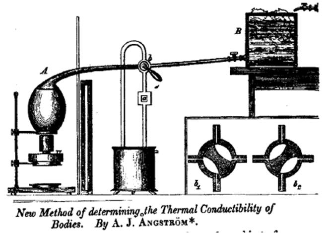
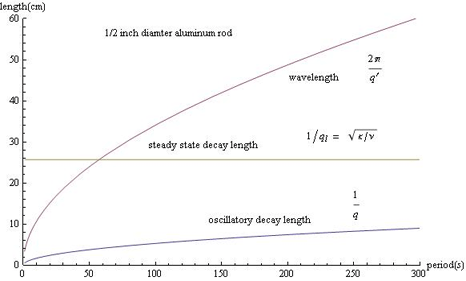
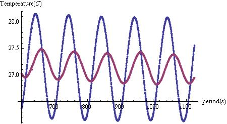

# Module 8, Part I: The Angstrom Method

Module 8 has two linked parts. This page develops and applies the Angstrom
method. Continue with [Part II: Conductivity, Heat Loss, And Final
Synthesis](../lab-10/index.md).

## Purpose

The TEC controller creates a sinusoidal temperature boundary at the base of
the aluminum rod. Thermal diffusion causes the oscillation amplitude to
decrease and its phase to lag with distance. Measuring both effects allows you
to separate axial thermal diffusion from heat loss to the air.

The module follows three priorities: obtain a trustworthy six-temperature
record, understand the Angstrom method, and compare experiment with theory.
The [learning objectives](#learning-objectives) state what you must be able to
do. The [S18 experimental overview](#s18-experimental-overview) previews the
measurements and control comparisons so that you can see what the theory must
explain. The detailed experimental instructions follow the theory in
[Stages 1-6](#stage-1-prepare-the-six-channel-measurement-and-live-record).

## Schedule And Due Work

| Session | In class | Due |
| --- | --- | --- |
| S18, Mon. Nov. 2 | Three-hour live Angstrom lab: display and record all six thermistors with the Python GUI at two or more frequencies | Module 8 home preparation; `P3` prediction and pilot-plan check |
| S19, Wed. Nov. 4 | Fit the live-run amplitudes and phases; select and test additional frequencies | Pilot-analysis and production-run plan check |
| S20, Mon. Nov. 9 | Acquire the multi-frequency production record with the Arduino, Python GUI, and laptop connected | Data-readiness and production-run check |
| S21, Wed. Nov. 11 | Fit spatial decay and phase slopes; infer `kappa` and `nu` | A5 analysis checkpoint |
| S22, Mon. Nov. 16 | Repeat or extend the measurement; test frequency consistency, residuals, and model validity | `P4`; formative modeling-app check |

## Outside-Class Workload Budget

| Session | Work | Planned time |
| --- | --- | ---: |
| S18 | Read this assignment and review the periodic solution | 60 minutes |
| S18 | Prepare the pilot-run settings and metadata plan | 30 minutes |
| S18 | **Total associated with S18** | **1 hour 30 minutes** |
| S19 | Organize the individual A5 S18 evidence, control analysis, and derivation | 120 minutes |
| S19 | Inspect pilot fits and prepare the production-run plan | 45 minutes |
| S19 | **Total associated with S19** | **2 hours 45 minutes** |
| S20 | Complete the individual A5 control comparison, derivation, and validity plan | 120 minutes |
| S20 | Prepare production filenames, metadata, and data-readiness checklist | 45 minutes |
| S20 | **Total associated with S20** | **2 hours 45 minutes** |
| S21 | Complete the spatial fits, uncertainty, and residual displays | 150 minutes |
| S21 | Document, commit, and push the formative modeling-app checkpoint | 30 minutes |
| S21 | **Total associated with S21** | **3 hours** |
| S22 | Prepare a repeat run or frequency-consistency and model-validity check | 60 minutes |
| S22 | **Total associated with S22** | **1 hour** |

All required measurements are made while the Arduino is connected to the
laptop and the Python GUI is displaying and saving the data. Do not leave the
apparatus running outside the scheduled protocol or without completing the
safety and data-readiness checks below.

## Learning Objectives

By the end of this module, you should be able to:

1. **Generate and measure the sinusoidally driven TEC temperature:** Sinusoidally heat the TEC using raw open-loop PWM, susceptibility-based feedforward, closed-loop P control, and closed-loop PI control; verify the stored file; and preserve sensor positions, units, timestamps, controller settings, and run metadata. **Explain** how the measured base temperature differs among raw PWM, feedforward, P, and PI control in mean error, amplitude, phase lag, waveform distortion, heating-cooling symmetry, and how those differences change with forcing frequency.

2. **Measure all six temperature histories:** display
   and record the TEC and `T1`-`T5` with the live GUI; 
   
2. **Derive and understand the settled-periodic temperature profile:** derive
   the complete Angstrom solution for a finite rod with an insulated tip by
   separating the stationary mean and oscillatory parts, applying the boundary
   conditions, and taking the real part of the complex solution. Explain how
   the finite-rod solution approaches the semi-infinite result. Interpret the
   solution physically in terms of three spatial length scales: the
   mean-temperature decay length $\ell_{\mathrm{mean}}=1/m$, the
   oscillation-amplitude decay length $\ell_{\mathrm{amp}}=1/q$, and the
   one-radian phase-shift length $\ell_{\mathrm{phase}}=1/q'$. Relate these
   scales to one another and to the dimensional parameters $\kappa$, $\nu$,
   and $\omega$ through $m^2=\nu/\kappa$, $m^2=q^2-q'^2$, and
   $2qq'=\omega/\kappa$; express their ratios using the dimensionless frequency
   $\Omega=\omega/\nu$; and fit the measurements to obtain $q$, $q'$,
   $\kappa$, and $\nu$ with units and uncertainty.
3. **Compare experiment and theory:** use per-sensor fits, spatial trends,
   residuals, frequency consistency, and the finite-length and
   transverse-Biot checks from Module 7 to judge the one-dimensional model.

## Roadmap And Student Work

The module follows one experimental argument. First establish and verify the
six-channel measurement so that the primary result is a trustworthy set of
temperature histories. Then use the Angstrom method to predict and extract
amplitude decay and phase lag. Finally, compare those measurements with the
model, infer \(\kappa\) and \(\nu\), and test whether the same theory explains
all retained sensors and forcing periods.

**Before S18:** read through the periodic solution, write down your qualitative
predictions, and prepare proposed pilot settings and metadata. This is the
`P3` check. Bring your proposed drive period, starting values of \(T_a\) and
\(T_b\), safety limits, and a prediction for how amplitude and phase will
change with distance. This is a planning check, not a separate written
submission.

**In class during S18-S20:** use Stages 1-4 for the S18 control comparisons
and two-frequency pilot measurement. During S19-S20, use the pilot analysis to
improve the settings and acquire the production record in Stage 5. Decide from
the live data when each response has settled before changing frequency.

**After the production run during S21-S22:** complete the spatial fits,
uncertainty and residual analysis, and model-validity checks. The `P4` check is
a minimum successful periodic dataset, as defined below, together with sensor
positions and units, acquisition metadata, and a rod-base waveform check. This
is an in-class data-readiness check, not a separate written submission. State
the criterion you used to decide that the response was settled.

### S18 Experimental Overview

A sinusoidal PWM command does not guarantee a sinusoidal temperature. The
raw-PWM, feedforward, P, and PI comparisons reveal what the actuator and
controller contribute to the measured boundary waveform. Along the rod, the
six-temperature record reveals a second question: why does the oscillation
shrink and lag with distance? The Angstrom theory connects these observations
to thermal diffusion and heat loss, and gives predictions to test at more than
one forcing period.

**Keep three temperatures distinct:** $T_{\mathrm{set}}$ is requested;
$T_{\mathrm{TEC}}$ measures the actuator; and `T1` at the first rod hole is the
boundary $T(0,t)$ used in the rod model. The detailed actions begin in
[Stage 1](#stage-1-prepare-the-six-channel-measurement-and-live-record).

## Choose Sensor Positions For The Quantity Being Measured

Module 7 established the geometry and validated six thermistor measurement
chains: one thermistor in the TEC base and five thermistors at measured
positions along the 6061-T6 aluminum rod. Keep the same coordinate origin at
the first rod hole, channel assignments, common-bath result, any optional
correction coefficients, measured diameter, and analysis length \(L\) from the
first hole to the tip. A sensor may be moved to a different hole, but each
measurement configuration must have its own recorded sensor map and position
uncertainties.

The thermistor embedded in the TEC measures the driven actuator, but it is not
the rod boundary at \(x=0\) and is not one of the five rod coordinates. Rod
thermistor 1 in the first hole measures \(T(0,t)\), the boundary condition used
in the Angstrom model. You will use the Angstrom measurement to determine thermal
conductivity rather than substitute a supplied final value. Literature values
of \(k\) may guide planning and model-validity checks.

This choice of origin does not change the Angstrom result. Shifting \(x=0\)
changes the reference amplitude and phase, but the fitted spatial decay and
phase coefficients depend on amplitude ratios, phase differences, and sensor
separations. Use the first hole as \(x=0\) consistently in every plot and fit.

The mean and oscillatory parts require different sensor-placement strategies.
For the course rod, the estimated mean-profile length is relatively long:
$mL\approx1.3$. The stationary mean excess temperature therefore remains
measurable over the full rod. Module 7 already measured this profile using a
full-length sensor configuration and compared it with the finite- and
infinite-rod models. **Do not repeat that measurement in Module 8.** Retain the
Module 7 sensor map, data, and fitted mean-decay coefficient $m$ for comparison
with the oscillatory results.

The oscillatory part decays much faster. Over periods from $100$ to $500$ s,
the estimate is $qL\approx6.5$ to $3.0$. In the semi-infinite approximation,
the oscillation amplitude at the far end would therefore be only
$e^{-qL}\approx0.0015$ to $0.05$ of its value at the base. A full-length sensor
layout would place too many thermistors where the oscillatory signal is very
small.

For the Module 8 Angstrom measurement, begin with `T1` in the first hole and
define that position as $x=0$. Place `T2`-`T5` at approximately 1-inch intervals
in order of increasing $x$. This spacing has produced measurable oscillatory
signals in prior trials while still providing enough separation to resolve
amplitude decay and phase lag. Measure and record every position, and save this
oscillatory-measurement map separately from the full-length mean-profile map
retained from Module 7.

Treat the 1-inch spacing as a starting point, not a permanent requirement.
Collect pilot data at a short and a long usable period before finalizing the
layout. If the downstream oscillations are too small to fit, move the sensors
closer to the base or closer together. If the amplitudes and phases change too
little between neighboring sensors, spread the sensors farther apart. After
any repositioning, remeasure every $x$ coordinate and update the oscillatory
sensor map before collecting the production data.

In principle, the Angstrom method needs temperatures at only two distinct rod
positions. Five simultaneous rod measurements are preferable because they
provide multiple amplitude and phase differences in one run, support spatial
fits and residual checks, and avoid comparing pairs acquired under different
room or boundary conditions. Use the pilot run to confirm that at least three
rod sensors retain measurable amplitude and phase at every selected frequency.

Before the pilot run, verify that the saved diagram or photograph identifies
the TEC-base channel, the five rod channels, the positive \(x\) direction, all
five measured rod positions, the analysis length from the first hole to the
tip, the overall physical length, and the measured diameter.

## Periodic Solution

**Learning Objective 2 in practice — Derive and understand the
settled-periodic temperature profile.** As you work through this section,
follow the complete finite-rod derivation and connect each equation to the
three observable spatial scales: mean-temperature decay, oscillation-amplitude
decay, and phase shift.



*Historical drawing of Angstrom's method for determining thermal
conductivity. The course replaces the alternating hot and cold reservoirs with
a TEC-controlled sinusoidal boundary temperature.*

Take a few minutes to look at the
[1863 English translation of Angstrom's original work](../../references/angstrom-thermal-conductivity-1863.pdf).
You are not expected to follow every line. Focus on the apparatus, the recorded
observations, and the way the measurements are connected to the theory. Recognize the kinship between Angstrom and ourselves; the scientific process isn't different 165 years later, although the tools have progressed.

### Start With The Rod Equation

Module 7, Part III [introduced this rod model and explained each physical term](../lab-08/index.md#model),
including its units and the definitions of the transport coefficients.

Use excess temperature $\theta=T-T_\infty$ and the rod equation

\[
\frac{\partial\theta}{\partial t}
=\kappa\frac{\partial^2\theta}{\partial x^2}-\nu\theta.
\]

Here $\kappa$ is thermal diffusivity in $\mathrm{m^2/s}$ and $\nu$ is
the lateral heat-loss rate coefficient in $\mathrm{s^{-1}}$. Every term has
units of K/s. We assume constant material properties, linear heat loss,
constant environmental temperature, and a temperature uniform across each
cross section. Module 7 denoted thermal diffusivity by $\alpha$; here
$\kappa\equiv\alpha=k/(\rho c)$. The symbol $T_\infty$ does not mean the
temperature at the other end of the universe. It is the temperature of the
surrounding room, which we treat as a large thermodynamic reservoir whose
temperature is not changed appreciably by the rod. We initially treat the rod
as semi-infinite, with $x\geq0$.

Use the measured temperature `T1` at the analysis base as

\[
\theta(0,t)=\theta_b\cos(\omega t),
\qquad
\omega=\frac{2\pi}{\tau},
\]

where $\tau$ is the period in seconds and $\omega$ is angular frequency in
rad/s. The TEC and its embedded thermistor create and monitor the forcing, but
the measured rod temperature at the first hole supplies this boundary
condition. We seek the settled periodic response after initial transients decay.
If the base oscillates about a mean above room temperature, the full solution
also contains a stationary mean profile. By linearity, we can solve for that
profile and the oscillating component separately; the derivation below gives
the oscillating component.

Before continuing, make a qualitative prediction. Sketch temperature versus
time at the base and at two increasing distances along the rod. Predict which
features remain the same, which change with distance, and what a shorter drive
period should do to the attenuation and phase lag. Return to this sketch after
the derivation and pilot run.

### Preview The Six-Sensor Angstrom Experiment

Open the [interactive six-sensor Angstrom simulator](../../simulators/angstrom-six-sensor/).
This version extends the finite-rod simulator used in Module 7. Select the
Angstrom sinusoidal drive and begin with

\[
T_{\mathrm{set}}(t)=T_a+T_b\sin(\omega t),
\qquad
T_a=40^\circ\mathrm{C},\quad
T_b=16^\circ\mathrm{C},\quad
\tau=200\ \mathrm{s}.
\]

The simulator displays the driven temperature and the live responses at six
positions along the finite rod. Compare their amplitudes and phase delays, and
then change the forcing period to predict which sensor positions will provide
measurable signals in the physical experiment. The simulator labels its six
modeled rod positions `T0`-`T5`; in the apparatus, the embedded `TEC` sensor is
separate and the five rod sensors are named `T1`-`T5`.

**Suggested simulation-only exploration.** Use the initial settings above and
let the response settle into a repeatable periodic state.

This simulated setpoint ranges from $24^\circ\mathrm{C}$ to $56^\circ\mathrm{C}$; it is
an exploration setting, **not** permission to exceed the
$56^\circ\mathrm{C}$ hardware limit.

For each modeled position, estimate the time-averaged temperature
$\overline{T}(x)$, oscillation amplitude $B(x)$, and phase lag relative to
`T0`. Look for four features:

1. The mean excess temperature, $\overline{T}(x)-T_\infty$, falls
   approximately exponentially with position.
2. The oscillation amplitude $B(x)$ also falls approximately exponentially,
   but generally with a different decay coefficient.
3. The phase lag increases monotonically downstream: each successive
   temperature trace reaches corresponding points in its cycle later.
4. Compare the PWM phase with both the requested setpoint and the temperature
   traces. The PWM should generally lead the measured thermal response because
   actuator effort precedes the temperature change it produces. Its phase
   relative to the requested setpoint is not universal: it depends on the
   controller type and gains, the TEC and rod dynamics, and any saturation. A
   P-only command is in phase with the instantaneous error; adding the integral
   term changes the command phase. Measure these phase relationships rather
   than assuming that PWM always leads the setpoint.

Test the two exponential statements by plotting
$\ln[\overline{T}(x)-T_\infty]$ and $\ln B(x)$ against $x$. Compare their
slopes, and inspect whether points near the finite tip depart systematically
from straight lines.

<details markdown="1">
<summary>What model is being simulated?</summary>

This simulator uses the same finite-difference rod and dynamic TEC model as
the Module 7 simulator. Its rod elements obey

\[
\frac{\partial\theta}{\partial t}
=\kappa\frac{\partial^2\theta}{\partial x^2}-\nu\theta,
\qquad \theta=T-T_\infty,
\]

with a finite, zero-flux far tip. The TEC has separate hot- and cold-side
thermal states and includes Peltier transport, Joule heating, internal
conduction, rod contact, and heat-sink loss. A PID controller drives bounded
heating and cooling PWM so that the `T0` sensor follows the requested
sinusoidal setpoint. Each of the six displayed thermistors has the same
first-order sensor lag.

Unlike the semi-infinite analytic solution derived below, the numerical model
retains the finite tip and actuator dynamics. It therefore lets you explore
where the exponential amplitude and phase relations work well and where the
ideal Angstrom assumptions begin to fail.

</details>

### Full Complex-Exponential Derivation

#### Start From The Space-Time Equation

For excess temperature \(\theta(x,t)=T(x,t)-T_\infty\), the semi-infinite rod
obeys

\[
\boxed{
\frac{\partial \theta(x,t)}{\partial t}
=\kappa\frac{\partial^2\theta(x,t)}{\partial x^2}
-\nu\theta(x,t)
},
\qquad x\geq 0.
\]

The periodic boundary conditions are

\[
\theta(0,t)=\theta_b\cos(\omega t),
\qquad
\lim_{x\rightarrow\infty}\theta(x,t)=0.
\]

#### Guess A Complex Exponential

A complex exponential is useful because differentiation returns a constant
times the same function. Guess

\[
\widetilde{\theta}(x,t)=\theta_b e^{-sx}e^{i\omega t}.
\]

The physical temperature is the **real part** of this expression. Because the
equation is linear with real coefficients, the real part of a complex solution
also satisfies the equation. Allowing $s$ to be complex lets us describe both
amplitude decay and phase delay along the rod. At $x=0$, taking the real part
gives the specified cosine boundary condition.

The derivatives are

\[
\frac{\partial\widetilde{\theta}}{\partial t}
=i\omega\widetilde{\theta},
\qquad
\frac{\partial^2\widetilde{\theta}}{\partial x^2}
=s^2\widetilde{\theta}.
\]

Substitution into the rod equation and cancellation of the common exponential
turn the differential equation into algebra:

\[
i\omega=\kappa s^2-\nu,
\qquad
\boxed{s^2=\frac{\nu+i\omega}{\kappa}}.
\]

The two spatial solutions are $e^{-sx}$ and $e^{+sx}$. Choose the square root
with positive real part and discard the growing solution $e^{+sx}$, because
the temperature oscillation must vanish far from the driven end.

#### Separate Amplitude Decay From Phase Delay

Write $s=q+iq'$, with $q>0$ and $q'>0$ for positive driving frequency. The
prime in $q'$ is part of its name, not a derivative. Squaring gives

\[
s^2=q^2-q'^2+2iqq'.
\]

Equating real and imaginary parts with $(\nu+i\omega)/\kappa$ gives

\[
\boxed{q^2-q'^2=\frac{\nu}{\kappa}},
\qquad
\boxed{2qq'=\frac{\omega}{\kappa}}.
\]

To find the two coefficients explicitly, use

\[
(q^2+q'^2)^2=(q^2-q'^2)^2+(2qq')^2
=\frac{\nu^2+\omega^2}{\kappa^2}.
\]

Thus $q^2+q'^2=\sqrt{\nu^2+\omega^2}/\kappa$. Adding and subtracting
the expressions for this sum and for $q^2-q'^2$ gives the amplitude-decay
and phase coefficients, both in inverse meters:

\[
q=\sqrt{\frac{\nu+\sqrt{\nu^2+\omega^2}}{2\kappa}},
\qquad
q'=\sqrt{\frac{-\nu+\sqrt{\nu^2+\omega^2}}{2\kappa}}.
\]

The frequency of the drive therefore sets two useful spatial scales. The
**oscillatory decay length** $1/q$ is the distance over which the oscillation
amplitude falls by a factor of $e$. The **spatial wavelength** $2\pi/q'$ is the
distance over which the oscillation accumulates a full $2\pi$ phase lag. For
comparison, the stationary temperature profile has decay length
$1/q_1=\sqrt{\kappa/\nu}$.



*Characteristic lengths calculated for a half-inch-diameter aluminum rod.
Longer periods penetrate farther into the rod but produce less phase change per
unit length. Shorter periods produce more phase change per unit length but also
attenuate more rapidly. The experimental period should give both a measurable
amplitude and a resolvable phase difference across several sensors.*

#### Take The Real Part

The complex solution can now be written

\[
\widetilde{\theta}(x,t)=\theta_b e^{-qx}e^{i(\omega t-q'x)}.
\]

Taking its real part gives

\[
\boxed{\theta(x,t)=\theta_b e^{-qx}\cos(\omega t-q'x)}.
\]

At every position, temperature oscillates at the imposed frequency. Its
amplitude decreases as $e^{-qx}$ and it lags the base by $q'x$ radians,
corresponding to a time delay $q'x/\omega$. This wave-like pattern is a
diffusive response, not ordinary wave propagation.

Allowing an arbitrary base amplitude $B_0$ and phase $\phi_0$ gives the form
used to fit the experiment:

\[
\theta(x,t)=B_0e^{-qx}\cos(\omega t-q'x+\phi_0).
\]

For the boundary condition chosen above, $B_0=\theta_b$ and $\phi_0=0$.

### Combine The Mean And Oscillatory Solutions

The derivation above gives only the oscillatory part. The imposed boundary
temperature also has a time-independent mean:

\[
T(0,t)=T_a+T_b\cos(\omega t).
\]

Because the rod equation is linear, add the stationary mean profile to the
settled oscillatory response. For a semi-infinite rod, the complete
settled-periodic solution is

\[
\boxed{
T(x,t)=T_\infty
+(T_a-T_\infty)e^{-mx}
+T_b e^{-qx}\cos(\omega t-q'x)
},
\]

where

\[
m=\sqrt{\frac{\nu}{\kappa}},
\qquad
s=q+iq'=\sqrt{\frac{\nu+i\omega}{\kappa}},
\qquad
m^2=q^2-q'^2.
\]

The first exponential describes the time-averaged temperature above room
temperature. The second describes the oscillation about that mean. Thus the
mean and the oscillation amplitude both decrease with position, but generally
with different decay coefficients, $m$ and $q$. This is a **settled periodic
state**, not a time-independent steady state. Using sine instead of cosine only
changes the choice of time origin.

The solution contains three physical length scales:

\[
\ell_{\mathrm{mean}}=\frac{1}{m}=\sqrt{\frac{\kappa}{\nu}},
\qquad
\ell_{\mathrm{amp}}=\frac{1}{q},
\qquad
\ell_{\mathrm{phase}}=\frac{1}{q'}.
\]

Over $\ell_{\mathrm{mean}}$, the mean excess temperature falls by a factor of
$e$. Over $\ell_{\mathrm{amp}}$, the oscillation amplitude falls by a factor of
$e$. Over $\ell_{\mathrm{phase}}$, the oscillation accumulates one radian of
phase lag; its spatial wavelength is therefore $2\pi\ell_{\mathrm{phase}}$.

Define the dimensionless driving frequency

\[
\Omega=\frac{\omega}{\nu}.
\]

The three scales are not independent. Dividing the relations for $q$ and $q'$
by $m=\sqrt{\nu/\kappa}$ gives

\[
\frac{q}{m}
=\sqrt{\frac{1+\sqrt{1+\Omega^2}}{2}},
\qquad
\frac{q'}{m}
=\sqrt{\frac{-1+\sqrt{1+\Omega^2}}{2}}.
\]

Equivalently, $\ell_{\mathrm{amp}}/\ell_{\mathrm{mean}}=m/q$ and
$\ell_{\mathrm{phase}}/\ell_{\mathrm{mean}}=m/q'$. For a finite rod, the
dimensionless lengths $mL$, $qL$, and $q'L$ state how many mean-decay,
amplitude-decay, and one-radian phase-shift lengths fit within the rod.

<details class="note" markdown="1">
<summary><strong>Popup: Estimate The Three Dimensionless Lengths For The Course Rod</strong></summary>

Use the planning values

\[
L=0.300\ \mathrm{m},\qquad
d=0.0127\ \mathrm{m},\qquad
h=10\ \mathrm{W\,m^{-2}K^{-1}},
\]

and the 6061-T6 aluminum properties

\[
k=167\ \mathrm{W\,m^{-1}K^{-1}},\qquad
\rho=2700\ \mathrm{kg\,m^{-3}},\qquad
c=896\ \mathrm{J\,kg^{-1}K^{-1}}.
\]

For a circular rod,

\[
\kappa=\frac{k}{\rho c}=6.90\times10^{-5}\ \mathrm{m^2\,s^{-1}},
\qquad
\nu=\frac{4h}{\rho cd}=1.30\times10^{-3}\ \mathrm{s^{-1}}.
\]

The mean-profile decay coefficient and dimensionless rod length are

\[
m=\sqrt{\frac{\nu}{\kappa}}=4.34\ \mathrm{m^{-1}},
\qquad
mL=1.30.
\]

Thus the rod contains about 1.3 mean-decay lengths, independent of forcing
frequency. For each forcing period $\tau$, calculate $\omega=2\pi/\tau$ and

\[
q=\sqrt{\frac{\nu+\sqrt{\nu^2+\omega^2}}{2\kappa}},
\qquad
q'=\sqrt{\frac{-\nu+\sqrt{\nu^2+\omega^2}}{2\kappa}}.
\]

| Period $\tau$ (s) | $mL$ | $qL$ | $q'L$ (rad) | Full $2\pi$ phase shifts, $q'L/(2\pi)$ |
| ---: | ---: | ---: | ---: | ---: |
| 100 | 1.30 | 6.47 | 6.33 | 1.01 |
| 200 | 1.30 | 4.62 | 4.43 | 0.71 |
| 300 | 1.30 | 3.81 | 3.58 | 0.57 |
| 400 | 1.30 | 3.34 | 3.07 | 0.49 |
| 500 | 1.30 | 3.01 | 2.72 | 0.43 |

At every period in this range, $qL>mL$. Therefore
$\ell_{\mathrm{amp}}=1/q$ is shorter than
$\ell_{\mathrm{mean}}=1/m$: the oscillation amplitude decays more rapidly with
position than the average excess temperature. At $100$ s, the rod spans about
one complete $2\pi$ spatial phase shift. At $500$ s, it spans about $0.43$ of a
complete phase shift. Longer-period oscillations penetrate farther and
accumulate less phase lag across the rod.

The semi-infinite model would predict a base-to-tip oscillation-amplitude ratio
$e^{-qL}$ ranging from about $0.0015$ at $100$ s to $0.049$ at $500$ s. These
small values explain why the oscillatory thermistors should be concentrated
near the base. Because the physical rod is finite, measurements near the tip
should ultimately be compared with the finite-rod solution rather than treated
as exact semi-infinite predictions.

</details>

### Guided Student Solution: The Finite Insulated-Tip Rod

For a finite rod, let the analysis base be at $x=0$ and the insulated tip be at
$x=L$. The boundary conditions are

\[
T(0,t)=T_a+T_b\cos(\omega t),
\qquad
\left.\frac{\partial T}{\partial x}\right|_{x=L}=0.
\]

**Step 1: Separate the mean and oscillatory parts.** Write

\[
T(x,t)=T_\infty+\overline{\theta}(x)
+\operatorname{Re}\!\left\{\widetilde{\theta}_{\mathrm{osc}}(x,t)\right\}.
\]

The stationary part obeys

\[
\frac{d^2\overline{\theta}}{dx^2}-m^2\overline{\theta}=0,
\qquad
\overline{\theta}(0)=T_a-T_\infty,
\qquad
\overline{\theta}'(L)=0.
\]

Use the [finite insulated-tip solution from Module 7](../fin-design-derivation/index.md#energy-balance-and-differential-equation)
to obtain

\[
\boxed{
\overline{\theta}(x)
=(T_a-T_\infty)
\frac{\cosh[m(L-x)]}{\cosh(mL)}
}.
\]

**Step 2: Solve the oscillatory spatial problem.** Use

\[
\widetilde{\theta}_{\mathrm{osc}}(x,t)=F(x)e^{i\omega t}.
\]

Substitution into the rod equation gives

\[
F''-s^2F=0,
\qquad
s^2=\frac{\nu+i\omega}{\kappa}.
\]

Apply

\[
F(0)=T_b,
\qquad
F'(L)=0.
\]

The finite-rod oscillatory solution is

\[
\boxed{
\widetilde{\theta}_{\mathrm{osc}}(x,t)
=T_b
\frac{\cosh[s(L-x)]}{\cosh(sL)}
e^{i\omega t}
}.
\]

**Step 3: Combine the two pieces and take the real part.** The complete
finite-rod settled-periodic solution is

\[
\boxed{
\begin{aligned}
T(x,t)=T_\infty
&+(T_a-T_\infty)
\frac{\cosh[m(L-x)]}{\cosh(mL)}
\\
&+\operatorname{Re}\!\left\{
T_b\frac{\cosh[s(L-x)]}{\cosh(sL)}e^{i\omega t}
\right\}.
\end{aligned}
}
\]

Define

\[
\frac{\cosh[s(L-x)]}{\cosh(sL)}
=A(x)e^{-i\phi(x)}.
\]

Here $A(x)$ is the dimensionless oscillation amplitude relative to the base,
so the temperature-oscillation amplitude is $T_bA(x)$, and $\phi(x)$ is the
phase lag. With $s=q+iq'$, its explicit magnitude is

\[
A(x)=\left|\frac{\cosh[s(L-x)]}{\cosh(sL)}\right|
=\sqrt{\frac{\cosh[2q(L-x)]+\cos[2q'(L-x)]}
{\cosh(2qL)+\cos(2q'L)}}.
\]

In particular, $A(0)=1$. Then the same result can be written entirely with real quantities:

\[
T(x,t)=T_\infty
+(T_a-T_\infty)
\frac{\cosh[m(L-x)]}{\cosh(mL)}
+T_bA(x)\cos[\omega t-\phi(x)].
\]

Expanding the complex hyperbolic functions gives an explicit expression for
$T(x,t)$ without the amplitude and phase functions:

\[
\boxed{
\begin{aligned}
T(x,t)={}&T_\infty
+(T_a-T_\infty)\frac{\cosh[m(L-x)]}{\cosh(mL)}
\\[6pt]
&+T_b\frac{
\cosh[q(2L-x)]\cos(q'x)+\cosh(qx)\cos[q'(2L-x)]
}{\cosh(2qL)+\cos(2q'L)}\cos(\omega t)
\\[6pt]
&+T_b\frac{
\sinh[q(2L-x)]\sin(q'x)+\sinh(qx)\sin[q'(2L-x)]
}{\cosh(2qL)+\cos(2q'L)}\sin(\omega t).
\end{aligned}
}
\]

The spatial parameters $m$, $q$, and $q'$ are defined above by
$m^2=\nu/\kappa$, $q^2-q'^2=\nu/\kappa$, and
$2qq'=\omega/\kappa$, with $q,q'>0$.

**Checks for you to complete:**

**Check 1.** Set $x=0$ and verify that the solution gives
$T(0,t)=T_a+T_b\cos(\omega t)$.

**Check 2.** Differentiate with respect to $x$ and verify that both
contributions have zero slope at $x=L$.

**Check 3.** Show that when $mL\gg1$ and $qL\gg1$,

\[
\frac{\cosh[m(L-x)]}{\cosh(mL)}\rightarrow e^{-mx},
\qquad
\frac{\cosh[s(L-x)]}{\cosh(sL)}\rightarrow e^{-sx}.
\]

Thus the finite solution reduces to the semi-infinite solution above.

**Check 4.** Explain why data near the tip are the most sensitive to the
difference between the finite and semi-infinite models.

### Recover Diffusivity And Heat Loss From Measurements

For two sensors separated by $\Delta x=x_2-x_1>0$, let their oscillation
amplitudes be $B_1>B_2$, and let the downstream sensor lag by
$\Delta\phi=\phi_1-\phi_2>0$ radians after phase unwrapping. Then

\[
q=\frac{\ln(B_1/B_2)}{\Delta x},
\qquad
q'=\frac{\Delta\phi}{\Delta x}.
\]

With several sensors, fit the slopes of log amplitude and unwrapped phase
versus position. Rearranging the real- and imaginary-part equations gives
the useful inverse relations:

\[
\kappa=\frac{\omega}{2qq'},
\qquad
\nu=\kappa(q^2-q'^2).
\]

This is an important experimental advantage of the Angstrom method. Thermal
conductivity follows directly from the product of the measured amplitude-decay
and phase slopes:

\[
\boxed{k=\rho c\kappa
=\rho c\frac{\omega}{2qq'}}.
\]

Determining \(k\) therefore does **not** require an independent measurement of
the convective coefficient \(h\) or the total heat lost from the rod. Such a
measurement would be difficult because convection depends on airflow,
orientation, surface condition, and temperature. Instead, the amplitude and
phase measurements contain enough independent information to separate axial
diffusion from convective side loss.

<details markdown="1">
<summary>Numerical sanity check</summary>

For example, suppose a 100-second run gives
\(\omega=0.0628\ \mathrm{rad/s}\), \(q=25\ \mathrm{m^{-1}}\), and
\(q'=18\ \mathrm{m^{-1}}\). Then

\[
\kappa=\frac{0.0628}{2(25)(18)}
=6.98\times10^{-5}\ \mathrm{m^2/s},
\]

and

\[
\nu=\kappa(25^2-18^2)
=2.10\times10^{-2}\ \mathrm{s^{-1}}.
\]

Use this only as a unit and order-of-magnitude check; it is not a supplied
result for the course rod.

</details>

The second inverse relation separately gives the side-loss rate \(\nu\), from
which the convective coefficient \(h\) can also be inferred. Here \(\rho\) is
density in \(\mathrm{kg/m^3}\) and \(c\) is specific heat capacity in
\(\mathrm{J/(kg\,K)}\), so \(k\) has units \(\mathrm{W/(m\,K)}\).

As a check, with no lateral loss, $\nu=0$, so

\[
q=q'=\sqrt{\frac{\omega}{2\kappa}}.
\]

Positive lateral heat loss makes $q>q'$. Therefore a fitted result with
\(q\leq q'\), a negative \(\nu\), or strongly frequency-dependent
\(\kappa\) is evidence to investigate the data, uncertainty, settling
criterion, or model assumptions rather than a number to repair silently. A shorter driving period produces
stronger attenuation and phase change per unit distance. These expressions
describe the settled periodic response; they do not include startup transients.
A finite rod generally requires both spatial exponentials to satisfy its
far-end boundary condition.

These equations use a one-dimensional, semi-infinite rod. Before selecting
sensors for the fit, carry forward the finite-length error and transverse-Biot
checks from Module 7. State which sensors and conditions satisfy your chosen
approximation tolerances, and then use the measured residuals and
frequency-consistency test to determine whether those approximations were
adequate in practice.

## Experimental Notation

| Symbol or channel | Meaning |
| --- | --- |
| \(T_\infty\) | Measured room temperature, treated as the surrounding thermal reservoir |
| \(T_{\mathrm{set}}(t)\) | Requested temperature waveform; distinct from both measured temperatures below |
| \(T_a\) | Requested mean TEC setpoint temperature |
| \(T_b\) | Requested TEC setpoint amplitude |
| \(T_{\mathrm{TEC}}\) or `TEC` | Temperature measured by the thermistor embedded in the TEC base |
| \(T(0,t)\) or `T1` | Temperature at the first rod hole, which defines the analysis boundary \(x=0\) |
| `T2`-`T5` | Temperatures at the four downstream rod sensors |
| \(a_i\) | Mean temperature obtained by fitting rod sensor \(i\) |
| \(B_i\) | Oscillation amplitude obtained by fitting rod sensor \(i\) |
| \(\phi_i\) | Unwrapped phase obtained by fitting rod sensor \(i\) |
| \(\tau\), \(\omega=2\pi/\tau\) | Forcing period and angular frequency |
| \(q\) | Spatial amplitude-decay coefficient obtained from \(\ln B_i\) versus \(x_i\) |
| \(q'\) | Spatial phase coefficient obtained from unwrapped \(\phi_i\) versus \(x_i\) |
| \(\kappa\) | Thermal diffusivity inferred from \(q\), \(q'\), and \(\omega\) |
| \(\nu\) | Convective side-loss rate inferred from \(q\), \(q'\), and \(\omega\) |
| \(r=\chi_{\mathrm{heat}}/\chi_{\mathrm{cool}}\) | Measured heating-to-cooling response ratio used in the feedforward compensation |

In this module, \(\tau\) denotes the **forcing period**. It is not the thermal
relaxation time denoted by \(\tau\) in Module 6.

<a id="s18-in-class-procedure"></a>

## Experimental Stages

Work through **S18.1-S18.10 in order in Stages 1-4**. Stages 5-6 use
the pilot results to acquire the production record and compare it with theory.
Maintain an **S18 evidence table** with one row for each action: cite the saved
file, figure, code checkpoint, measurement, or written observation; record the
principal result; and describe any departure from the procedure. This table
becomes the first part of A5. A checked box by itself is not evidence.

**Required experimental core:** the raw-PWM and feedforward/P/PI comparisons, followed by
two usable forcing periods with at least five complete settled cycles at each
and measurable amplitude and phase at three or more rod sensors. **Extensions:**
additional frequencies up to roughly five, an automated frequency schedule,
and the optional global fit in Stage 6. Secure the required dataset first.

## Stage 1: Prepare The Six-Channel Measurement And Live Record

**Goal:** Verify the measurement and recording system before energizing the TEC.

**Do:** Complete S18.1-S18.2 with the TEC output off.

<a id="s18-1"></a>

### S18.1: Verify The Measurement And Safety Limits

Verify the `TEC` and `T1`-`T5` channel labels, units, common-bath result,
optional correction coefficients, measured sensor positions, and safety
limits. Begin with `T1` in the first rod hole at $x=0$ and `T2`-`T5` at
approximately 1-inch intervals in order of increasing distance. Use the
[sensor-placement reasoning](#choose-sensor-positions-for-the-quantity-being-measured)
above to document the initial map and later pilot-based changes.

For every trial, keep the measured rod-base temperature at or below
$56^\circ\mathrm{C}$, retain margin for overshoot, and use no forcing period
shorter than $100\ \mathrm{s}$ except for the $50\ \mathrm{s}$ raw-PWM diagnostic
in S18.3. Preserve the existing safety limits and physical
thermal cutoff. Stop the run if a safety limit or the cutoff is reached.

<a id="s18-2"></a>

### S18.2: Verify The Live Display And Saved Record

Connect the Arduino to the laptop and start the Python GUI. Verify the live
display and timestamped local file against the requirements below before
proceeding.

Revise the Arduino sketch and Python GUI so that one serial record contains, at
minimum,

```text
time_ms,run_state,control_mode,step,Ta_C,Tb_C,period_s,setpoint_C,feedforward_pwm,TEC_C,T1_C,T2_C,T3_C,T4_C,T5_C,controller_pwm,heating_to_cooling_ratio,signed_pwm
```

The GUI must display the TEC thermistor and all five rod thermistors live,
display the requested setpoint, control mode, and PWM output, and save a local
copy of every complete record it receives. Fields that do not apply in the
selected control mode must have a documented placeholder rather than changing
the record structure. The Arduino must use one documented
`Serial.print()` record format throughout the experiment.

Preserve every startup transient, control-mode change, frequency transition,
and safety event in the same documented record. Do not replace raw data with a
cleaned file. The `step` field identifies the active run segment even when
frequency changes are selected manually.

<details markdown="1">
<summary>Suggested Copilot prompts for the Arduino sketch and Python GUI</summary>

For the existing tested Arduino sketch:

> Extend this sketch without removing its working PI control or safety limits.
> Add two diagnostic raw-PWM modes: `u = ub*sin(omega*t)`, which alternates
> between positive and negative PWM about room temperature, and
> `u = ua + ub*sin(omega*t)`, constrained by `ua > ub > 0`, which remains on
> the heating branch with a mean TEC temperature near 40 C. Do not apply the
> heating-cooling compensation in either diagnostic mode. Also add selectable
> susceptibility-based feedforward, proportional-only, and PI modes for the
> corrected comparison. Derive feedforward PWM from an interpolation or lookup
> table of the measured steady-state susceptibility curve rather than assuming
> that PWM itself should be sinusoidal.
> Print one documented CSV record containing elapsed milliseconds, operating
> state, control mode, run segment, requested sinusoid parameters, setpoint,
> feedforward command, TEC temperature, five rod temperatures, raw controller
> command, cooling compensation ratio, and applied signed PWM. Compute the
> selected signed P or PI command, multiply negative commands by the measured
> ratio $r=\chi_h/\chi_c$, and then apply PWM saturation, direction
> selection, safety limits, and anti-windup. Never energize both H-bridge
> directions. Use one documented `Serial` record format for the live GUI.

For the existing tested Python GUI:

> Extend this GUI without removing its current controls. Parse and validate the
> new CSV record, display the TEC and five rod thermistors live on a common time
> axis, display control mode, setpoint, and PWM, report malformed or missing records, and save
> every unmodified valid record to a timestamped local CSV file.

</details>

**Stop when:** All six channels update plausibly, the saved file contains the
documented complete records, and the controls and safety limits are ready.

**Save:** The sensor map and calibration record, acquisition code checkpoint,
sample raw file, and evidence for S18.1-S18.2.

## Stage 2: Explore Uncompensated Sinusoidal PWM

**Goal:** Observe how the actuator responds before compensating its unequal
heating and cooling response.

**Do:** Complete the two raw-PWM trials below while displaying and saving all
six temperatures. Begin with a $100\ \mathrm{s}$ period and retain the safety
limits established in Stage 1.

<a id="s18-3"></a>

### S18.3: Apply Zero-Centered Sinusoidal PWM

Before asking the TEC to track a temperature setpoint, drive it with the
signed PWM command in Arduino counts:

\[
\boxed{u(t)=u_a+u_b\sin(\omega t)},
\qquad -255\leq u(t)\leq255.
\]

The sign selects heating or cooling; $|u|$ gives the PWM magnitude from 0 to 255.
Measure and record room temperature and verify the signed-PWM convention.
Use $u_a=0$ and keep $u_b=100$ PWM counts fixed for all three forcing periods:
$50$, $100$, and $200\ \mathrm{s}$. Begin with the $100\ \mathrm{s}$ period.
Changing only the period lets you observe its effect on temperature amplitude
and phase lag.
One could estimate the time varying temperature using the Module 6 one-lump model with its simulation defaults:
room temperature $22^\circ\mathrm{C}$, heating susceptibility
$\chi_h=0.46\ ^\circ\mathrm{C/PWM}$, cooling susceptibility
$\chi_c=0.23\ ^\circ\mathrm{C/PWM}$, and thermal relaxation time
$\tau_{\mathrm{th}}=80\ \mathrm{s}$. Integrating
$\tau_{\mathrm{th}}\dot T=T_{\mathrm{room}}+\chi(u)u-T$, with the appropriate
heating or cooling branch, gives the model response. First solve the case with
equal heating and cooling susceptibility magnitudes, as derived below. A single
sinusoidal particular solution applies to that case; it does not give the full
response when the two susceptibility magnitudes differ.
Here $\tau_{\mathrm{th}}$ is the thermal relaxation time, not the forcing period.

Use your measured Module 6 parameters to refine this estimate if they differ
from the defaults; the attached rod can also change the response. Start near
room temperature and apply $u(t)=100\sin(\omega t)$, which varies between
$-100$ and $+100$ PWM counts. Allow the response to settle at each forcing
period, keeping $u_b=100$ fixed, and record the measured temperature peak.
Keep the Stage 1 safety limits active throughout the trial.
**How do you expect the temperature to respond? Does it meet your expectations?** Explain what you observe.
This is a deliberately uncompensated experiment. A symmetric PWM command does
not imply a symmetric temperature response when heating and cooling have
different susceptibilities. Plot the measured TEC temperature against $u(t)$
and identify unequal excursions, slopes, phase lag, and distortion. Collect data for 3 periods; 50 sec, 100 sec and 200 sec.

#### Derive The Response For Equal Heating And Cooling Susceptibilities

First assume $\chi_h=\chi_c=\chi>0$. Since $u$ is signed, the same positive
$\chi$ multiplies $u$ on both branches: positive PWM heats and negative PWM
cools. Equivalently, susceptibilities written as $+\chi$ and $-\chi$ would
multiply the unsigned magnitude $|u|$.

Set $\theta(t)=T(t)-T_{\mathrm{room}}$ and $u_a=0$. For
$u(t)=u_b\sin(\omega t)$, the one-lump equation becomes

\[
\tau_{\mathrm{th}}\dot\theta+\theta
=\chi u_b\sin(\omega t).
\]

Try the particular solution

\[
\theta_p(t)=a\sin(\omega t)+b\cos(\omega t).
\]

Substitution and matching the sine and cosine coefficients gives

\[
a-\omega\tau_{\mathrm{th}}b=\chi u_b,
\qquad
b+\omega\tau_{\mathrm{th}}a=0.
\]

Therefore,

\[
a=\frac{\chi u_b}{1+(\omega\tau_{\mathrm{th}})^2},
\qquad
b=-\frac{\chi u_b\omega\tau_{\mathrm{th}}}
{1+(\omega\tau_{\mathrm{th}})^2}.
\]

Adding the homogeneous solution gives the complete temperature history:

\[
\boxed{
T(t)=T_{\mathrm{room}}
+\frac{\chi u_b}{\sqrt{1+(\omega\tau_{\mathrm{th}})^2}}
\sin(\omega t-\delta)
+C e^{-t/\tau_{\mathrm{th}}}
},
\qquad
\delta=\tan^{-1}(\omega\tau_{\mathrm{th}}).
\]

The initial temperature determines $C$. If $T(0)=T_{\mathrm{room}}$, then

\[
C=\frac{\chi u_b\omega\tau_{\mathrm{th}}}
{1+(\omega\tau_{\mathrm{th}})^2}.
\]

After the exponential transient decays, the temperature oscillates about room
temperature with amplitude $T_{\mathrm{amp}}$ and phase lag $\delta$ relative
to the PWM:

\[
\boxed{T_{\mathrm{amp}}=
\frac{\chi u_b}{\sqrt{1+(\omega\tau_{\mathrm{th}})^2}}},
\qquad
\Delta t_{\mathrm{lag}}=\frac{\delta}{\omega}.
\]

The thermal response attenuates the oscillation and delays it. Setting $u_b=1$
gives the solution for $u(t)=\sin(\omega t)$. A sinusoidal guess alone describes
the settled response; the exponential term is needed to satisfy the initial
condition.

#### Check The Derivation At 50, 100, And 200 Seconds

1. Substitute the complete solution into the differential equation and verify
   the initial condition $T(0)=T_{\mathrm{room}}$.
2. For forcing periods $\tau=50$, $100$, and $200\ \mathrm{s}$, use
   $\omega=2\pi/\tau$ and $\tau_{\mathrm{th}}=80\ \mathrm{s}$. Calculate the
   normalized amplitude $T_{\mathrm{amp}}/(\chi u_b)$, phase lag $\delta$ in
   radians, and time lag $\delta/\omega$. Keep the same $\chi$ and use $u_b=100$
   PWM counts for all three model calculations. Numerically integrate the equal-susceptibility
   equation from room temperature and overlay the analytical solution for each
   period, showing both the startup transient and the settled oscillation.
3. Compare these predictions with your raw-PWM measurements at 50, 100, and
   200 s. Report the mean temperature, oscillation amplitude, and phase lag
   relative to the applied PWM, with $u_b=100$ PWM counts fixed in all three
   runs. Explain how amplitude and phase lag change with period, and which
   departures from the equal-susceptibility prediction could arise from the
   actual unequal heating and cooling responses.

<a id="s18-4"></a>

### S18.4: Apply Positive-Only Sinusoidal PWM

Next choose $u_a>u_b>0$, so that

\[
u_{\min}=u_a-u_b>0.
\]

Adjust $u_a$ until the mean TEC temperature is approximately
$40^\circ\mathrm{C}$ while retaining a safe oscillation amplitude. The PWM now
remains on the positive heating branch throughout the cycle. Compare this
response with the zero-centered trial. Separating these cases lets you decide
which asymmetry comes from reversing the TEC current and which discrepancies
remain even when the actuator stays in one direction.

These raw-PWM trials are diagnostic open-loop experiments, not yet
feedforward temperature control. They establish what the uncorrected actuator
does before the measured susceptibility is used to construct a command.

**Stop when:** The two trials show how polarity reversal changes the mean,
amplitude, phase, symmetry, and distortion of the TEC response.

**Save:** The raw records, $u_a$, $u_b$, period, room temperature, PWM-temperature
plots, predictions, and observations for S18.3-S18.4.

<a id="stage-1-establish-the-boundary-condition"></a>

## Stage 3: Establish And Compare Feedforward, P, And PI Control

**Goal:** Produce and evaluate a sinusoidal rod boundary using the measured
susceptibility and then feedback.

**Do:** Complete S18.5-S18.8, keeping the requested temperature-drive settings
fixed for the three-method comparison.

<a id="s18-5"></a>

### S18.5: Specify The Setpoint And Construct Feedforward

Specify the requested sinusoidal temperature setpoint

\[
\boxed{T_{\mathrm{set}}(t)=T_a+T_b\sin(\omega t)},
\qquad
\omega=\frac{2\pi}{\tau}.
\]

Here $T_a$ is the mean TEC setpoint, $T_b$ is its oscillation amplitude,
$\tau$ is the forcing period, and $\omega$ is the angular frequency. For the first
feedforward trial, use the suggested values

\[
T_a=40^\circ\mathrm{C},
\qquad
T_b=16^\circ\mathrm{C},
\qquad
\tau=100\ \mathrm{s},
\qquad
\omega=\frac{2\pi}{100\ \mathrm{s}}
\approx 0.0628\ \mathrm{rad/s}.
\]

The resulting requested TEC profile is

\[
\boxed{
T_{\mathrm{set}}(t)
=40^\circ\mathrm{C}
+16^\circ\mathrm{C}\sin\!\left(\frac{2\pi t}{100\ \mathrm{s}}\right)
}.
\]

This has a mean of $40^\circ\mathrm{C}$, an amplitude of $16^\circ\mathrm{C}$,
and a requested range from $24^\circ\mathrm{C}$ to $56^\circ\mathrm{C}$. The
$56^\circ\mathrm{C}$ measured rod-base safety limit still takes precedence;
reduce $T_a$ or $T_b$ if necessary to prevent tracking error or overshoot from
exceeding that limit.
We assume an initial room temperature of approximately $22^\circ\mathrm{C}$ to
simplify the starting protocol, but use the actual room temperature measured
in S18.3 for the excess-temperature analysis. The requested TEC temperature is
the controller input; the measured temperature `T1` at $x=0$ is the
boundary condition used in the Angstrom analysis.

Load the measured heating and cooling susceptibility curves. Generating the
temperature sinusoid may require PWM of either sign. Your Module 4 measurements
showed that equal-magnitude PWM commands do not produce equal temperature
responses in the two directions. Let $\chi_h$
and $\chi_c$ denote the positive magnitudes of the measured heating and cooling
susceptibilities, respectively, and calculate

\[
\boxed{r=\frac{\chi_h}{\chi_c}}.
\]

A useful starting estimate is $\chi_c\approx\chi_h/2$, so $r\approx2$:
cooling may require approximately twice the PWM magnitude of heating for the
same temperature response. Use the ratio measured for your own TEC rather than
assuming that it is exactly two.

Remember that a sine wave is symmetric about its mean:

\[
T_{\mathrm{set}}\!\left(t+\frac{\tau}{2}\right)-T_a
=-\left[T_{\mathrm{set}}(t)-T_a\right].
\]

The desired temperature therefore spends equal time above and below $T_a$ and
has equal positive and negative excursions. The required PWM need not have this
symmetry because heating and cooling have different gains and dynamics. In an
open-loop trial, this difference may appear as unequal heating and cooling
slopes, unequal extrema, an offset from the intended mean, or waveform
distortion.

After completing the two raw-PWM trials, do not mistake a sinusoidal PWM for a
feedforward temperature command. Use your measured steady-state susceptibility
curve to determine the PWM required at each desired temperature. If the
calibration is written as

\[
T_{\mathrm{ss}}=f(u),
\]

construct an interpolation or lookup table for the inverse relation and apply

\[
u_{\mathrm{ff}}(t)=f^{-1}\!\left(T_{\mathrm{set}}(t)\right).
\]

Use the appropriate measured heating or cooling branch when the calibration
distinguishes them. This is an open-loop feedforward command: it uses the
steady-state $\chi$ calibration but does not correct the instantaneous
temperature error.

**Predict, at each point in the cycle, which value of $u$ should produce
that temperature.** Plot the predicted $u_{\mathrm{ff}}(t)$ before applying it
and explain why the required PWM waveform need not itself be sinusoidal.

<a id="s18-6"></a>

### S18.6: Apply The Feedforward Command

Apply the command from S18.5 with no P or I feedback. Inspect the measured `T1`
boundary rather than assuming that the requested waveform was produced. Use
the [pilot decision rules](#optimize-the-waveform-from-the-pilot-data) if tracking
or safety requires a change, and record the revised settings.

<a id="s18-7"></a>

### S18.7: Repeat With P And PI Control

Repeat the corrected trial with proportional-only control and then with PI
control at the same temperature-drive settings.

The feedback response is slow enough that the controller should not rely on
the integral term alone to discover this asymmetry. For proportional-only and
PI control, compare

\[
u_{\mathrm{P}}=K_p e,
\qquad
u_{\mathrm{PI}}=K_p e+K_i\int e\,dt,
\qquad
e=T_{\mathrm{set}}-T_{\mathrm{TEC}}.
\]

Apply the same measured heating-cooling compensation and safety limits in both
feedback modes. For example, the PI command becomes

\[
u_{\mathrm{cmd}}=
\begin{cases}
u_{\mathrm{PI}}, & u_{\mathrm{PI}}\geq0 \quad\text{(heating)},\\[4pt]
r\,u_{\mathrm{PI}}, & u_{\mathrm{PI}}<0 \quad\text{(cooling)}.
\end{cases}
\]

The sign of $u_{\mathrm{cmd}}$ selects the H-bridge direction, and its magnitude
sets the PWM after clamping it to the safe range. This measured,
direction-dependent scaling is a **static actuator compensation**, also called
static feedforward compensation. It linearizes the unequal heating and cooling
gains by supplying the known extra cooling command immediately; it does not
predict the rod's dynamic response. PI feedback corrects the remaining
tracking error more completely than P-only feedback. Apply saturation in both
feedback modes and anti-windup in PI mode, and never energize both H-bridge
direction inputs simultaneously.

<a id="s18-8"></a>

### S18.8: Compare The Measured Boundary Responses

Compare the two uncompensated PWM trials, corrected feedforward, P-only,
and PI using mean temperature, amplitude, phase, heating-cooling symmetry,
waveform distortion, residuals, and applied PWM. For feedforward/P/PI, compare
mean tracking error and measured-to-requested amplitude at common $T_a$, $T_b$,
and period. Use the [time fits in Stage 4](#stage-4-pilot-analysis-and-experiment-plan)
and the [A5 comparison requirements](#part-2-measured-boundary-control-comparison)
to quantify the differences. Raw-PWM trials have no requested temperature
waveform; compare their measured response to the applied PWM. If settings must
change, repeat the feedforward/P/PI comparison at common safe settings.

**Stop when:** You have the common-setting comparison required by A5, including
at least three settled cycles per method. If a trial is unusable, document it
and return to this comparison after revising settings with Stage 4.

**Save:** Evidence for S18.5-S18.8: susceptibility curves, measured ratio,
feedforward map and predicted PWM, controller gains, raw records, and comparison
plots and metrics. Use measured `T1` as the boundary in every Angstrom fit.

## Stage 4: Pilot Analysis And Experiment Plan

**Goal:** Use the six histories to choose two usable forcing periods and a
sensor layout that resolves amplitude decay and phase lag (Learning Objective 2).

**Do:** Complete S18.9-S18.10 using live observations and time fits.

<a id="s18-9"></a>

### S18.9: Settle, Fit, And Improve The First Pilot Run

Acquire pilot data with the best usable control method from Stage 3. Define
numerical tolerances for changes in fitted mean, amplitude, and unwrapped phase
between successive complete-cycle windows; use the measured noise and fit
uncertainty to justify them. Inspect residuals for drift. Apply this settling
test to the rod boundary and retained sensors before selecting a fit interval.
Do not declare a response settled merely because five cycles have elapsed.
Five cycles are the minimum retained **after** the team's quantitative settling
criterion has been satisfied.

The time required to approach a settled periodic response depends on both the
amplitude and frequency of the drive. A larger amplitude can lengthen the
transient and bring the actuator closer to its limits. At higher frequency the
PI controller has less time to follow the changing setpoint, so tracking error,
phase lag, attenuation, and waveform distortion generally increase. Use the
measured `T1` waveform and the settling test above to decide when the
response is usable; do not assume that a fixed waiting time works for every
choice of $T_b$ and $\omega$.

For each sensor, fit

\[
T_i(t)=a_i+B_i\cos(\omega t+\phi_i).
\]

With this convention, a downstream phase lag appears as a smaller unwrapped
value of $\phi_i$. Therefore a plot of unwrapped phase versus position has
slope $-q'$. Reversing the sinusoid convention reverses the phase signs but
must not change the inferred physics.

The experimental example below shows temperatures measured at two rod
positions. The traces have the same temporal frequency, while the downstream
response has a smaller amplitude and reaches each peak later.



*Course data acquired with a 100-second forcing period, showing the two
observables used by the Angstrom method: amplitude decay and phase lag. Fit
each trace independently to obtain $B_i$ and $\phi_i$; spatial fits of
$\ln B_i$ and unwrapped $\phi_i$ then determine $q$ and $q'$.*

#### Optimize The Waveform From The Pilot Data

The best waveform is the one that produces both measurable attenuation and a
resolvable phase lag across several rod sensors while remaining safe and close
to sinusoidal. Do not use a forcing period shorter than $100\ \mathrm{s}$. A
$100\ \mathrm{s}$ period with $T_b=16^\circ\mathrm{C}$ is an intentionally
aggressive starting trial and may be difficult for the PI controller to track
cleanly.

Use the `T1` waveform and pilot fits from S18.3-S18.8, not the command alone, to
judge whether the boundary is usable. If the specified $100\ \mathrm{s}$,
$16^\circ\mathrm{C}$ temperature waveform is poorly tracked, try a
$150\ \mathrm{s}$ period or reduce $T_b$ to $10^\circ\mathrm{C}$. Retune $K_p$
and $K_i$ after changing frequency or amplitude; gains that work for one
waveform may not work well for another. Apply these decision rules:

- For the primary forcing period, aim for the farthest retained sensor to have
  $B_{\mathrm{far}}\approx B_1/e$. A substantially smaller response may be
  difficult to distinguish from sensor noise; a much larger response means that the sensor
  array spans less than one amplitude-decay length.
- Aim for an unwrapped phase lag from the first to the farthest retained sensor
  of roughly 0.5-2 radians. This is a planning target, not a fit constraint.
- If distant oscillations are too small, first try a longer period. If all
  sensors have nearly the same phase, a shorter period may help, but never go
  below $100\ \mathrm{s}$.
- If the measured waveform clips, flattens, or tracks poorly, reduce $T_b$,
  reduce the mean temperature, or retune the controller before collecting
  production data.
- Lower amplitude waveforms are generally easier for the PI controller to
  generate cleanly, but the temperature oscillation decreases with distance
  from the TEC. Reducing $T_b$ can therefore make the response at downstream
  sensors difficult to distinguish from noise.
- If the oscillation is clean but too small at every sensor, increase $T_b$
  cautiously. Keep the measured rod-base temperature below
  $56^\circ\mathrm{C}$ and retain margin for overshoot.
- Keep $T_a$ and $T_b$ fixed while comparing periods unless the pilot data
  show that a change is necessary. This makes frequency comparisons easier to
  interpret.

Exclude the initial transient from the fit, keeping the raw file unchanged,
and justify the selected interval. Fit at least five complete settled periods;
plot the data and fitted sinusoid for every sensor, amplitude $B_i$ versus
position on a logarithmic vertical scale, and unwrapped phase versus position.
Retain at least three rod sensors with measurable amplitude and phase.

<a id="s18-10"></a>

### S18.10: Select And Test A Second Usable Frequency

Candidate periods include 100, 180, 240, 300, and 480 seconds while initially
retaining the same $T_a$ and $T_b$. Longer periods penetrate farther along the
rod but produce less phase change per unit length.

Select a second forcing period from the observed attenuation, phase lag, and
base tracking. Keep $T_a$ and $T_b$ fixed unless a documented change is needed
for safety or tracking. Record the change, watch the new transient decay, apply
the same settling test, and retain at least five complete settled cycles with
measurable amplitude and phase at three or more rod sensors.

Keep the sinusoidal phase continuous when the frequency changes so that the
requested temperature does not jump merely because a new frequency segment
begins. At every transition, print a metadata/event line and include
the active step and forcing parameters in subsequent data records. Preserve
the transient after each frequency change; the analysis will later identify
the settled interval for that frequency.

Make the frequency change from the GUI when the live record is ready. An
automatic scheduler is optional. Use the two pilot frequencies to finalize
the sensor layout; if sensors move, remeasure the positions and update the map
before production. Additional frequencies, up to roughly five spanning periods
from 100 to 500 s, are an extension after the required pair is usable.

**Stop when:** Two usable periods satisfy the settling, retained-cycle, and
sensor requirements, and the pilot fits support the production settings.

**Save:** Evidence for S18.9-S18.10, including fit intervals and settling
comparisons. Your experiment plan must state the periods, mean, amplitude, run
durations, sampling interval, safety limits, settling criterion, channels,
files, and the tests you will use to decide whether each run is usable.

At the end of S18, stop the apparatus safely and verify that the GUI file
contains the complete run, including the raw-PWM, feedforward, P-only, and PI
trials, startup transients, control-mode changes, and every frequency change.
Preserve the raw file unchanged for the S19 analysis.

## Stage 5: Production Data

**Goal:** Secure the required two-period dataset with the selected settings.

**Do:**

1. Acquire the required dataset using the settling and retained-cycle criteria
   established in S18.9-S18.10. Identify the settled interval independently
   for each frequency.
2. Keep the rod geometry and sensor map unchanged.
3. Record room temperature and check for drift.
4. Preserve raw data. Apply any optional correction coefficients and all
   exclusions in analysis code, not by overwriting the original file.
5. Record every restart, frequency transition, safety event, and departure
   from the approved protocol.
6. If time permits after securing the required pair, acquire additional
   periods manually or with the optional tested schedule below.

**Stop when:** Both required periods have verified complete records that pass
the pilot-defined data-quality checks.

**Save:** Raw production files, metadata, event records, sensor map, and the
selected settled intervals for the P4 data-readiness check.

<details markdown="1">
<summary>Optional extension: build and test a frequency schedule</summary>

For an optional automated schedule, revise the GUI and Arduino code so the GUI
can define a sequence of frequency steps. Each step must specify at least its
duration, \(T_a\), \(T_b\), and either \(\omega\) or the period. The Arduino advances the schedule
and calculates the setpoint while the laptop remains connected and the Python
GUI displays and records the measurements.

Test an accelerated multi-step schedule before using it to collect data.
Demonstrate safe completion, correct metadata, continuous recording, and at
least two automatic frequency changes before restoring the intended durations.

Use the candidate periods in [S18.10](#s18-10), the pilot data, and the
stated settling criterion to choose each step duration;
do not assume that every frequency settles on the same schedule. Allow the
operator to hold or extend a step until the settling test and retained-cycle
requirement are satisfied. Automatic elapsed-time transitions alone do not
establish that the data are usable.

**Suggested Copilot prompt for the frequency schedule:**

> Add a multi-frequency schedule to this working Arduino/Python system.
> Each step contains duration, mean temperature, sinusoidal amplitude, and
> period. Let the GUI edit, send, and display the schedule. Let the Arduino
> validate and execute it while the GUI remains connected, maintain
> continuous sinusoidal phase when the period changes, print step metadata in
> every CSV record, let the operator hold or extend a step for settling,
> preserve all existing safety limits, and finish with zero TEC output.

</details>

## Stage 6: Spatial Fits

**Goal:** Compare experiment and theory (Learning Objective 3). Use the
spatial fits, residuals, frequency consistency, and finite-rod checks below to
decide where the model succeeds and where its assumptions fail.

**Do:** At each retained forcing period, fit

\[
B(x)=B_0e^{-qx},
\qquad
\phi(x)=\phi_0-q'x.
\]

Also fit the mean temperatures $a_i$ to the finite insulated-tip rod model.
Define

\[
\xi_i=\frac{x_i}{L},
\qquad
\mu=mL.
\]

Then fit the measured pairs $(\xi_i,a_i)$ to

\[
\boxed{
a(\xi)-T_\infty
=(a_0-T_\infty)
\frac{\cosh[\mu(1-\xi)]}{\cosh(\mu)}
},
\]

where $T_\infty$ is the measured room temperature and $a_0$ is the fitted or
measured mean temperature at $x=0$. Extract the dimensionless parameter
$\mu=mL$, and then use the measured analysis length $L$ to obtain

\[
\boxed{m=\frac{\mu}{L}}.
\]

Propagate the uncertainties in both $\mu$ and $L$. Compare this value of $m$
with the Module 7 full-length mean-profile result and with the independent
Angstrom relation

\[
m=\sqrt{q^2-q'^2}.
\]

Because the Module 8 oscillatory sensor map is concentrated near the base, its
$a_i$ values may constrain $mL$ less strongly than the full-length Module 7
data. Report the fit uncertainty and residuals rather than assuming that the
finite-rod fit is precise.

Your Python app, notebook, or script must visibly show:

- imported raw data and selected fitting interval,
- TEC tracking and the measured rod-base waveform,
- sinusoid fit for every retained sensor,
- mean temperature $a_i$ versus position and the finite-rod fit yielding
  $mL$ and $m$,
- amplitude and unwrapped phase versus position,
- fitted `q` and `q_prime` with units and uncertainty,
- calculated `kappa` and `nu`,
- residuals and any excluded data with justification,
- the finite-length and transverse-Biot-number checks that justify the
  one-dimensional semi-infinite analysis for the retained sensors.

Use the two-stage analysis above as the primary method: first fit each
temperature trace to obtain \(a_i\), \(B_i\), and \(\phi_i\), and then fit their
spatial dependence. This makes individual sensor behavior, phase unwrapping,
and exclusions visible. As an optional model-validity extension, fit all retained
\(T_i(t)\) data globally with one shared set of spatial parameters and compare
the resulting \(q\), \(q'\), residuals, and uncertainties with the transparent
two-stage result.

**Stop when:** You have compared the inferred parameters across both required
periods, inspected residuals and uncertainties, and stated where finite-length
and transverse-Biot checks support or limit the model.

**Save:** The runnable analysis, per-sensor and spatial fits, residuals,
uncertainties, exclusions, and experiment-theory comparison.

## Evidence, A5, And Modeling-App Check

### Evidence To Save During S18-S22

Preserve the requested and measured boundary waveforms, controller settings,
sensor map, raw pilot and production data, fitting intervals, exclusions,
intermediate fit parameters, residuals, and exact code version. In your own
course repository, use `docs/module_notes/module_08_angstrom.md`,
`data/module_08/`, and `docs/figures/module_08/`. Never replace raw
measurements with processed data.

<a id="a5-angstrom-derivation-and-model-validity-plan"></a>

### A5: S18 Evidence, Boundary-Control Analysis, And Angstrom Theory

- **Type:** individual, 10 points
- **Due:** Monday, November 23, at **9:05 AM**
- **Moodle status:** This planned deadline becomes official when the A5
  activity is posted in Moodle.
- **Moodle file:** `A5_Lastname.pdf`
- **Repository file:** `docs/assessments/a5_angstrom_derivation_plan.md`

Use the team's common raw data, but submit an individual analysis and
explanation. Parts 1-3 below are required. Extra experimental frequencies,
the automated scheduler, and the global-fit extension are optional; the
specified A5 simulation comparisons remain required. Reuse the figures and
metrics saved during the stages where they meet the requirements below.
Organize the PDF in the following order.

#### Part 1: Evidence That The S18 Procedure Was Followed

Include a ten-row table, one row for each action **S18.1-S18.10** in
[Stages 1-4](#s18-in-class-procedure). Each row must contain:

- the S18 action number and a concise statement of what was done,
- a specific evidence reference such as a filename and interval, figure,
  sensor map, calibration value, controller setting, GUI screenshot, code
  checkpoint, or event record,
- the measured or observed result, and
- any deviation from the procedure and its consequence.

At minimum, the evidence must identify the six channels and sensor positions;
show that the GUI displayed and saved complete records; report room
temperature; identify the zero-centered and positive-only raw-PWM trials;
report the measured heating-to-cooling ratio and feedforward map; identify the
corrected feedforward, P-only, and PI intervals; document the settling test and
retained cycles; and identify the second forcing frequency and its transition.
Do not substitute a checklist of unsupported claims for evidence.

#### Part 2: Measured Boundary-Control Comparison

Begin with a concise comparison of the two uncompensated raw-PWM trials. Show
the signed PWM and measured TEC temperature for the zero-centered command and
the positive-only command, and explain what changed when polarity reversal was
removed. Then, at one common value of \(T_a\), \(T_b\), and forcing period,
compare corrected feedforward, P-only, and PI control. Include:

1. A three-panel plot with common axes showing the requested setpoint,
   measured TEC temperature \(T_{\mathrm{TEC}}(t)\), and measured rod boundary
   \(T_1(t)\) for each control method over at least three settled cycles.
2. A table reporting, for every method, the mean tracking error, measured-to-
   requested TEC amplitude ratio, TEC phase lag relative to the setpoint, RMS
   tracking error, and a quantitative measure of waveform distortion or fit
   residual.
3. A plot of tracking error and signed PWM over representative settled cycles.
   Mark saturation and distinguish heating from cooling.
4. A second comparison using at least two forcing frequencies for the best
   usable control method. Hold \(T_a\) and \(T_b\) fixed unless safety or
   tracking requires a documented change. Plot the setpoint and measured TEC
   temperature and report how amplitude ratio, phase lag, RMS error, and
   distortion change with frequency.

Answer these questions using the measurements:

1. At the common frequency, how do feedforward, P-only, and PI control differ
   in mean error, amplitude, phase, heating-cooling symmetry, distortion, and
   required PWM?
2. Which discrepancy does the susceptibility-based feedforward command reduce,
   and which dynamic errors can it not correct?
3. Why can P-only control retain tracking error, and what does integral action
   improve? What new lag, overshoot, saturation, or windup behavior appears?
4. As forcing frequency increases, why does the measured TEC temperature
   generally depart more strongly from the requested sinusoid? Relate the
   result to thermal inertia, controller bandwidth, actuator limits, and the
   gains used.
5. How do \(T_{\mathrm{TEC}}(t)\) and \(T_1(t)\) differ in amplitude and phase?
   Explain why \(T_1(t)\), rather than the requested setpoint or embedded TEC
   thermistor, is the boundary condition for the rod model.

#### Part 3: Experiment, Simulation, And Theory

First use the six-sensor numerical model as a controlled experiment. Reproduce
the two diagnostic commands in order: a zero-centered sinusoidal PWM that
reverses sign, followed by a positive-only sinusoidal PWM whose mean produces
approximately \(40^\circ\mathrm{C}\). Do not compensate heating and cooling in
these two simulations. Explain the resulting symmetry, mean, amplitude, phase,
and distortion of the simulated TEC temperature.

Next use the course geometry, \(T_a=40^\circ\mathrm{C}\),
\(T_b=16^\circ\mathrm{C}\), and one common period for all three corrected
control methods. Construct open-loop feedforward from the model's steady
PWM-temperature susceptibility curve; then run P-only and PI control with the
same \(K_p\), changing only \(K_i\) between those two runs. Retain at least
five settled cycles. For each method,
fit the simulated TEC temperature to a sinusoid and report its mean,
amplitude, phase lag, mean error, RMS error, waveform-fit residual, and the
fraction of time for which the PWM saturates. Include setpoint-temperature and
error-PWM plots with common axes.

Repeat the PI simulation at periods of 100 s, 200 s, and 500 s. If a run is
not usable, keep the result and explain the failure rather than silently
retuning it. Answer the following questions from the simulations:

1. Why can susceptibility-based feedforward reproduce the correct mean yet
   show substantial attenuation and phase lag at finite frequency?
2. Why does P-only control have a nonzero mean tracking error? Relate the sign
   and size of that error to the mean PWM required to hold the rod above room
   temperature.
3. Which error does integral action remove in the settled-periodic state, and
   why does zero mean error not imply zero instantaneous sinusoidal error?
4. As the period decreases, how do amplitude ratio, phase lag, RMS error, and
   controller effort change? Identify the TEC, rod, sensor, and controller
   time scales responsible for the trend.
5. Which method gives the smallest tracking error under these model
   conditions? Does that make it unconditionally best for the physical
   apparatus? Discuss saturation, windup, noise, robustness to model error,
   and the need to retune gains.

Then run the simulator with the measured geometry and the closest available
experimental values of \(T_a\), \(T_b\), period, controller type, and gains.
Include at least one plot that compares measured and simulated TEC and rod
temperatures over matched settled cycles. A side-by-side plot is acceptable
when the simulated and measured time origins differ; normalize the phase
reference explicitly.

Explain which measured features the simulation reproduces and which it misses.
Discuss TEC tracking, attenuation and phase lag along the rod, waveform
distortion, finite-length effects, and plausible differences between the
modeled and physical actuator, sensors, heat loss, and controller.

Complete the amplitude/phase derivation, inverse relations for `kappa` and
`nu`, and dimensional checks. Use the settled-periodic solution to explain why
the mean excess temperature, oscillation amplitude, and phase are governed by
three spatial scales. Connect the observed frequency dependence to \(q\),
\(q'\), \(\kappa\), and \(\nu\), rather than describing the plots only. Include
the justified acquisition plan and the finite-length and transverse-Biot
checks carried forward from Module 7. State explicitly whether the retained
sensors support the proposed one-dimensional analysis.

### Formative Modeling-App Check

There is no separate modeling-app paper. Keep the team note at
`docs/module_notes/module_08_modeling_app.md` and authoritative runnable app,
script, or notebook under `python/analysis/`. Show it during the scheduled
progress check; its code, plots, and residuals become part of C6 and F1.

Submit runnable code, a short README with the exact command or procedure, the
data file or stable link, intermediate plots, preliminary `kappa` and `nu`, the
finite-length and transverse-Biot checks, and a note describing any AI
assistance. Every team member must be able to explain the input format, the
sequence of fits, and why the selected one-dimensional approximation is
acceptable or not.

### A5 Rubric

| Criterion | Points |
| --- | ---: |
| Ten-step S18 evidence table is specific, complete, and identifies deviations | 2 |
| Feedforward, P-only, and PI plots and quantitative comparison use common conditions | 2 |
| Frequency comparison measures and explains changes in tracking and waveform quality | 2 |
| Experiment-simulation comparison and Angstrom theory explain the observed behavior | 2 |
| Derivation, units, validity checks, acquisition plan, and cited Git checkpoint are correct and clear | 2 |

The formative app is ready when it loads documented raw data; displays
per-sensor fits, amplitude, unwrapped phase, and residuals; reports `q`,
`q_prime`, `kappa`, and `nu` with units and uncertainty; and documents
exclusions, approximation checks, run instructions, and AI assistance.

### How The Learning Objectives Are Assessed

| Learning objective | Evidence |
| --- | --- |
| 1. Measure all six temperature histories and the driven boundary | Ten-step S18 evidence table, live six-channel record, feedforward/P/PI base-response comparison, multi-frequency acquisition, verified files, sensor map, controller settings, and complete run metadata |
| 2. Derive and understand the settled-periodic temperature profile | Complete finite insulated-tip derivation and semi-infinite limit, `P3` explanation of the three spatial length scales and their dimensional and dimensionless relationships, A5 derivation, and amplitude and phase fits yielding $q$, $q'$, $\kappa$, and $\nu$ |
| 3. Compare experiment and theory | A5 experiment-simulation comparison, `P4`, residuals, spatial and frequency consistency, Module 7 approximation checks, and the C6 explanation |
