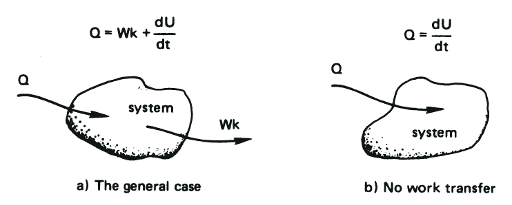
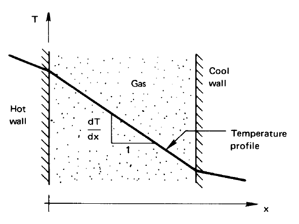
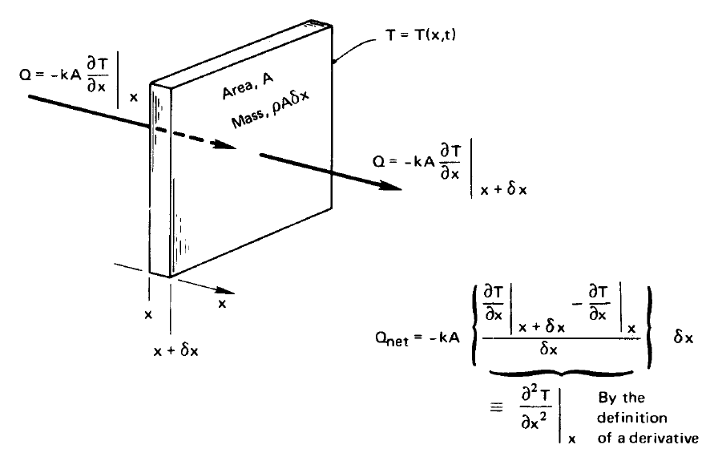
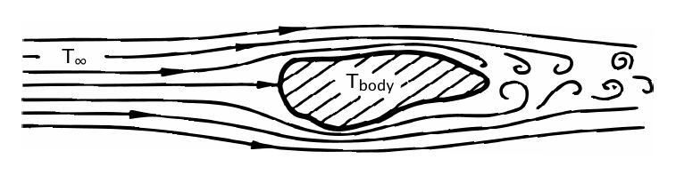
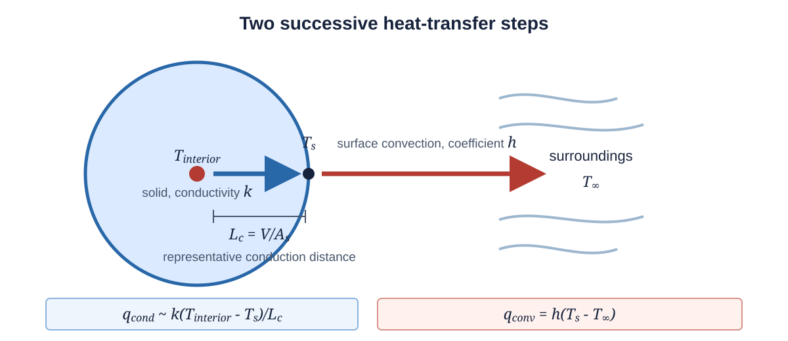
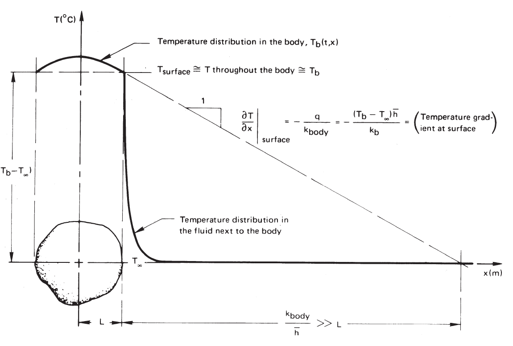

# Module 7, Part I: Thermal Transport Foundations

Module 7 has three linked parts. This first part connects the lumped thermal
models from Module 6 to the spatial models needed for the long-cylinder
experiment. Continue with [Part II: Finite And Infinite Rod
Theory](../fin-design-derivation/index.md), followed by [Part III: Rod
Instrument And Stationary Fin](../lab-08/index.md).

## Module 7 Priorities

Module 7 has two priorities, in this order:

1. **Build the six-thermistor instrument.** This is the primary objective of
   the module. Establish one TEC-base thermistor and five rod thermistors as a
   checked measurement system, then develop the Arduino acquisition and Python
   software needed to display and record all six temperatures together. The
   default is to use the raw readings when the six sensors agree within
   \(1^{\circ}\mathrm{C}\) in a common bath; apply calibration corrections only
   if that check fails.
2. **Understand heat transport in a long, thin cylinder.** Use Fourier's law,
   conservation of energy, side cooling, and boundary conditions to develop
   and test the one-dimensional heat-transport model for the rod.

Part I concentrates on the second priority so that the equations used to
design and interpret the six-thermistor experiment have a clear physical
foundation. The instrument itself is built and checked in Part III.

**How to use your time.** Parts I and II are primarily work to complete at
home. You may use up to one hour of class time to begin this theory work; then
finish it at home and bring specific questions to class. Preserve the
remaining laboratory time for Part III, where you will build, check, and test
the six-thermistor instrument and its software.

## Module 7 Roadmap

The three parts form one model-building and model-testing sequence:

| Part | Central question | What you do | Where it is assessed |
| --- | --- | --- | --- |
| Part I: foundations | How do a constitutive law and conservation produce a temperature equation? | Interpret Fourier's law, derive the heat equation, and establish the Biot test. | A4 Part 1 and selected C5 questions |
| Part II: rod theory | What stationary profile follows from axial conduction, side cooling, and the end conditions? | Derive the finite-rod solution, its semi-infinite limit, and the two model-validity checks. | A4 Parts 2-4 and selected C5 questions |
| Part III: experiment | Do the assumptions and predicted profiles describe the course rod? | Check the six sensors in a common bath, calibrate only if needed, record the approach to steady state, measure the stationary profile, compare models, and inspect residuals. | C5, the formative stationary-fin record, and later C6 evidence |

**Model hierarchy.** Part I derives the time-dependent heat equation while
neglecting heat loss from the side of the rod. Part II adds distributed side
cooling but assumes steady state, so $\partial T/\partial t=0$. Part III keeps
the side-cooling term and restores the time derivative to describe how the rod
approaches its stationary profile.

## Two Different Approximation Questions

The words **long** and **thin** describe two independent approximations. We will
not hide them inside one general statement that the rod is "approximately
one-dimensional."

1. **Length:** Can the physical end at \(x=L\) be ignored over the part of the
   rod we measure? We will answer this first by solving the finite-length
   one-dimensional boundary-value problem analytically and comparing it with
   the semi-infinite solution.
2. **Radius:** Can temperature variation across a cross section be ignored? For
   a circular rod, we will use

   \(\displaystyle
   \mathrm{Bi}_{\perp}=\frac{h(A/P)}{k}=\frac{hR}{2k}.
   \)

   We work in the \(\mathrm{Bi}_{\perp}\ll1\) regime, where a one-dimensional
   model is justified. If this condition fails, the one-dimensional model must
   be rejected; a radial model is beyond the scope of this course.

The next full theory treatment uses
[Lienhard Section 4.5](../../references/lienhard-heat-transfer-textbook-v6.pdf)
to carry out the finite-length solution and the transverse-Biot-number check.
Each topic will combine an instructor lecture with guided self-study from the
textbook. The accompanying
[Module 7, Part II: Finite And Infinite Rod Theory](../fin-design-derivation/index.md)
page develops every equation from (4.27) through (4.51).

Sections 1-5 and **What To Prepare** are the required route through Part I.
The unified-transport comparison, electrical-transient sidebar, and optional
nondimensional derivation provide broader context but are not additional
assignments.

## Learning Objectives

These are the Part I objectives supporting Module 7's second priority. By the
end of Module 7, Part I, you should be able to:

1. Explain Fourier's law as a phenomenological constitutive relation and
   combine it with local conservation of energy to derive the one-dimensional
   heat equation.
2. Distinguish temperature, heat-transfer rate, and heat flux, and interpret
   the units and physical meanings of thermal conductivity $k$, thermal
   diffusivity $\alpha$, and the convection coefficient $h$. Apply Fourier's
   law to calculate a temperature difference from a prescribed heat flux.
3. Derive and interpret the Biot number
   $\mathrm{Bi}=hL_c/k$, with $L_c=V/A_s$, and use it to decide whether the lumped model assumption is valid, e.g. the internal
   temperature variation may be neglected.
4. Distinguish the two independent approximations required for the course rod:
   neglecting the finite end and neglecting radial temperature variation.

## Module 7 Vocabulary And Notation

These foundational terms are used throughout all three parts of Module 7.
Parts II and III add vocabulary specific to the fin model and the experiment.

| Term | Meaning |
| --- | --- |
| Temperature, \(T\) | A local thermal state variable, measured in kelvin or degrees Celsius. Temperature differences drive heat transfer. |
| Heat, \(Q\) | Energy transferred across a system boundary because of a temperature difference, measured in joules. |
| Heat-transfer rate or heat current, \(\dot Q\) | Heat transferred per unit time, measured in watts. |
| Heat flux, \(\mathbf q\) or \(q_x\) | Heat-transfer rate per unit area, measured in W/m\(^2\). |
| Thermal conductivity, \(k\) | A material property relating conductive heat flux to temperature gradient through Fourier's law; units W/(m K). |
| Specific heat, \(c\) | Energy needed per unit mass per degree of temperature rise; units J/(kg K). The volumetric heat capacity is \(\rho c\), and a body of mass \(m\) has thermal capacitance \(mc\). |
| Thermal diffusivity, \(\alpha=k/(\rho c)\) | The material property governing how rapidly a temperature disturbance spreads; units m\(^2\)/s. |
| Thermal resistance, \(R_{\mathrm{th}}\) | A geometry-dependent ratio \(\Delta T/\dot Q\), measured in K/W. For uniform one-dimensional conduction, \(R_{\mathrm{th}}=L/(kA)\). |
| Constitutive law | A material-response relation connecting a flux to a driving field, such as Fourier's law \(\mathbf q=-k\nabla T\). |
| Conservation law | A balance stating that accumulation equals inflow minus outflow plus generation. Conservation of energy and a constitutive law together produce the heat equation. |
| Surface heat-transfer coefficient, \(h\) | The coefficient in Newton's law of cooling, \(q=h(T_s-T_\infty)\); units W/(m\(^2\) K). It depends on the fluid, flow, and geometry. |
| Characteristic length, \(L_c=V/A_s\) | The representative internal conduction distance used in the Biot number. |
| Biot number, \(\mathrm{Bi}=hL_c/k\) | The ratio of internal conduction resistance to surface convection resistance. Small \(\mathrm{Bi}\) supports a nearly uniform internal temperature. |
| Lumped-capacitance model | A model that assigns one temperature to an entire object; it requires sufficiently small internal temperature variation. |

Read selectively in
[Lienhard, A Heat Transfer Textbook](../../references/lienhard-heat-transfer-textbook-v6.pdf),
Section 1.3, pp. 11-26. Focus on Fourier's Law, the derivation of the heat
conduction equation, convection/lumped cooling, dimensional analysis, the Biot
number, and Fig. 1.10.

This bridge follows the order of Lienhard Section 1.3:

| Lienhard reading | How to read it |
| --- | --- |
| pp. 11-13, Fourier's Law | Read carefully. This is the law that turns a temperature gradient into a heat flux. |
| pp. 14-16, thermal conductivity and Example 1.2 | Skim for scale. Notice how \(k\) controls the temperature gradient needed for a given heat flux. |
| pp. 17-18, one-dimensional heat conduction equation | Read slowly. This is the derivation core of the bridge. |
| pp. 19-21, convection and Newton's law of cooling | Read for the meaning of \(h\), the heat transfer coefficient. |
| pp. 21-24, lumped capacity, Fig. 1.10, and Biot number | Read carefully. This explains when a one-temperature model is acceptable. |
| pp. 24-26, thermocouple example | Skim for how Lienhard checks the Biot number assumption in a real calculation. |

**Notation.** Throughout the course, $c$ denotes the specific heat of the
solid and $h$ denotes the surface heat-transfer coefficient. Lienhard and
other sources may write the same solid specific heat as $c_p$. We use $c$
because the distinction between $c_p$ and $c_v$ is negligible for the
incompressible solids studied here. Lowercase $h$ also distinguishes the
surface coefficient, in W/(m\(^2\) K), from a total lumped thermal conductance,
which has units W/K.

## Why This Bridge Exists

Module 6 used lumped models: one temperature for one object, or two temperatures
for two coupled objects. That works when internal temperature gradients are
small enough to ignore. The long cylinder is different. Its temperature depends
on position as well as time, so we need a model that can describe heat flowing
along the rod.

The bridge has three questions:

1. What law tells us how heat flows down a temperature gradient?
2. How does conservation of energy turn that law into a differential equation?
3. When is it reasonable to ignore spatial temperature gradients?

## 1. Heat And Temperature

Heat and temperature are related, but they are not the same quantity.
Temperature describes the thermal state of a system. Heat is energy transferred
across the system boundary because of a temperature difference.

### Analogy: Heat Flow, Water Flow, And Electrical Current

One useful analogy is water flowing between reservoirs at different heights.
Water height, or equivalently gravitational pressure head, is analogous to
temperature: it is a **driving potential**, not the quantity that flows. A
difference in height drives a volume-flow rate of water; a difference in
temperature drives a heat-transfer rate. In this course, we will often call
\(\dot Q\) the **heat current**: an energy-current rate measured in watts.
The familiar electrical version is
**Ohm's law**: a voltage difference drives an electrical current. In all three
systems, a long or narrow path opposes the flow.

| Heat transfer | Gravity-driven water flow | Electrical current |
| --- | --- | --- |
| Temperature difference, \(\Delta T\) | Height difference, \(\Delta h\), or pressure difference, \(\Delta p\) | Voltage difference, \(\Delta V\) |
| Heat current (heat-transfer rate), \(\dot Q\) (W) | Volume-flow rate, \(\dot V\) (m\(^3\)/s) | Current, \(I\) (A) |
| Thermal resistance, \(R_{\mathrm{th}}\) (K/W) | Hydraulic resistance, \(R_{\mathrm{hyd}}\) (Pa s/m\(^3\)) | Electrical resistance, \(R\) (\(\Omega\)) |
| Thermal capacitance, \(mc\) (J/K) | Storage capacity of a tank | Electrical capacitance, \(C\) (F) |

The three steady-flow laws have the same mathematical form:

\[
\underbrace{\dot Q}_{\text{heat current}}
=\frac{\underbrace{\Delta T}_{\text{temperature difference}}}
{\underbrace{R_{\mathrm{th}}}_{\text{thermal resistance}}},
\qquad
\underbrace{\dot V}_{\text{water-flow rate}}
=\frac{\underbrace{\Delta p}_{\text{pressure difference}}}
{\underbrace{R_{\mathrm{hyd}}}_{\text{hydraulic resistance}}},
\qquad
\underbrace{I}_{\text{current}}
=\frac{\underbrace{\Delta V}_{\text{voltage difference}}}
{\underbrace{R}_{\text{electrical resistance}}}.
\]

For steady one-dimensional heat conduction through a uniform material,

\[
R_{\mathrm{th}}=\frac{L}{kA},
\qquad
\dot Q=\frac{T_{\mathrm{hot}}-T_{\mathrm{cold}}}{R_{\mathrm{th}}}.
\]

Here \(L\) is the length of the conduction path, \(A\) is its cross-sectional
area perpendicular to the heat flow, and \(k\) is the thermal conductivity of
the material. Section 2 explains these quantities more fully and shows how this
geometry-dependent resistance follows from Fourier's local heat-flux law.

For a reservoir-height difference \(\Delta h\), gravity produces a pressure
difference \(\Delta p=\rho g\Delta h\). For fully developed laminar flow of
an incompressible Newtonian fluid through a straight circular pipe,

\[
R_{\mathrm{hyd}}=\frac{8\mu L}{\pi r^4},
\qquad
\dot V=\frac{\Delta p}{R_{\mathrm{hyd}}}
=\frac{\rho g\Delta h}{R_{\mathrm{hyd}}}.
\]

Ohm's law is the corresponding electrical relation:

\[
I=\frac{\Delta V}{R}.
\]

The corresponding **storage**, or capacitance, laws describe what happens when
the driving potential changes in time:

\[
\underbrace{\dot Q}_{\text{heat current}}
=\underbrace{mc}_{C_{\mathrm{th}}\text{, thermal capacitance}}
\frac{dT}{dt},
\qquad
\underbrace{\dot V}_{\text{water-flow rate}}
=\underbrace{A_{\mathrm{tank}}}_{C_{\mathrm{hyd}}\text{, hydraulic capacitance}}
\frac{dh}{dt},
\qquad
\underbrace{I}_{\text{current}}
=\underbrace{C}_{\text{electrical capacitance}}
\frac{dV}{dt}.
\]

Here \(A_{\mathrm{tank}}\) is the horizontal cross-sectional area of a tank:
it determines how much water must enter to raise its water level by a given
amount. Similarly, \(mc\) determines how much energy must enter to raise the
temperature of a body by a given amount. These forms assume that \(m\), \(c\),
\(A_{\mathrm{tank}}\), and \(C\) are constant over the range considered.

Thus \(C_{\mathrm{th}}=mc\) is the thermal analogue of electrical capacitance
\(C\). The analogy is useful, but limited: a temperature difference is a
thermal potential that drives heat current. Heat is not a substance stored in
an object; it is energy transferred across the object boundary because of a
temperature difference. The transferred energy changes the object's internal
energy \(U\), which is stored in the object. Thermal capacitance relates heat
current to the rate of temperature change,
\(\dot Q=C_{\mathrm{th}}\,dT/dt\), just as electrical capacitance relates
current to the rate of voltage change. A larger thermal mass requires more
transferred energy to produce a given temperature change.




*Lienhard and Lienhard, Fig. 1.1, textbook p. 7: First-Law energy balance for a
closed system.*

The **First Law of Thermodynamics** is conservation of energy. With Lienhard's
sign convention, the rate at which heat enters a closed system equals the rate
at which the system does compression work plus the rate at which its internal
energy increases.

For a closed system with compression work, Lienhard Eq. (1.2a) is

\[
\dot Q=p\frac{dV}{dt}+\frac{dU}{dt}.
\tag{1.2a}
\]

For the incompressible solids and liquids used in this course, the volume-work
term is normally absent and the specific heats at constant pressure and volume
may be represented by \(c\). Equation (1.3) then becomes

\[
\dot Q=\frac{dU}{dt}=mc\frac{dT}{dt}.
\tag{1.3}
\]

This equation does **not** say that heat and temperature are identical. It says
that a net heat-transfer rate changes the internal energy and therefore changes
temperature at a rate controlled by the thermal mass \(mc\).

## 2. Heat Conduction And Fourier's Law

Use Lienhard Section 1.3, "Modes of heat transfer," pp. 11-27, as the source for this section.

This is the first major idea in the pp. 11-26 reading span.

| Read this in Lienhard | What to take from it |
| --- | --- |
| Section 1.3, p. 11, line beginning "Fourier's law," through Eq. (1.8) | \(q\) is heat flux, \(k\) is thermal conductivity, and the temperature gradient drives conduction. |
| Section 1.3, p. 11, line beginning "The heat flux is a vector quantity" | The minus sign is a direction statement: heat flows from higher temperature to lower temperature. |
| Section 1.3, p. 13, line beginning "The direction of heat flow," through Eq. (1.9) | In one-dimensional steady conduction, Lienhard often rewrites the law with positive \(\Delta T\) and positive \(q\). |
| Section 1.3, p. 13, line beginning "Notice that," through Eq. (1.10) | For the same heat flux, a material with larger \(k\) needs a smaller temperature gradient. |

For an isotropic material, Fourier's Law has the general form

\[
\mathbf q=-k\nabla T.
\]

The heat-flux vector \(\mathbf q\) points opposite the temperature gradient:
heat flows from hot regions toward cold regions. In one dimension, this becomes

\[
q_x=-k\frac{\partial T}{\partial x}.
\]

Here \(q_x\) is heat flux in W/m\(^2\), \(k\) is thermal conductivity in
W/(m K), and \(\partial T/\partial x\) is the temperature gradient in K/m. The minus
sign matters: heat flows in the direction of decreasing temperature.

Lienhard writes \(dT/dx\) when discussing one-dimensional steady conduction.
We use \(\partial T/\partial x\) because the long-cylinder experiment will have
a temperature \(T(x,t)\) that can depend on both position and time.

For a rod with cross-sectional area \(A\), the heat-flow rate is

\[
\dot Q_x=-kA\frac{\partial T}{\partial x}.
\]

Fourier's law is fundamentally a **flux law**. The heat flux \(q_x\) is the
heat-transfer rate per unit area, whereas the heat current \(\dot Q_x=Aq_x\)
is the total heat-transfer rate through a specified cross section. The thermal
conductivity \(k\) is independent of the sample geometry: it is a property of
the material, although it can depend on temperature, composition, and
direction in an anisotropic material.

Thermal resistance is different. For steady one-dimensional conduction through
a uniform sample of length \(L\), constant area \(A\), and constant \(k\),
integrating Fourier's law gives

\[
\dot Q=\frac{kA}{L}\left(T_{\mathrm{hot}}-T_{\mathrm{cold}}\right)
=\frac{T_{\mathrm{hot}}-T_{\mathrm{cold}}}{R_{\mathrm{th}}},
\qquad
R_{\mathrm{th}}=\frac{L}{kA}.
\]

Thus \(R_{\mathrm{th}}\) is not a material property. It is the
geometry-dependent lumped parameter obtained when the continuous flux law is
applied to, or discretized over, a finite piece of material. Doubling \(L\)
doubles its thermal resistance, while doubling \(A\) halves it; neither change
alters \(k\). This should remind you of electrical resistance: resistances in
series add directly, whereas resistances in parallel combine through their
reciprocals.

For this course, the key idea is not the symbol manipulation. The key idea is
that a temperature gradient causes a heat current.



*Lienhard and Lienhard, Fig. 1.5, textbook p. 14: a temperature gradient and
the corresponding direction of conductive heat flow.*

### Why Use A Phenomenological Constitutive Law?

The relation just introduced is a **phenomenological constitutive law**.
Conservation of energy tells us that local energy accumulation must equal heat
flowing in minus heat flowing out, plus any heat generated, but conservation
alone does not tell us what heat flux a given temperature field produces.
Fourier's law supplies that second relation.

Its form reflects four observations: a uniform temperature produces no
conductive flux; the flux points opposite the temperature gradient; the local
flux is determined primarily by the nearby temperature field; and, near
thermal equilibrium, the first approximation is a response proportional to
the driving gradient.

Fourier's law is a **constitutive law** because it specifies how a particular
material responds. It is **phenomenological** because it summarizes measured
macroscopic behavior without deriving that behavior from the microscopic
motion of phonons, electrons, or molecules. The thermal conductivity $k$ must
be measured. It tells how much heat flux the material carries for a given
temperature gradient.

The proportionality is a linear-response approximation. For an anisotropic
material, $k$ can be a tensor; for large gradients or very short length and
time scales, the response can be nonlinear or nonlocal. Fourier's law is the
appropriate first model when those complications are unimportant.

### Unified Transport Equations

Fourier's law is one member of a broad family of phenomenological constitutive
laws for linear transport. The common mathematical structure is easiest to see
for steady transport with no local sources. A gradient of a driving field
produces a flux; conservation says that the flux has zero divergence; and
substituting the constitutive law into the conservation law produces the field
equation.

#### Steady, Source-Free Transport

| Phenomenon | Constitutive flux law | Steady, source-free conservation | Field equation after substitution |
| --- | --- | --- | --- |
| Heat conduction | \(\mathbf q=-k\nabla T\) | \(\nabla\!\cdot\mathbf q=0\) | \(\nabla\!\cdot(k\nabla T)=0\) |
| Molecular diffusion | \(\mathbf J_m=-D\nabla c\) | \(\nabla\!\cdot\mathbf J_m=0\) | \(\nabla\!\cdot(D\nabla c)=0\) |
| Electrical conduction | \(\mathbf J=\sigma\mathbf E=-\sigma\nabla\phi\) | \(\nabla\!\cdot\mathbf J=0\) | \(\nabla\!\cdot(\sigma\nabla\phi)=0\) |

For constant \(k\), \(D\), and \(\sigma\), respectively, these become

\[
\nabla^2T=0,\qquad \nabla^2c=0,\qquad \nabla^2\phi=0.
\]

#### Transient Transport

For a transient problem, conservation relates the divergence of the flux to
the rate of change of a **stored quantity**. Substitution gives

| Phenomenon | Stored quantity per unit volume | Transient conservation law | Result after substituting the flux law |
| --- | --- | --- | --- |
| Heat conduction | Thermal energy density, with \(\partial u_{\mathrm{th}}/\partial T=\rho c\) | \(\partial u_{\mathrm{th}}/\partial t=-\nabla\!\cdot\mathbf q+\dot q_v\) | \(\rho c\,\partial T/\partial t=\nabla\!\cdot(k\nabla T)+\dot q_v\) |
| Molecular diffusion | Molecular concentration \(c\) | \(\partial c/\partial t=-\nabla\!\cdot\mathbf J_m+s\) | \(\partial c/\partial t=\nabla\!\cdot(D\nabla c)+s\) |
| Electrical conduction | Charge density \(\rho_e\) | \(\partial\rho_e/\partial t=-\nabla\!\cdot\mathbf J\) | \(\partial\rho_e/\partial t=\nabla\!\cdot(\sigma\nabla\phi)\) |

Here \(u_{\mathrm{th}}\) is the thermal energy stored per unit volume. For
constant density \(\rho\) and specific heat \(c\), raising the temperature by
\(dT\) changes that stored energy density by

\[
du_{\mathrm{th}}=\rho c\,dT.
\]

The chain rule therefore gives the accumulation term in the heat equation:

\[
\frac{\partial u_{\mathrm{th}}}{\partial t}
=\frac{\partial u_{\mathrm{th}}}{\partial T}
 \frac{\partial T}{\partial t}
=\rho c\frac{\partial T}{\partial t}.
\]

The units provide a useful check: \(\rho c\) has units of
J/(m\(^3\) K), so multiplying it by \(\partial T/\partial t\) gives
W/m\(^3\), the rate of thermal-energy accumulation per unit volume.

The first two rows produce closed diffusion equations for the driving fields.
Local thermal energy storage is related directly to temperature through the
volumetric heat capacity \(\rho c\), while the stored molecular quantity is
the concentration \(c\) itself. Consequently, conservation plus the
constitutive flux law gives an equation containing only \(T\), or only \(c\).

Electrical conduction has the same steady, source-free field equation, but its
transient behavior is not generally a diffusion equation for potential. The
conserved quantity is charge density \(\rho_e\), not potential \(\phi\). The
sidebar develops this distinction and its connection to electrostatics.

<details class="note" markdown="1">
<summary><strong>Sidebar: Why electrical potential behaves differently in a transient</strong></summary>

Electrical conduction is different. Electrical current is driven by the
potential gradient, but the conserved stored quantity is charge density
\(\rho_e\), not potential \(\phi\). The last entry in the table therefore
contains both \(\rho_e\) and \(\phi\); charge conservation and Ohm's law alone
do **not** make a closed diffusion equation for electrical potential. Gauss's
law and the permittivity relate charge density to the electric field, while
the geometry and boundary conditions determine capacitance and the potential.

For example, in a uniform conductor with constant conductivity \(\sigma\) and
permittivity \(\epsilon\), Gauss's law gives
\(\nabla\!\cdot\mathbf E=\rho_e/\epsilon\). Combining this with
\(\mathbf J=\sigma\mathbf E\) and charge conservation gives

\[
\frac{\partial\rho_e}{\partial t}
=-\frac{\sigma}{\epsilon}\rho_e,
\qquad
\rho_e(t)=\rho_e(0)e^{-t/\tau_e},
\qquad
\tau_e=\frac{\epsilon}{\sigma}.
\]

This is **charge relaxation**, not spatial diffusion of \(\phi\). Excess
charge in the bulk relaxes toward surfaces, and the potential at each instant
is determined by the corresponding electrostatic boundary-value problem. The
familiar transient voltage in an \(RC\) circuit comes from charge stored on
capacitors and therefore depends on geometry as well as material properties.
This is why electrical potential is most directly analogous to temperature
and concentration in the **steady** table.

Electrostatics uses a related field-source equation. **Gauss's law** says that
charge is the source of electric field. In vacuum,

\[
\nabla\!\cdot\mathbf E=\frac{\rho_e}{\epsilon_0}.
\]

Thus, with \(\mathbf E=-\nabla\phi\), the electrostatic potential obeys
Poisson's equation,

\[
\nabla^2\phi=-\frac{\rho_e}{\epsilon_0}.
\]

In matter, the more general statement is
\(\nabla\!\cdot\mathbf D=\rho_{\mathrm{free}}\), where
\(\mathbf D=\epsilon\mathbf E\) for a simple linear dielectric. In a region
with no charge, electrostatics gives Laplace's equation,
\(\nabla^2\phi=0\).

The closest thermal parallel is **steady** conduction. With volumetric heat
generation \(\dot q_v\), a uniform material obeys

\[
\nabla^2T=-\frac{\dot q_v}{k};
\]

without internal generation it obeys \(\nabla^2T=0\). By contrast, the
time-dependent heat and molecular-diffusion equations describe fields that
smooth out over time. This distinction will matter when we move from the
steady finite-rod model to the time-dependent Angstrom experiment.

</details>

Here \(\mathbf q\) is heat flux in W/m\(^2\), \(\mathbf J_m\) is molecular
flux, \(\mathbf J\) is electrical current density in A/m\(^2\), and \(c\) in
the molecular-diffusion row is concentration. The \(c\) in \(\rho c\) is
specific heat; the symbols coincide but represent different physical
quantities. The source \(\dot q_v\) is heat generated per unit volume, whereas
\(s\) is the net rate at which molecules are added per unit volume.

## 3. One-Dimensional Conduction: From Energy Balance To The Heat Equation

Use Lienhard Section 1.3, pp. 17-18 (PDF pp. 31-32), beginning with
"One-dimensional heat conduction equation," and Fig. 1.8. Read this part
slowly; it is the bridge from a heat-flow law to a temperature equation.

This is the derivation core of the bridge.

The division of labor is important. Conservation of energy is universal, but
its local balance contains both the unknown temperature field and the unknown
heat flux. Fourier's material-specific constitutive law expresses the heat flux
in terms of the temperature gradient and thereby **closes** the conservation
equation. Combining the two produces a field equation for $T(x,t)$ alone.



*Lienhard and Lienhard, Fig. 1.8, textbook p. 18: Fourier conduction into and
out of a differential element.*

For the differential element, the net conductive heat loss is

\[
\dot Q_{\mathrm{net}}
=-kA\left(
\left.\frac{\partial T}{\partial x}\right|_{x+\delta x}
-\left.\frac{\partial T}{\partial x}\right|_x
\right)
\simeq-kA\frac{\partial^2T}{\partial x^2}\delta x.
\tag{1.12}
\]

The corresponding internal-energy change is

\[
-\dot Q_{\mathrm{net}}
=\frac{dU}{dt}
=\rho cA\frac{\partial T}{\partial t}\delta x.
\tag{1.13}
\]

Combining them gives

\[
\frac{\partial^2T}{\partial x^2}
=\frac{\rho c}{k}\frac{\partial T}{\partial t}
=\frac{1}{\alpha}\frac{\partial T}{\partial t},
\qquad \alpha=\frac{k}{\rho c}.
\tag{1.14}
\]

Your goal is to understand how Lienhard gets from this physical picture:

```text
small slice of material + Fourier's Law + conservation of energy
```

to this one-dimensional heat equation:

\[
\frac{\partial T}{\partial t}
=
\alpha\frac{\partial^2T}{\partial x^2}.
\]

Follow Lienhard's derivation in this order:

| Step | Lienhard reference | What the step does |
| --- | --- | --- |
| 1 | Section 1.3, p. 17, line beginning "One-dimensional heat conduction equation" | Names the problem: Fourier's law contains both \(T\) and \(q\), but we want an equation for \(T(x,t)\). |
| 2 | Section 1.3, p. 17, line beginning "Now let us eliminate q," plus Fig. 1.8 and Eq. (1.12) | Applies Fourier's Law at the left and right faces of a thin slice. The difference between the two fluxes produces a second derivative, \(\partial^2T/\partial x^2\). |
| 3 | Section 1.3, p. 17, line beginning "To eliminate the heat loss," through Eq. (1.13) | Uses the First Law for the slice: net heat loss changes the slice's internal energy. |
| 4 | Section 1.3, p. 17, line beginning "Combining eqns." through Eq. (1.14) | Combines the flux difference with energy storage to eliminate \(q\). This gives the one-dimensional heat equation. |
| 5 | Section 1.3, p. 18, line beginning "This result is the one-dimensional heat conduction equation" | Explains why the result matters: we can solve for the temperature distribution \(T(x,t)\). |
| 6 | Section 1.3, p. 18, line beginning "This is the thermal diffusivity" | Introduces thermal diffusivity, \(\alpha=k/(\rho c)\), as the material property controlling transient spreading of heat. |

Use these checkpoints while reading pp. 17-18:

1. In Eq. (1.12), identify the heat conducted out of the right face and the
   heat conducted in through the left face.
2. Explain why subtracting those two nearby fluxes produces
   \(\partial^2T/\partial x^2\), not just \(\partial T/\partial x\).
3. In Eq. (1.13), identify the energy-storage term for the slice.
4. In Eq. (1.14), point to the moment when \(q\) disappears and the unknown
   becomes \(T(x,t)\).
5. On p. 18, explain in words what thermal diffusivity \(\alpha\) measures.

Start with conservation of energy for a small piece of material:

```text
rate of thermal energy storage = heat flowing in - heat flowing out + heat generated
```

For a solid with density \(\rho\), specific heat \(c\), and constant thermal
conductivity \(k\), this becomes

\[
\rho c\frac{\partial T}{\partial t}
=
k\nabla^2 T+\dot q'''.
\]

This is the same physical idea as Lienhard's Eq. (1.14), but written in a more
general three-dimensional form and with a possible internal heat-generation term,
\(\dot q'''\). Lienhard's Chapter 1 derivation is one-dimensional and has no
internal heat generation.

If there is no internal heat generation, \(\dot q'''=0\), then

\[
\frac{\partial T}{\partial t}
=
\alpha\nabla^2T,
\qquad
\alpha=\frac{k}{\rho c}.
\]

The parameter \(\alpha\) is the thermal diffusivity. It tells how quickly a
temperature disturbance spreads through the material. Its dimensions are
\(\mathrm{m^2/s}\), the same as the diffusion coefficient \(D\) for Brownian
particles. The mathematical analogy is direct: \(\alpha\) governs the spreading
of a temperature field, while \(D\) governs the spreading of particle
concentration or probability.

For a long, thin rod whose temperature varies mostly along its length, this
becomes the one-dimensional heat equation:

\[
\frac{\partial T}{\partial t}
=
\alpha\frac{\partial^2T}{\partial x^2}.
\]

The later rod module will add side heat loss to the room, because the cylinder is
not perfectly insulated.

## 4. Heat Convection And Newton's Law Of Cooling



*Lienhard and Lienhard, Fig. 1.9, textbook p. 19: fluid flow carries heat away
from a warmer body.*

Newton proposed that the cooling rate should be proportional to the difference
between the body temperature and the incoming-fluid temperature:

\[
-\frac{dT_{\mathrm{body}}}{dt}
\propto T_{\mathrm{body}}-T_\infty.
\tag{1.15}
\]

Using the First Law gives

\[
-\dot Q\propto T_{\mathrm{body}}-T_\infty.
\tag{1.16}
\]

Defining the positive outward heat flux \(q=\dot Q_{\mathrm{out}}/A\) and the
heat-transfer coefficient \(h\) gives Newton's law of cooling:

\[
q=h\left(T_{\mathrm{body}}-T_\infty\right).
\tag{1.17}
\]

Here \(h\) has units W/(m\(^2\) K). Unlike \(k\), which is a material property,
\(h\) depends on the fluid, flow, geometry, and often temperature.

## 5. Lumped Cooling And The Biot Number

Here we justify the use of the lumped model in which we approximate the body to be at a uniform temperature. This approximation is valid when the Biot number is small, \(\mathrm{Bi}\ll1\). Use Lienhard Section 1.3, pp. 11-26, as the source for this
section. Read pp. 19-21 to understand Newton's law of cooling and the heat
transfer coefficient \(h\). Then read pp. 21-24 carefully for the lumped-capacity
model, Fig. 1.10, and the Biot number. Skim pp. 24-26 to see how the
thermocouple example checks whether \(\mathrm{Bi}\ll1\) is actually valid.

Before assuming that a body has one uniform temperature, ask how heat moves
through it. Heat must first conduct through the solid to its surface and then
transfer from the surface to the surroundings by convection. Describing the
internal conduction resistance requires a characteristic length.

The characteristic conduction length is

\[
\boxed{L_c=\frac{V}{A_s}},
\]

where $V$ is the object's volume and $A_s$ is the surface area through which
heat is transferred to the surroundings. It represents the distance scale for
internal conduction. For a long circular cylinder losing heat through its
curved surface, $L_c=A/P=R/2$.



*Heat first conducts through the solid over the representative distance
\(L_c=V/A_s\), then crosses the surface by convection to surroundings at
\(T_\infty\). The surface temperature \(T_s\) connects the two heat-transfer
steps.*

The two stages have approximate thermal resistances

\[
R_{\mathrm{cond}}\sim\frac{L_c}{kA},
\qquad
R_{\mathrm{conv}}\sim\frac{1}{hA}.
\]

Thermal resistance relates a temperature difference to a total heat-transfer
rate:

\[
\Delta T=R\dot Q.
\]

Therefore, both \(R_{\mathrm{cond}}\) and \(R_{\mathrm{conv}}\) have units of
kelvin per watt, K/W.

Using the same representative area for this scaling argument, their ratio is

\[
\frac{R_{\mathrm{cond}}}{R_{\mathrm{conv}}}
\sim\frac{hL_c}{k}
=\mathrm{Bi}.
\]

This ratio compares resistance to heat flow **inside the solid** with resistance
to heat transfer **from its surface to the surroundings**. It is the **Biot
number**, Bi.

In this resistance-scaling picture, the same representative heat-transfer rate
passes through the two successive steps: conduction through the solid and
convection from its surface. Therefore,

\[
\dot Q = \frac{\Delta T_{\mathrm{cond}}}{R_{\mathrm{cond}}}=\frac{\Delta T_{\mathrm{conv}}}{R_{\mathrm{conv}}}
\]

and

\[
\frac{\Delta T_{\mathrm{cond}}}{\Delta T_{\mathrm{conv}}}=\frac{R_{\mathrm{cond}}}{R_{\mathrm{conv}}} = \mathrm{Bi}.
\]

If \(\mathrm{Bi}\ll1\) then \(\Delta T_{\mathrm{cond}} \ll \Delta T_{\mathrm{conv}}\) or equivalently, \(T_{\mathrm{interior}} - T_s \ll T_s - T_{\infty}\). Since the temperature change in the solid is much smaller than the temperature change outside the solid  we justify the lumped model assumption that the temperature of the solid doesn't depend on position.

We now derive why the same dimensionless combination appears in the
heat-transport equations.

<details class="note" markdown="1">
<summary><strong>Optional extension: Deriving the Biot number by nondimensionalization</strong></summary>

With no internal heat generation, the temperature inside the solid obeys

\[
\rho c\frac{\partial T}{\partial t}=k\nabla^2T.
\]

At a surface cooled by convection, Fourier's Law inside the solid must match
Newton's law of cooling at the surface:

\[
-k\frac{\partial T}{\partial n}=h(T-T_\infty),
\]

where \(n\) is the outward-normal direction. Define dimensionless temperature,
position, and time by

\[
\theta=\frac{T-T_\infty}{T_i-T_\infty},
\qquad
\mathbf{x}^*=\frac{\mathbf{x}}{L_c},
\qquad
\mathrm{Fo}=\frac{\alpha t}{L_c^2}.
\]

Here \(\mathrm{Fo}\) is the Fourier number and
\(\alpha=k/(\rho c)\) is the thermal diffusivity. In these variables, the heat
equation becomes

\[
\frac{\partial\theta}{\partial\mathrm{Fo}}
=\nabla^{*2}\theta,
\]

and the convective boundary condition becomes

\[
-\frac{\partial\theta}{\partial n^*}
=\frac{hL_c}{k}\theta
=\mathrm{Bi}\,\theta,
\qquad
\boxed{\mathrm{Bi}=\frac{hL_c}{k}}.
\]

The Biot number therefore appears naturally when the convective boundary
condition is made dimensionless. It is not an additional empirical correction.
It is the parameter that determines how strongly surface cooling competes with
internal conduction.

Here \(h\) is the convection coefficient to the surroundings, \(k\) is the
thermal conductivity inside the solid, and \(L_c\) is the characteristic
length defined above. The tricky bit is that there can be more than one
characteristic length in the problem. How do you choose which one to use? For a
long, thin cylinder, the radial Biot number can be small while a Biot number
formed using the length can be large because \(R\ll L\). In this case, instead
of using a differential equation that depends on both radius and length, you
can reduce it to a one-dimensional problem by neglecting radial temperature
variation.

Interpretation:

- Small \(\mathrm{Bi}\): internal conduction offers much less resistance than
  convection. Internal temperature gradients are small, so a lumped model may
  be reasonable.
- Large \(\mathrm{Bi}\): internal conduction offers appreciable resistance.
  Internal temperature gradients matter, so a spatial model is needed.

</details>

Only after establishing that \(\mathrm{Bi}\) is small do we approximate the
body by one temperature. Applying the First Law, introduced in Section 1, and
using Newton's law of cooling then gives

\[
-hA(T-T_\infty)
=\frac{d}{dt}\left[\rho cV(T-T_{\mathrm{ref}})\right].
\tag{1.19}
\]

Therefore,

\[
\frac{d(T-T_\infty)}{dt}
=-\frac{hA}{\rho cV}(T-T_\infty),
\tag{1.20}
\]

whose general solution is

\[
\ln(T-T_\infty)
=-\frac{t}{\rho cV/(hA)}+C.
\tag{1.21}
\]

With \(T(0)=T_i\), define \(\tau=\rho cV/(hA)\). The normalized cooling curve is

\[
\frac{T-T_\infty}{T_i-T_\infty}=e^{-t/\tau}.
\tag{1.22}
\]



*Lienhard and Lienhard, Fig. 1.10, textbook p. 23: when internal conduction is
fast compared with surface cooling, the body remains nearly isothermal.*

Figure 1.10 is the picture to keep in mind: dimensional analysis is not extra
decoration. It tells us which effects are small enough to neglect and which
effects must be kept in the model.

## What To Prepare

Before class, write short answers to these questions. Use Lienhard Section 1.3,
pp. 11-26. Give most of your time to questions 3-9, which follow the main arc
from Fourier's Law to the heat equation to the Biot number.

### A4, Part I: Lienhard Problem 1.3

Complete [Lienhard Problem 1.3](../../references/lienhard-heat-transfer-textbook-v6.pdf#page=51)
in full. This is the first assessed component of `A4`, which you will submit
after completing Parts I and II of Module 7. For each material:

1. begin with Fourier's law and show how you obtain the temperature rise from
   the specified heat flux, slab thickness, and thermal conductivity,
2. report the temperature rise with units, and
3. explain which results are physically unreasonable and why. Hint: think about our TEC, for which we go to lengths to protect it from overheating.

Use one clear sample calculation and organize the remaining results in a
table. Do not merely report numerical answers; the assessment is testing your
use of Fourier's law, units, and physical judgment.

### Reading Questions

1. Why is Fourier's law a **phenomenological constitutive law**, and what does
   its minus sign say about the direction of heat flow?
2. Distinguish temperature \(T\), heat-transfer rate \(\dot Q_x\), and heat
   flux \(q_x\). Give the physical meaning and units of thermal conductivity
   \(k\), thermal diffusivity \(\alpha\), and surface heat-transfer coefficient
   \(h\).
3. On pp. 14-16, why does a larger \(k\) lead to a smaller temperature gradient
   for the same heat flux?
4. In Lienhard Eq. (1.12), what physical quantity is being calculated?
5. In Lienhard Eq. (1.13), what physical quantity is being stored?
6. Why does combining Eq. (1.12) and Eq. (1.13) produce an equation for
   \(T(x,t)\) instead of an equation for \(q\)?
7. What physical property does thermal diffusivity \(\alpha\) describe?
8. How does the ratio of conduction resistance to convection resistance produce
   the Biot number, and why does a small Biot number support a lumped-temperature
   model?
9. In Lienhard's thermocouple example, why does checking \(\mathrm{Bi}\) matter?
10. What two independent approximation questions must be answered before the
    long cylinder can be modeled as a one-dimensional, semi-infinite rod? State
    which calculation tests each approximation.

## How This Work Is Assessed

The Part I objectives are assessed directly in `A4`, beginning with your
solution to Lienhard Problem 1.3, and in the `C5` oral check. The same
foundations are reused later in `A5` for the time-dependent Angstrom analysis.
Problem 1.3 is submitted as part of the individual `A4` PDF; the reading
questions do not create another submission. Keep those answers and a
dimensional equation sheet in `docs/theory/theory_bridge_chapter_1_notes.md`
so you can reuse the reasoning without rewriting it for an extra grade.

The goal is not memorization of an isolated formula. You should be able to
identify the physical balance, state the boundary conditions, carry the units,
and explain what approximation each solution uses.

Use the single
[Module 7 workload budget](../lab-08/index.md#outside-class-workload-budget)
for Parts I-III. The Part I reading, derivation work, preparation questions,
and Problem 1.3 are already included there; do not count them again. Bring
specific questions to class if the derivations remain unclear after the
planned time.
